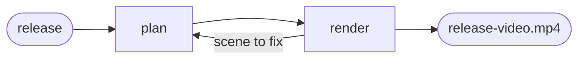

# Release video

## Actions

Run the flow above. Read only the next action file.

| Action | Does |
| --- | --- |
| plan | cover every shipped feature with a scene, or a reason to skip it |
| render | turn the plan into the MP4 and check it on screen |

## Transversal rules

- The plan lives in `aidd_docs/release-video/scenes.json`; `scripts/check-release-video.js` is its judge and `scripts/render-release-video.cjs` its renderer.
- Show only what the product does; mark every invented demo value as an example on screen.
- Keep product choices with the user.
- Stop at the MP4: attaching it to a release and announcing it are the user's.
