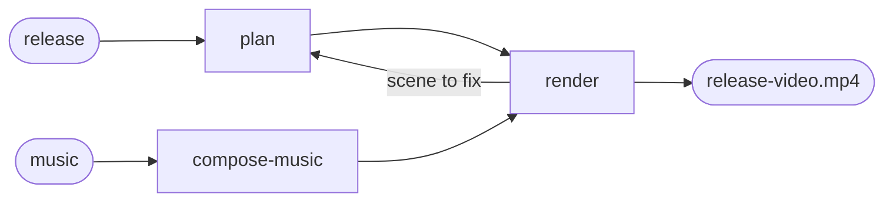

# Release video

## Actions

Run the flow above. Read only the next action file.

| Action | Does |
| --- | --- |
| plan | cover every shipped feature with a scene, or a reason to skip it |
| render | turn the plan into the MP4 and check it on screen |
| compose-music | write a new track when the user asks for other music |

## Transversal rules

- The plan lives in `aidd_docs/release-video/scenes.json`; the check and the renderer are in `assets/`, their tests in `scripts/__tests__/`.
- Show only what the product does; mark every invented demo value as an example on screen.
- A viewer may watch with the sound off and never read the release notes: the picture carries the message, the sound only makes it lively.
- Never reuse the audio of a published video: it carries that video's own sounds, which then play at moments that mean nothing here.
- Keep product choices with the user, music included: it is judged by listening, which is the user's.
- Stop at the MP4: attaching it to a release and announcing it are the user's.
