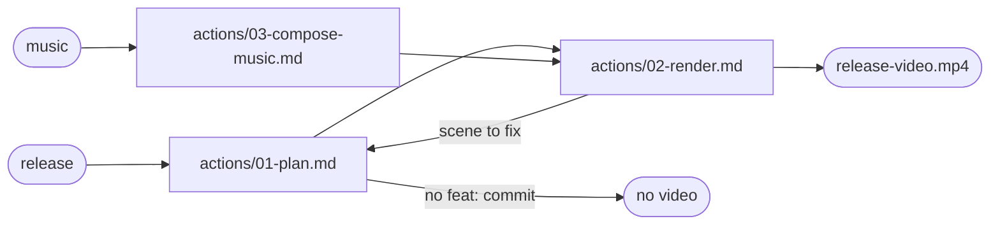

# Release video

## Transversal rules

- The plan lives in `aidd_docs/release-video/scenes.json`.
- The check and the renderer are in `assets/`, their tests in `scripts/__tests__/`.
- Show only what the product does, and mark every invented figure as an example on screen.
- A demo of text alone, plainly a session, needs no example mark.
- The picture carries the message for a viewer with the sound off who never read the release notes.
- Never reuse the audio of a published video, because its sounds play at moments that mean nothing here.
- Keep product choices with the user, music included, since only the user listens.
- Stop at the MP4, because attaching it to a release and announcing it are the user's.
