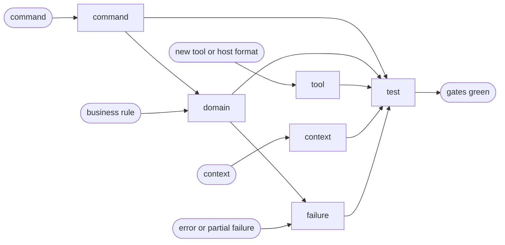

# Working on the CLI

## Actions

Run the flow above. Read only the action for the change, then what it loads.

| Action  | Does                                                      |
| ------- | --------------------------------------------------------- |
| tool    | add an AI tool or follow a host's format change           |
| command | add or change a command                                   |
| domain  | change a business rule inside a context                   |
| failure | handle an error, a missing file or a partial failure      |
| test    | write or fix a test                                       |
| context | create, split or move a context                           |

## Transversal rules

- Paths are rooted at `cli/`.
- A red gate is fixed at its cause, never by an exemption or a wider allow-list.
- A golden, an e2e output or a fixture is a frozen surface: change it only for a deliberate product change, and say so in the commit.
