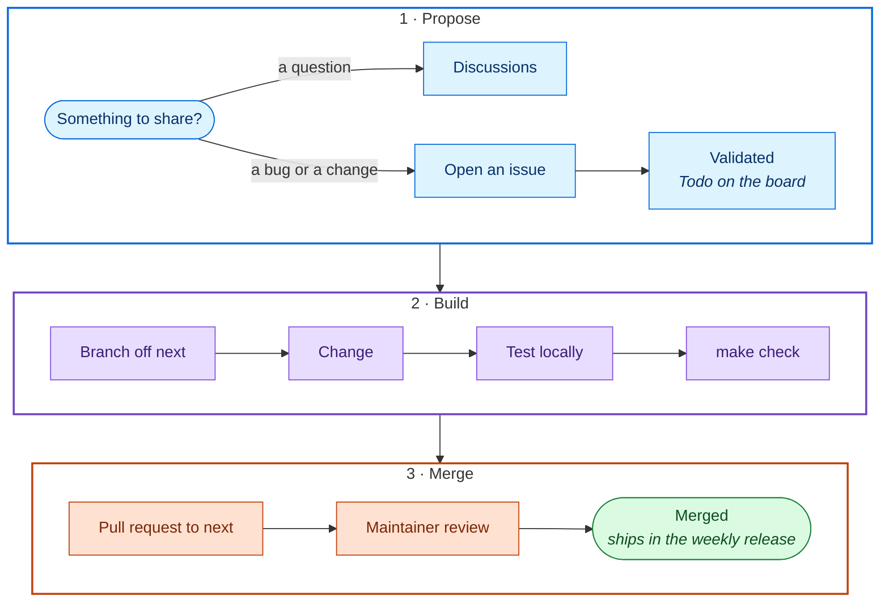

# Contributing



## 1. Propose

| You have | Open | Required fields |
| --- | --- | --- |
| A question | [Discussions](https://github.com/ai-driven-dev/framework/discussions) | none |
| A bug | [Bug report](https://github.com/ai-driven-dev/framework/issues/new?template=bug_report.yml) | description, expected and observed behaviour, AI tool, OS |
| A problem and its fix | [Quick contribution](https://github.com/ai-driven-dev/framework/issues/new?template=quick_contribution.yml) | problem, proposed solution |
| A larger change | [Detailed contribution](https://github.com/ai-driven-dev/framework/issues/new?template=detailed_contribution.yml) | problem, scope, acceptance criteria |

Board status:

| Status | Means |
| --- | --- |
| `Ideation` | Weighed, not agreed |
| `Todo` | Validated by a Member or a Maintainer. Anyone can take it. |
| `In Progress` | Someone is working on it |
| `In review` | A pull request is open |
| `Done` | Merged |

## 2. Set up

| You need | Version |
| --- | --- |
| [Node](https://nodejs.org) | 22.18+ or 24.11+ (26 and later also work) |
| [pnpm](https://pnpm.io) | any recent version |
| `gh` and `jq` | for the skills that talk to GitHub |

Fork the repository, or branch from it if you have write access.

| Run | Does |
| --- | --- |
| `make setup` | Installs dependencies and git hooks, registers the marketplace, installs the plugins into Claude Code and Codex |
| `make doctor` | Checks your environment |
| `make reload` | Reloads your checkout into your tools |
| `make check-hosts` | Tables what each installed tool really loads of the plugins |
| `make check` | Runs the pre-commit checks |

### Reload flow

`make reload` builds the checkout's CLI (running `scripts/dev-sync.sh` on an unbuilt checkout falls back to the published CLI, which may predate `--agents-only`), then runs from your home directory for each detected tool:

```text
setup --global --source local --path <checkout> --ide <tool> --plugins all --yes
  add --agents-only
→ Claude / Codex: refresh native plugin copies, repeat setup without --provider
→ doctor --global --tool <tool>
→ sync the managed Agents instruction section
```

The CLI owns installation and model generation; tiers and models are in [`docs/SUBAGENTS.md`](docs/SUBAGENTS.md#-models). `--agents-only` leaves main-session settings untouched, and with no `--provider` each tool keeps the provider saved for it, else the first its profile lists. A managed OpenCode installation uses its existing reload helper.

Commands and model/plugin details appear as they run, followed by one result per tool: `OK`, `WARN` or `FAIL` (`DELEGATED` for managed OpenCode). Any warning (a `Warning:` line in the CLI output) or failure exits nonzero; fix the reported cause and rerun. `OK` covers the CLI installation and registration checks, not a live agent session; restart your tools to load the changes.

A Codex build that refuses to upgrade a local marketplace makes the CLI print a `Warning:` line, so reload fails on every Codex run there; that refusal is unverified here and not worked around.

Native copies are released only after setup succeeds. A later failure has no automatic rollback. Manually changed owned files remain protected and can block installation; reload reports the conflict instead of overwriting them.

## 3. The rules

| # | Rule |
| --- | --- |
| 1 | **No slop.** Read every line before you propose it. |
| 2 | **Spend tokens like they cost something.** |
| 3 | **Write in Claude Code syntax.** The [CLI](cli/README.md) translates it for other tools at release. |
| 4 | **Follow the skill structure.** See the [architecture](docs/ARCHITECTURE.md), and generate with `/aidd-context:04-skill-generate`. |
| 5 | **Evolve the memory** in [`aidd_docs/memory/`](aidd_docs/memory/). |
| 6 | **Test in two tools.** Claude Code and one other, for example Codex. |
| 7 | **Commit as `<type>(<scope>): description`.** One scope per commit: [convention](aidd_docs/memory/vcs.md#commits). |

## 4. Open a pull request

| Do | Where |
| --- | --- |
| Branch off `next` and target `next` | [Exceptions](aidd_docs/memory/vcs.md#branches) |
| Fill in the template | [Pull request template](.github/PULL_REQUEST_TEMPLATE.md) |
| Wait for a Maintainer review | [Governance](GOVERNANCE.md#code-decisions) |

GitHub requests review from the [framework reviewers](https://github.com/orgs/ai-driven-dev/teams/framework-reviewers) through `CODEOWNERS`. If no reviewer is assigned, request a Maintainer; authors cannot approve their own PRs.
