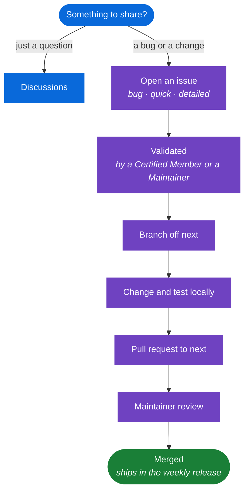

# Contributing

One path, open to everyone. Who may do what is in [Governance](GOVERNANCE.md#roles).



## 1. Share it

| You have | Do |
| --- | --- |
| A question | Ask in [Discussions](https://github.com/ai-driven-dev/framework/discussions) |
| A bug | Open a [bug report](https://github.com/ai-driven-dev/framework/issues/new?template=bug_report.yml) |
| A problem and its solution | Open a [quick contribution](https://github.com/ai-driven-dev/framework/issues/new?template=quick_contribution.yml) |
| A scope and acceptance criteria | Open a [detailed contribution](https://github.com/ai-driven-dev/framework/issues/new?template=detailed_contribution.yml) |

- A Certified Member or a Maintainer validates the issue by moving it to `Todo`.
- Then anyone can pick it up.

## 2. Set up

You need:

- [Node](https://nodejs.org) 22.18+ or 24.11+. 26 and later also work.
- [pnpm](https://pnpm.io).
- `gh` and `jq`, for the skills that talk to GitHub.

Fork the repository, or branch from it if you have write access. Then run:

```sh
make setup
```

It installs the dependencies and the git hooks, registers the marketplace, and installs the plugins into Claude Code and Codex.

| Run | Does |
| --- | --- |
| `make` | Lists every target |
| `make doctor` | Checks your environment |
| `make check` | Runs the pre-commit checks |

## 3. Make your change

1. **No slop.** Read every line before you propose it.
2. **Spend tokens like they cost something.**
3. **Write in Claude Code syntax.** Skills, agents and rules use it; the [CLI](cli/README.md) translates them for the other tools at release.
4. **Follow the skill structure.** See the [architecture](docs/ARCHITECTURE.md) and generate with `/aidd-context:04-skill-generate`.
5. **Evolve the memory** in [`aidd_docs/memory/`](aidd_docs/memory/).
6. **Test locally.** Run `make reload`, restart your session, and test in Claude Code and in one other tool, for example Codex.
7. **Commit as `<type>(<scope>): description`**, one scope per commit. See the [convention](aidd_docs/memory/vcs.md#commits).

## 4. Open a pull request

- Branch off `next`, and target `next`. Exceptions: [routing table](aidd_docs/memory/vcs.md#branches).
- Fill in the [pull request template](.github/PULL_REQUEST_TEMPLATE.md).
- A Maintainer review gates every merge: [how decisions are made](GOVERNANCE.md#code-decisions).

More: [Architecture](docs/ARCHITECTURE.md) · [Concepts](docs/CONCEPTS.md) · [Maintainers guide](docs/MAINTAINERS.md) · [Back to the README](README.md)
