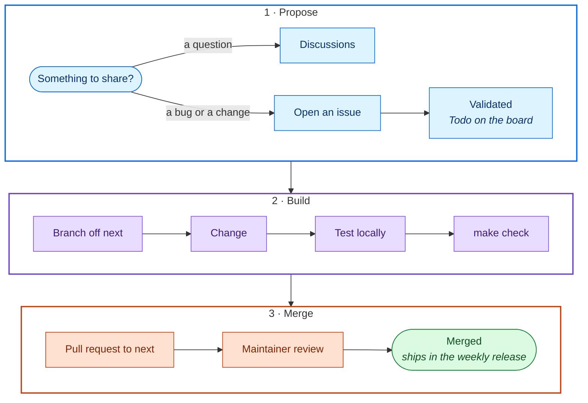

# Contributing

## 1. Propose

| You have | Open | Required fields |
| --- | --- | --- |
| A question | [Discussions](https://github.com/ai-driven-dev/framework/discussions) | none |
| A bug | [Bug report](https://github.com/ai-driven-dev/framework/issues/new?template=bug_report.yml) | description, expected and observed behaviour, AI tool, OS |
| A problem and its fix | [Quick contribution](https://github.com/ai-driven-dev/framework/issues/new?template=quick_contribution.yml) | problem, proposed solution |
| A larger change | [Detailed contribution](https://github.com/ai-driven-dev/framework/issues/new?template=detailed_contribution.yml) | problem, scope, acceptance criteria |

Board status:

| Status | Means |
| --- | --- |
| `Ideation` | Weighed, not agreed |
| `Todo` | Validated by a Member or a Maintainer. Anyone can take it. |
| `In Progress` | Someone is working on it |
| `In review` | A pull request is open |
| `Done` | Merged |

## 2. Set up

| You need | Version |
| --- | --- |
| [Node](https://nodejs.org) | 22.18+ or 24.11+ (26 and later also work) |
| [pnpm](https://pnpm.io) | any recent version |
| `gh` and `jq` | for the skills that talk to GitHub |

Fork the repository, or branch from it if you have write access.

| Run | Does |
| --- | --- |
| `make setup` | Installs dependencies and git hooks, registers the marketplace, installs the plugins into Claude Code and Codex |
| `make doctor` | Checks your environment |
| `make reload` | Reloads your checkout into your tools |
| `make check` | Runs the pre-commit checks |

## 3. The rules

| # | Rule |
| --- | --- |
| 1 | **No slop.** Read every line before you propose it. |
| 2 | **Spend tokens like they cost something.** |
| 3 | **Write in Claude Code syntax.** The [CLI](cli/README.md) translates it for other tools at release. |
| 4 | **Follow the skill structure.** See the [architecture](docs/ARCHITECTURE.md), and generate with `/aidd-context:04-skill-generate`. |
| 5 | **Evolve the memory** in [`aidd_docs/memory/`](aidd_docs/memory/). |
| 6 | **Test in two tools.** Claude Code and one other, for example Codex. |
| 7 | **Commit as `<type>(<scope>): description`.** One scope per commit: [convention](aidd_docs/memory/vcs.md#commits). |

## 4. Open a pull request

| Do | Where |
| --- | --- |
| Branch off `next` and target `next` | [Exceptions](aidd_docs/memory/vcs.md#branches) |
| Fill in the template | [Pull request template](.github/PULL_REQUEST_TEMPLATE.md) |
| Wait for a Maintainer review | [Governance](GOVERNANCE.md#code-decisions) |
