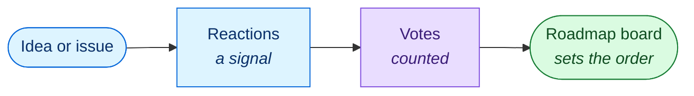

# Governance

## Roles

| Role | Who | Can |
| --- | --- | --- |
| **Public** | Anyone with a GitHub account | Open issues, comment, react, open a pull request on a validated issue |
| **Member** | An active member of the [AIDD programme](https://www.ai-driven-dev.fr/) (Core Team), or someone who passed the [AIDD certification](https://www.ai-driven-dev.fr/) (Certified Member) | Cast a counted vote, validate contribution issues |
| **Maintainer** | A certified member who gives AIDD trainings, or AIDD staff | Everything a Member can, plus approve and merge pull requests, block a change, promote people |

## Code decisions

Only a Maintainer merges.

| Case | Rule |
| --- | --- |
| Default | One Maintainer approval and passing checks |
| A change falls short | Any Maintainer blocks it by requesting changes, until it is resolved |
| Across plugins, a contract, the license or this document | Two Maintainer approvals |

## The roadmap

| Who | Counts as |
| --- | --- |
| Anyone | A reaction: a signal |
| Members and Maintainers | One equal vote each |
| Maintainer | Breaks ties |

- The board: [AIDD Roadmap](https://github.com/orgs/ai-driven-dev/projects/8).
- A milestone is a theme. Items without one are the backlog, ordered by priority.
- The vote orders the roadmap.
- It does not decide whether a validated issue becomes a pull request.

## Influence the roadmap

| Where | What |
| --- | --- |
| [Framework Evolution](https://discord.gg/DyzRuZ7SF?event=1514565536695193710) | The weekly Discord event where the roadmap is decided |
| [Discussions](https://github.com/ai-driven-dev/framework/discussions) | Open an idea, and 👍 what you want |
| [Discord channel](https://discord.com/channels/1173363373115723796/1512081578858119238) | Talk with the community |
| [Changelog](CHANGELOG.md) | What shipped |

## Conduct

- [Code of Conduct](CODE_OF_CONDUCT.md)
- Changes to this document need two Maintainer approvals.
