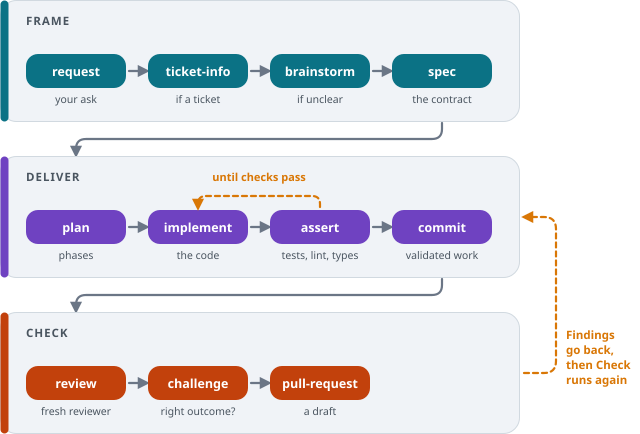
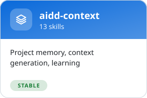
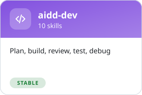
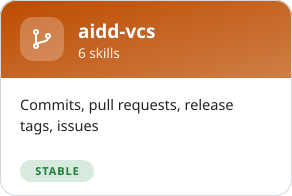
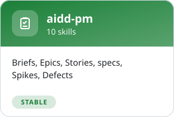
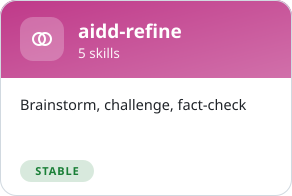
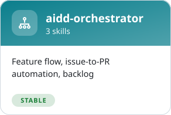
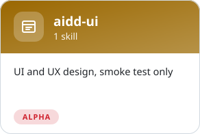
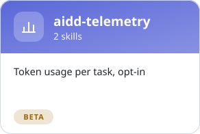
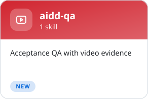

<div align="center">


# AI-Driven Dev Framework

## Enterprise-grade SDLC for high-quality software development.

Unify **engineering teams** around **standardized workflows** and **shared best practices**, across modern stacks and **legacy systems**, while reducing **technical debt**.

🧱 **IDE agnostic** · 🏗️ **Legacy systems** · 🌱 **Token-optimized** · 🇫🇷 **Made in France**

<p>
  <!--counts:start--><kbd>9 plugins</kbd> · <kbd>51 skills</kbd> · <kbd>2 agents</kbd><!--counts:end-->
</p>

[](https://opensource.org/)
[](LICENSE)
[](https://github.com/ai-driven-dev/framework/releases)
[](https://github.com/ai-driven-dev/framework/actions/workflows/ci.yml)

<p>
  <a href="docs/INSTALL.md"><b>Install</b></a> ·
  <a href="docs/GUIDES.md"><b>Guides</b></a> ·
  <a href="docs/CATALOG.md"><b>Catalog</b></a> ·
  <a href="docs/FAQ.md"><b>FAQ</b></a> ·
  <a href="CONTRIBUTING.md"><b>Contribute</b></a> ·
  <a href="https://github.com/orgs/ai-driven-dev/projects/8"><b>Roadmap</b></a>
</p>

</div>

---

From a rough idea to a reviewed pull request, inside the AI coding tool you already use.

https://github.com/user-attachments/assets/92474f4c-053a-471d-9c62-16560b7a2a09

## Works with your tool

<!--tools:start-->

<table>
<thead><tr><th width="800">Tool</th><th width="400" align="center">CLI</th><th width="400" align="center">Plugin marketplace</th><th width="400" align="center">Flat files</th></tr></thead>
<tbody><tr><td><b>Claude Code</b></td><td align="center">✅</td><td align="center">✅</td><td align="center">✅</td></tr>
<tr><td><b>Cursor</b></td><td align="center">✅</td><td align="center">✅</td><td align="center">✅</td></tr>
<tr><td><b>GitHub Copilot</b></td><td align="center">✅</td><td align="center">✅</td><td align="center">✅</td></tr>
<tr><td><b>OpenCode</b></td><td align="center">✅</td><td align="center">—</td><td align="center">✅</td></tr>
<tr><td><b>Kilo Code</b></td><td align="center">✅</td><td align="center">—</td><td align="center">✅</td></tr>
<tr><td><b>Codex</b></td><td align="center">✅</td><td align="center">✅</td><td align="center">✅</td></tr></tbody>
</table>

<!--tools:end-->

<br />

More details: [compatibility](docs/COMPATIBILITY.md).

## Get started

You need [Node](https://nodejs.org) 22.12 or later. Pick one way.

**Any tool: the CLI.**

```sh
npx @ai-driven-dev/cli@latest setup
```

Bootstraps your project: tool configuration and plugins.

<p align="center">
  
  <br />
  <sub>Real output, in an empty project, with the flags that skip the questions.</sub>
</p>

**Natively, for tools with a plugin marketplace.**

<details>
<summary>Show the commands (example: Claude Code)</summary>

```text
/plugin marketplace add ai-driven-dev/framework
/plugin install aidd-context@aidd-framework
/plugin install aidd-refine@aidd-framework
/plugin install aidd-dev@aidd-framework
/plugin install aidd-vcs@aidd-framework
/plugin install aidd-pm@aidd-framework
/plugin install aidd-orchestrator@aidd-framework
```

</details>

Each tool, updating, removing: [install guide](docs/INSTALL.md).

## Quick start

<table>
<thead><tr><th>Run</th><th>When</th></tr></thead>
<tbody>
<tr><td><code>/aidd-context:00-onboard</code></td><td>First time, or unsure what to do next. It reads the project and tells you.</td></tr>
<tr><td><code>/aidd-context:02-project-memory</code></td><td>You want the AI to learn your project once, then remember it.</td></tr>
<tr><td><code>/aidd-orchestrator:01-sdlc</code></td><td>You want a feature delivered end to end.</td></tr>
</tbody>
</table>

Onboarding and project memory happen once. Then `/aidd-orchestrator:01-sdlc` runs every feature along the same chain.

<!--sdlc:start-->

<p align="center"><picture><source media="(prefers-color-scheme: dark)" srcset="docs/assets/diagrams/sdlc-dark.svg"></picture></p>

<!--sdlc:end-->

Fixing a bug, changing one thing, investigating? See the [guides by goal](docs/GUIDES.md).

## Plugins

Install the six stable ones. The other three are off the recommended path.

<!--plugins:start-->

<p align="center">
<a href="plugins/aidd-context/README.md"><picture><source media="(prefers-color-scheme: dark)" srcset="docs/assets/plugins/aidd-context-dark.svg"></picture></a>
<a href="plugins/aidd-dev/README.md"><picture><source media="(prefers-color-scheme: dark)" srcset="docs/assets/plugins/aidd-dev-dark.svg"></picture></a>
<a href="plugins/aidd-vcs/README.md"><picture><source media="(prefers-color-scheme: dark)" srcset="docs/assets/plugins/aidd-vcs-dark.svg"></picture></a>
<a href="plugins/aidd-pm/README.md"><picture><source media="(prefers-color-scheme: dark)" srcset="docs/assets/plugins/aidd-pm-dark.svg"></picture></a>
<a href="plugins/aidd-refine/README.md"><picture><source media="(prefers-color-scheme: dark)" srcset="docs/assets/plugins/aidd-refine-dark.svg"></picture></a>
<a href="plugins/aidd-orchestrator/README.md"><picture><source media="(prefers-color-scheme: dark)" srcset="docs/assets/plugins/aidd-orchestrator-dark.svg"></picture></a>
<a href="plugins/aidd-ui/README.md"><picture><source media="(prefers-color-scheme: dark)" srcset="docs/assets/plugins/aidd-ui-dark.svg"></picture></a>
<a href="plugins/aidd-telemetry/README.md"><picture><source media="(prefers-color-scheme: dark)" srcset="docs/assets/plugins/aidd-telemetry-dark.svg"></picture></a>
<a href="plugins/aidd-qa/README.md"><picture><source media="(prefers-color-scheme: dark)" srcset="docs/assets/plugins/aidd-qa-dark.svg"></picture></a>
</p>

<!--plugins:end-->

## Documentation

<table>
<thead><tr><th>For</th><th>Document</th><th>Read it to</th></tr></thead>
<tbody>
<tr><td rowspan="8"><b>Use it</b></td><td><a href="docs/INSTALL.md">Install</a></td><td>Install, update or remove it</td></tr>
<tr><td><a href="docs/GUIDES.md">Guides</a></td><td>Find the skills for your goal: fix a bug, build a feature</td></tr>
<tr><td><a href="docs/CONCEPTS.md">Concepts</a></td><td>Learn the terms and how project memory works</td></tr>
<tr><td><a href="docs/CATALOG.md">Catalog</a></td><td>See every skill and what it does</td></tr>
<tr><td><a href="docs/COMPATIBILITY.md">Compatibility</a></td><td>See what each tool receives</td></tr>
<tr><td><a href="cli/README.md">CLI</a></td><td>Look up a command</td></tr>
<tr><td><a href="docs/FAQ.md">FAQ</a></td><td>Check cost, security and limits</td></tr>
<tr><td><a href="CHANGELOG.md">Changelog</a></td><td>See what changed</td></tr>
<tr><td rowspan="2"><b>Contribute</b></td><td><a href="CONTRIBUTING.md">Contributing</a></td><td>Follow the contribution flow</td></tr>
<tr><td><a href="docs/ARCHITECTURE.md">Architecture</a></td><td>Know where a capability belongs</td></tr>
<tr><td rowspan="3"><b>Maintain</b></td><td><a href="docs/MAINTAINERS.md">Maintainers</a></td><td>Run releases, add a plugin</td></tr>
<tr><td><a href="GOVERNANCE.md">Governance</a></td><td>See who decides, and how the roadmap is set</td></tr>
<tr><td><a href="RELEASE.md">Releases</a></td><td>Follow the release cycle</td></tr>
<tr><td rowspan="2"><b>Get help</b></td><td><a href=".github/SUPPORT.md">Support</a></td><td>Ask a question or report a bug</td></tr>
<tr><td><a href="SECURITY.md">Security</a></td><td>Report a vulnerability privately</td></tr>
</tbody>
</table>

## Security and privacy

- **Permissions.** A plugin can run scripts. Read it before you install it: [what runs, and when](docs/ARCHITECTURE.md#-bundled-hooks).
- **Telemetry.** Off by default. It only runs if you opt in: [how it works](docs/FAQ.md#measurement).
- **Vulnerabilities.** Report them privately: [`SECURITY.md`](SECURITY.md).

## Community

Built by the [AI-Driven Dev](https://www.ai-driven-dev.fr/) community: 3 years of R&D, 500+ developers trained, production software shipped with 100% AI-generated code. Free and open source (MIT); a [⭐](https://github.com/ai-driven-dev/framework/stargazers) helps others find it.

[Discord 🇫🇷](https://discord.gg/EWySJSpjWs) · [Discussions](https://github.com/ai-driven-dev/framework/discussions) · [Issues](https://github.com/ai-driven-dev/framework/issues) · [Team training](https://www.ai-driven-dev.fr/entreprise) · [How the roadmap is set](GOVERNANCE.md#how-to-influence-the-roadmap)

[](https://github.com/ai-driven-dev/framework/graphs/contributors)

---

<div align="center">

<a href="https://github.com/ai-driven-dev/framework/stargazers"></a>

Made with care in France 🇫🇷 · ← [AIDD organisation](https://github.com/ai-driven-dev)

</div>
