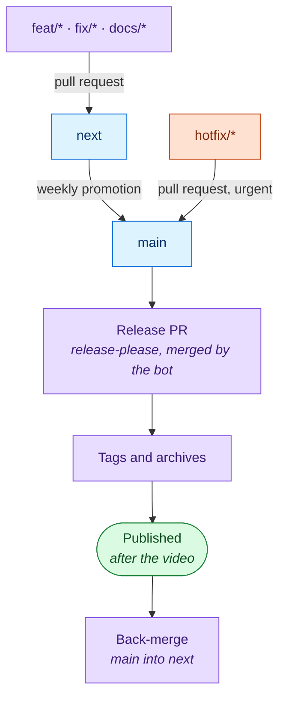

# Release

Weekly releases, with a fast lane for urgent fixes.

Branch prefix to target: [`vcs.md`](aidd_docs/memory/vcs.md#branches).

## Rules

| Rule | Why |
| --- | --- |
| `main` is production, and the marketplace tracks it | Users only get released, versioned code |
| `next` is integration | The week's work batches there |
| A release happens only when there is work | release-please cuts it |
| The Release PR merges itself | Otherwise `main` briefly holds unversioned code |
| The back-merge into `next` is automatic | Otherwise the manifest and changelog on `next` drift |
| Promote with a **merge commit** | A squash can fail `Commitlint` and skip the release. A rebase breaks the back-merge |
| Force a version with `release-as` in `release-please-config.json` | Remove it after the release |

## Weekly release

1. Plan the release video with the `release-video` skill, until `node .claude/skills/release-video/assets/check-release-video.js` passes.
2. Run [Promote](https://github.com/ai-driven-dev/framework/actions/workflows/promote.yml): `next` to `main`.
3. release-please opens the Release PR. It merges itself.
4. Tags are created. The release stays a draft until the bundle, the distributions and the video are attached.
5. Publishing the release fires the announcements.
6. `main` is back-merged into `next`.

If the video, a bundle or a distribution fails, the release stays a draft.
Once fixed: `gh release edit <tag> --draft=false --latest`.

## Hotfix

1. Branch `hotfix/*` from `main`, fix, open a pull request to `main`.
2. Write every commit as conventional: merge is the only method allowed, so none is squashed away.
3. Merge with an empty description: `gh pr merge <n> --merge --body ""`.
4. release-please cuts a patch release.
5. `main` is back-merged into `next`.

The empty description matters: release-please reads a body as a second commit and lists the change twice.
