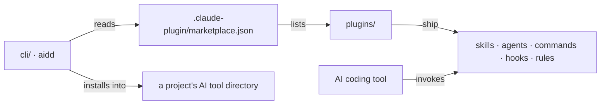

# Architecture

CLI internals: [`internal/cli/architecture.md`](internal/cli/architecture.md). Plugin taxonomy: [`docs/ARCHITECTURE.md`](../../docs/ARCHITECTURE.md).

## Stack

| Part | What |
| --- | --- |
| Product | markdown skills, agents, rules and templates; an LLM interprets them, no runtime |
| Delivery | Node and pnpm; `cli/` is the `aidd` binary, `kanban/` a private package |
| Manifest | `.claude-plugin/marketplace.json`; plugin versions are release-please's (`internal/deployment.md`) |

## How it fits together

- `cli/` and `kanban/` each have their own lockfile and install alone.
- `pnpm-workspace.yaml` lists no `packages:` on purpose: membership would change how their dependencies resolve.
- CI type-checks, lints and tests both; only `cli/` is published.

## Key decisions

| Decision | Why |
| --- | --- |
| Knowledge and execution separated | a knowledge plugin produces artifacts to read; it never writes or runs application source |
| Concern decides placement | a missing capability goes to the plugin owning the concern; the caller delegates |
| A skill is a router | `SKILL.md` dispatches to actions; the only place a capability is named |
| Recipe skills discover providers at runtime | by description; only agent permission lists and orchestration references name a provider |
| Observation is its own layer | `aidd-telemetry` counts what a session consumed; it never touches application source |
| A launcher runs an external binary, never embeds it | `kanban` broke that and was unwired |

## Gotchas

- Off the curated install path: `aidd-ui` (alpha), `aidd-telemetry` (beta, opt-in), `aidd-qa` (unproven outside this repository).
- A skill never links outside itself: the tree ships flat and as a marketplace, and no relative path survives both.
- Bundled hooks run Node: without `node` on `PATH`, no memory refresh and no task question.
