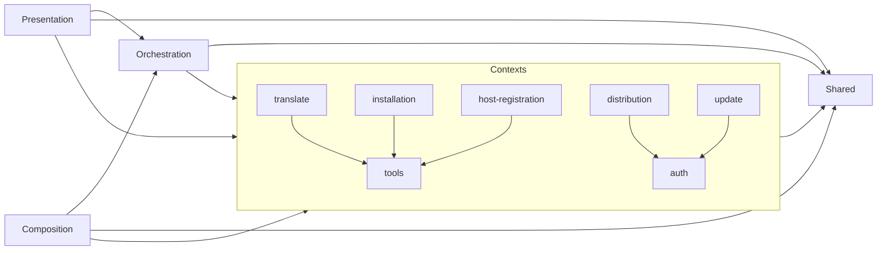

# CLI Architecture

Context shape, layers and process contract: the `working-on-cli` skill's [`references/architecture.md`](../../../../.claude/skills/working-on-cli/references/architecture.md).

## Dependencies

Inter-context edges are exactly `ALLOWED` in `cli/tests/architecture/allowed-edges.ts`, held by `cli/tests/architecture/kind-imports.arch.test.ts`.

## Decisions

| Decision | Why |
| --- | --- |
| Another context is read through its `contract/` only | its `domain/`, `ports/` and `infrastructure/` stay private; Biome holds the `HELD_BY_BIOME` contexts |
| A module is shared only with callers in two contexts | one caller means the code belongs to it; `cli/tests/architecture/earned-sharing.arch.test.ts` |
| The host record's shape lives in `host-registration/domain/`; the manifest stores it opaque | only host registration knows what the record means |
| Claude registers at `--scope local` | the hashed settings file keeps one writer: `cli/src/composition/tool-profiles/claude.ts` |
| Owned files are regenerated, co-owned files are merged | `MergeStrategy` in `cli/src/shared/domain/merge.ts` |
| The manifest reads v9, and v8 only to split it once | no migration chain: [`decisions/manifest-reads-v9-and-splits-v8.md`](decisions/manifest-reads-v9-and-splits-v8.md) |
| One hooks descriptor per tool, one merge engine, one host adapter per tool (OpenCode and Kilo share `host-bridge.cjs`) | adding a tool is a descriptor and a payload fixture; adapters in `cli/assets/hooks-runtime/` |

## Machine claims lock

- Machine claims change under an inter-process manifest lock covering load, mutation and save.
- `plugin add` holds it while fetching, building and writing; a waiter fails after 30 seconds with a named busy-lock error.
- The lock is never stolen for age alone, so contention cannot silently lose a claim.

## Gotchas

- `cli/tsup.config.ts` inlines configs at build time and copies schemas beside the binary.
- The build empties its output; `AIDD_BUILD_OUT_DIR` accepts only `dist` or a folder under `.e2e-build/`.
- `git` exports `GIT_*` into every child; strip them before reading a repository.
