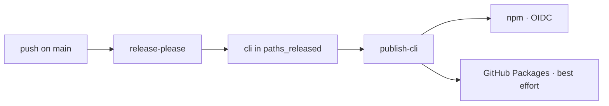

# CLI Deployment

Repository pipeline and release: [`../deployment.md`](../deployment.md).

## Pipeline

- `.github/workflows/cli-ci.yml` has no `paths` filter, so its required check is always satisfiable.
- Its `changes` job decides from the diff which jobs have work.
- The `gate` job (`cli / gate`) fans every job in; it is the one CLI check `.github/rulesets/` requires.
- `pnpm build` copies the runtime JSON schemas; `cli/scripts/check-bundle-size.mjs` then enforces `bundleBudgetKB`.

## Release

- release-please tags this package `cli-v<semver>`; a bare `v<semver>` is the root marketplace.
- `publish-cli` runs when `cli` is in `paths_released`, never on a tag.
- npm is the load-bearing step: `npm publish` under OIDC, no token; `pnpm publish` there is avoided on purpose.
- The GitHub Packages step is `continue-on-error`.
- `aidd update` reads the latest version from npm dist-tags: [`decisions/self-update-version-source-npm.md`](decisions/self-update-version-source-npm.md).
- npm answers GitHub's default `Accept` header with 406, so a registry read sets `application/json`.
