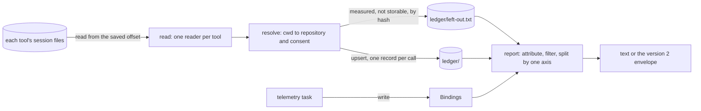

# Telemetry

Code map. Formats, rules and stores: [usage contract](../../../product/usage-contract.md). Usage: [plugin README](../../../../plugins/aidd-telemetry/README.md).

## Adding a tool

| Edit | Where |
| --- | --- |
| its line format (`decode`) | `cli/src/contexts/telemetry/infrastructure/sources/<tool>/` |
| its transcript source | `cli/src/contexts/telemetry/infrastructure/sources/transcript-files.ts` |
| one reader in the ingest list | `cli/src/composition/contexts/telemetry.ts` |
| its name | `USAGE_TOOLS` in `cli/src/contexts/telemetry/contract/usage-record.ts` |
| its home, relocated per sandbox | `cli/tests/shared/testing/cli-sandbox.builder.ts`, `cli/tests/contexts/telemetry/testing/telemetry-sandbox.builder.ts`, `scripts/check-claude-tokens-end-to-end.cjs`, `scripts/probe-identifier-join.cjs` |

## Data flow

- A transcript is read in 1 MiB blocks: an ingest holds about three copies of the longest line.
- Rewrite, shrink or replacement during a read: [residual limits](../../../product/usage-contract.md#residual-limits).
- An envelope keeps its figures apart from its `run`: [envelope reference](../../../../plugins/aidd-telemetry/skills/01-usage/references/envelope.md#figures-and-run).
- Only reading is tool-specific; everything after the usage record is written once.
- Hooks and CLI meet only in files, pinned for both by `scripts/__tests__/fixtures/telemetry-bindings/`.
- Two `SessionStart` hooks: `task.cjs remind` prints one person-facing line when the branch has no task, and `ledger.cjs ingest` runs `aidd telemetry ingest --quiet` (both in `plugins/aidd-telemetry/hooks/`).
- Another tool's calls are attributed by branch. `telemetry task` binds the session `CLAUDE_CODE_SESSION_ID` names. Codex names none to a command, so one run from a Codex started inside Claude Code binds the inherited parent session (limit in the usage contract).

## Where to look

| Question | Under `cli/src/contexts/telemetry/` |
| --- | --- |
| Why a call is counted once | `domain/usage-fold.ts` |
| A call's repository | `application/directory-resolver.use-case.ts`, `domain/repository-identity.ts` |
| A call's task | `domain/report/attribution.ts`, `domain/declaration/binding-resolution.ts` |
| Whether a branch is declared; `plugins/aidd-telemetry/hooks/lib/git.cjs` mirrors it | `domain/branch-binding.ts` |
| Consent, and when a clone consented | `domain/telemetry-consent.ts`, `domain/consent/consent-history.ts`, `infrastructure/git/git-consent-adapter.ts` |
| What a clone is | `domain/consent/clone-identity.ts` |
| Reading from the saved offset | `infrastructure/sources/transcript-files.ts`, `domain/transcript-position.ts` |
| Why a moved Codex file is read from its start | `infrastructure/sources/codex/codex-usage-source-adapter.ts` |
| The ledger on disk | `infrastructure/storage/ledger/usage-ledger-adapter.ts`, `application/ledger-upkeep.ts` |
| What an ingest measured but could not store | `infrastructure/storage/ledger/left-out-adapter.ts` |
| Who the measurement names | `domain/identity/person-identity.ts`, `application/identity/`, `infrastructure/git/git-user-source-adapter.ts` |
| What `forget` erases | `application/forget/` |
| Report axes and envelope | `domain/report/usage-report.ts`, `contract/report-envelope.ts` |
| Report filters | `domain/report/report-filter.ts` |

## Tests

- Anonymized records in `cli/tests/fixtures/claude-usage/` and `cli/tests/fixtures/codex-usage/` pin each line format.
- `cli/tests/e2e/telemetry-journey.e2e.test.ts` drives the real hooks through a shim to the built binary.
- `pnpm test:foreign-clock` runs the telemetry tests under `TZ` `Pacific/Kiritimati` and locale `ar_SA.UTF-8`; CI runs it in `cli-coverage`.
- A cross-zone test sets `TZ` itself; only a child process can vary the locale.
- `scripts/__tests__/telemetry-skills-name-real-commands.test.js` checks the skills' commands against the help golden.
