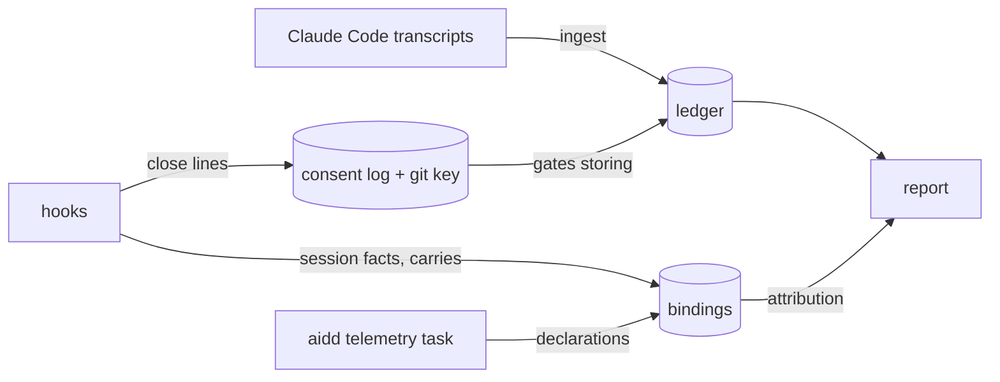
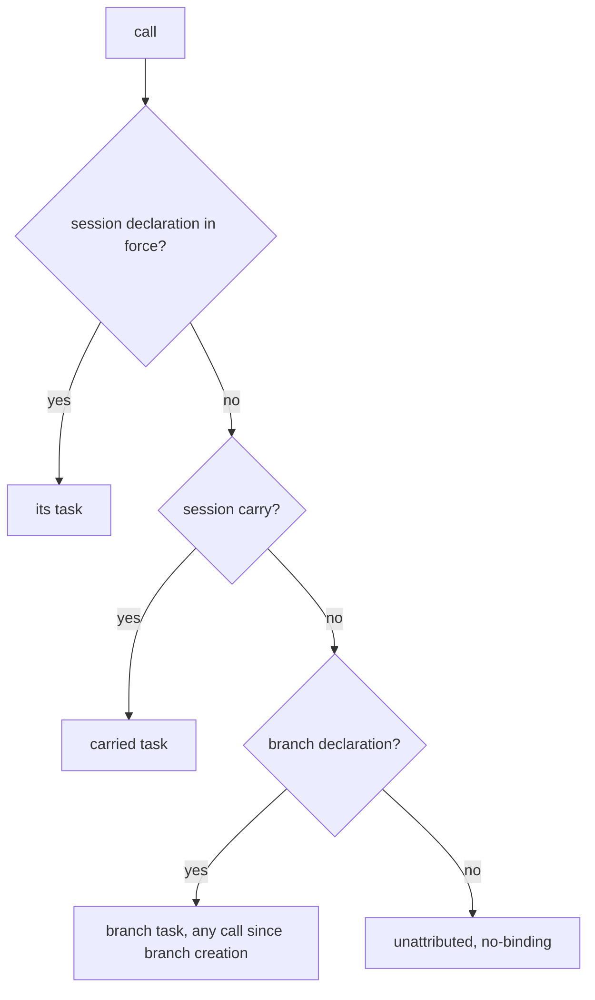
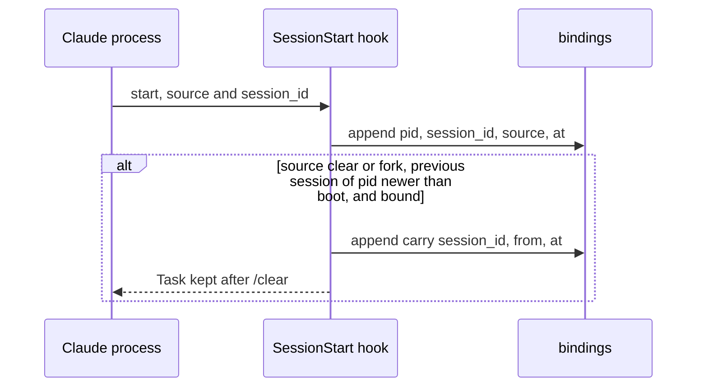
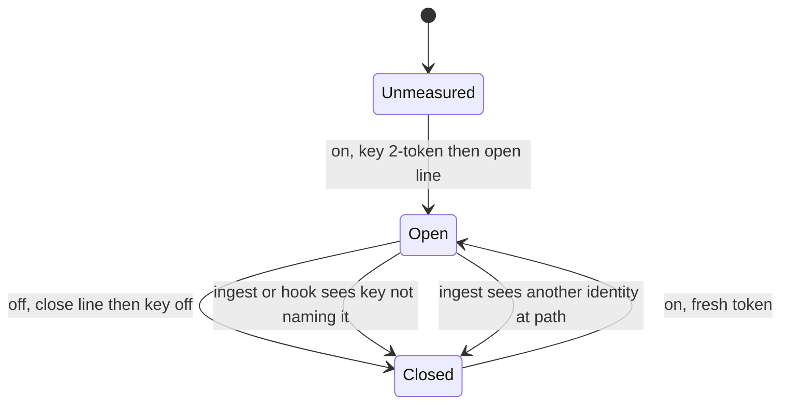

# Usage contract

> For: maintainers, hook authors, a later destination. What `aidd telemetry` records, stores and reports for Claude Code, release 1. How to use it: [plugin README](../../plugins/aidd-telemetry/README.md). Where the code is: [`cli/aidd_docs/memory/telemetry.md`](../../cli/aidd_docs/memory/telemetry.md).

The code is the authority. A change to a format below changes this page in the same commit.

| Part | Owns |
| --- | --- |
| CLI, `cli/src/contexts/telemetry/` | reading, storing, attributing, reporting |
| Plugin hooks, `plugins/aidd-telemetry/hooks/`, plain Node | asking for a task, answering it, recording session facts |

Only Claude Code is measured. The record admits other tools; no reader for them exists.

## Usage record

One record per billed model call, facts only: no cost, person, task or ticket. Those are derived once, at report time, for every tool. Type: `UsageRecord`, `cli/src/contexts/telemetry/domain/usage-record.ts`.

| Field | Type | Meaning |
| --- | --- | --- |
| `tool` | `claude-code` \| `codex` | tool whose files were read |
| `tool_version` | string \| null | version that wrote the line |
| `key` | string | stable across re-reads, unique within `tool` |
| `session_id` | string | the tool's session id |
| `agent` | `main` \| `subagent` \| `advisor` | who made the call |
| `at` | ISO-8601 UTC | when the call was recorded |
| `model` | string \| null | model that billed it |
| `input` | integer \| null | input tokens, cache read and write excluded |
| `output` | integer \| null | output tokens, reasoning included |
| `cache_read` | integer \| null | input served from cache |
| `cache_write` | integer \| null | input written to cache, all lifetimes |
| `cache_write_1h` | integer \| null | of which one-hour; `null` when not said |
| `reasoning` | integer \| null | of which reasoning; `null` when not said |
| `cwd` | string \| null | working directory, local only |
| `git_branch` | string \| null | branch, local only; names the declaration to look up, never parsed |

The ledger stores `StoredUsage`: the record plus `repository_id`, resolved at ingest.

**Null is not zero.**
- Unknown is `null`, never `0`. A `null` counter is left out of its sum and counted in that counter's `unknown_records`.
- A usage line missing a counter is still a record, that counter `null`.
- A line that is no usage line (not JSON, no `message.usage`, no `message.id`, `sessionId` or `timestamp`) is never a record. An unrecognised shape counts in `coverage.unrecognised_shapes`.
- The report says: "not recognised: a call missing a counter is kept with that counter unknown; a line that is no usage line is not counted".

**Key and fold** (`domain/formats/claude-transcript-usage.ts`).

| Rule | Value |
| --- | --- |
| Key | `message.id:requestId`; without `requestId`, `message.id:sessionId:timestamp`; each advisor iteration adds `#advisor<n>` |
| Fold | a call is written several times (streamed snapshots, resumed sessions, sub-agents); one record per `(tool, key)`: largest sum of the four counters (`null` as `0` for this comparison only) |
| Tie | earliest `at`, then lowest `session_id`, then serialised record. No input order changes the winner |
| Dropped | model `<synthetic>` |
| `cache_write` | summed over `message` iterations (the top-level split reflects only the first) |
| Advisor | each `advisor_message` iteration is a record, `agent: advisor`, own model |
| Sub-agent | `isSidechain` or an `agentId` |

**Repository.** The call's working directory resolved at ingest: its git root, named by the hash of the `origin` address (`host/owner/repo`), else the root commit. The address is never kept.

**Not stored.** Storing follows [Consent](#consent). A call read and left out counts in `coverage.not_stored` under one reason:

| Reason | When |
| --- | --- |
| `outside-repo` | no git root, or a repository with neither origin nor root commit |
| `never-seen-alive` | directory gone, never seen alive |
| `no-consent` | clone had no consent at that time: not opted in yet, or turned off |
| `consent-closed` | its live key names a closed interval; says "run `aidd telemetry on`", never says the clone has not opted in |
| `unreadable-consent` | git config or `.git` unreadable, directory or git dir the file system will not let ingest look at, clone with no identity, damaged consent log |
| `no-cwd` | no working directory |
| `undated` | timestamp not a readable date, with no zone (`Z` or `±hh:mm`), or outside four-digit years |

## Report envelope

`aidd telemetry report --json` prints one object, `version: 1`. A field may be added to version 1; never renamed, retyped or removed without a new `version`. Type: `ReportEnvelope`, `cli/src/contexts/telemetry/application/report/report-envelope.ts`.

| Field | Meaning |
| --- | --- |
| `version` | `1` |
| `period` | `{from, to}`, UTC days, `null` for open |
| `axis` | `total`, `person`, `session`, `model`, `agent`, `day`, `repository`, `task`, `ticket` |
| `filters` | `task`, `ticket`, `person`, `model`, `agent`, `session`, `repository`, `absent`, `unattributed`, in that order: `null` when not given, else as resolved (see [Filters](#filters)) |
| `rows` | one per axis value, of the calls that match |
| `totals` | the calls of the period that match |
| `unknown_records` | calls with at least one counter unknown |
| `coverage` | `files_read`, `records`, `unrecognised_shapes`, `not_stored`, `consent_log_damaged`, `oldest_transcript_at`, `skipped_ledger_lines`. `records` counts the calls of the period, matching or not |

Row and `totals`: `records`, `input`, `output`, `cache_read`, `cache_write` (each `{tokens, unknown_records}`), `total`. A row also has:

| Field | Values |
| --- | --- |
| `kind` | `value`, `unattributed`, `absent` |
| `key` | axis value for `value`, else `null` |
| `reason` | `no-binding` or `declared-none` for `unattributed`, else `null` |

- Every axis partitions the same calls: each adds up to `totals`, counter by counter.
- `AIDD_TELEMETRY=0`: nothing read, object is `{"version": 1, "refused": "AIDD_TELEMETRY=0"}`.
- The text report labels an `absent` person `anonymous`; the envelope keeps `kind: absent`, `key: null`.
- A report ingests first. `files_read` and `unrecognised_shapes` describe that run; `records` the period.
- A report with `--days`, `--from` or `--to` reads only the days of its period and the day on each side, plus any monthly file one of them falls in, with every day of its month; with none it reads the whole ledger. The copies of one call have been observed less than a day apart, and under that bound both print the same figures. Outside it, only a report with no period folds every copy of a call. `skipped_ledger_lines` counts the lines of the partitions read.
- No path, working directory or branch. `session` keys are full session ids, `repository` keys are hashes.

### Filters

Every row a report prints can be selected, and the report it selects adds up to that row. A filter keeps a call when the axis it names gives that call exactly the value named, by the same function that builds the rows. A `day` row is selected by the period, `--from D --to D`; the `total` row by no filter.

| Flag | Keeps the calls whose | Value |
| --- | --- | --- |
| `--task <name>` | `task` is that value | a task name |
| `--ticket <ref>` | `ticket` is that value | a ticket, as declared |
| `--person <id>` | `person` is that value | the identity |
| `--model <id>` | `model` is that value | a model id |
| `--agent <agent>` | `agent` is that value | `main`, `subagent`, `advisor` |
| `--session <id>` | `session` is that value | a session id, or a start of one |
| `--repository <id>` | `repository` is that value | a repository id, a start of one, or `.` |
| `--absent <axis>` | axis has no value | `person`, `model`, `ticket` |
| `--unattributed [reason]` | `task` and `ticket` are unattributed | `no-binding`, `declared-none`, or `any` (the default) |

- Flags combine with AND. Each takes one value; given twice, exit 1.
- One selector per axis: `--unattributed` selects on `task` and `ticket`, so it cannot be combined with `--task`, `--ticket` or `--absent ticket`; nor can a value and `--absent` of the same axis. Exit 1.
- A value is trimmed as a declaration is; empty once trimmed, exit 1. It is compared exactly, case included.
- A value outside a closed set (`--agent`, `--absent`, `--unattributed`) exits 1. A value of an open set that no call has gives an empty report, exit 0.
- `--session` and `--repository` resolve among the values of that axis in the calls of the period: a value equal to the one typed wins, else the one value it starts. Two or more: exit 1, listing them in full, sorted. None: an empty report, and `filters` prints the value as typed.
- `--repository .` names the repository the command runs in, by the rule ingest uses: its hosted `origin`, else its first commit. A linked worktree names its main tree's repository. Not a repository, gone, unreadable, or with neither: exit 1. It is compared in full, never as a start.
- Order: the flags are checked, then `AIDD_TELEMETRY=0` refuses (no git is run, the envelope has no `filters`), then `.` is located, then transcripts are ingested and the ledger read, then starts are resolved. Filters apply after attribution and after the period; the window a bounded report reads is unchanged.
- A task name belongs to no repository: `--task refactor` adds up every repository's `refactor`, as `--axis task` does. Add `--repository .` for one.
- The text report folds whitespace in a name onto one line. A filter compares with the stored value, which `--json` prints as `key`.
- `--repository .` names the repository as it stands now. Calls stored under an earlier `origin`, or before a remote was added, carry another id and are not selected; `--axis repository` lists them.
- `--person` is the identity of the machine reporting, as `--axis person` is: locally it selects every call or none.

## Stores

Directory: `AIDD_TELEMETRY_DIR`, else `AIDD_USER_CONFIG_DIR/telemetry`, else `XDG_CONFIG_HOME/aidd/telemetry`, else `~/.config/aidd/telemetry`. Empty means unset. CLI (`runtime/wiring/telemetry.ts`) and hooks (`hooks/lib/telemetry-dir.cjs`) share the rule, pinned by `scripts/__tests__/fixtures/telemetry-bindings/`. Created private.

| Store | Writer | Readers | Holds |
| --- | --- | --- | --- |
| `ledger/<YYYY-MM-DD>.jsonl` | `ingest`, `report` | `report`, `forget` | `StoredUsage` by UTC day of `at`, in time then key order, one call per line. Ingest reads its calls' days and the day on each side, and rewrites only a changed day, whole, by rename; no new bytes, no write. `report` rewrites, folded, the partitions it read that share a call or hold a line that is not a record; a report with no period reads every partition, so after it each call is on disk once. A monthly `<YYYY-MM>.jsonl` from an earlier version is still read, split into its days by the first ingest or report whose window touches it, or by a report with no period, then removed |
| `ledger/offsets.json` | `ingest`, `report` | same | per transcript: bytes consumed, size, file identity. Shrunk or changed identity: read whole |
| `ledger/roots.json` | `ingest`, `on` | `ingest`, `forget` | `{version: 2, directories}`: per directory and per clone seen alive there, `repository_id`, `root`, `clone`, `seen_at`. Other format holds nothing: a live directory is remembered again, a gone one counts `never-seen-alive`. `on` records its own root for `forget` |
| `ledger/consents.jsonl` | `on`, `off`, `ingest`, hooks (close only) | same, plus `forget` | consent intervals, see [Consent](#consent). Outlives the clone; removed with the ledger. Hooks parse it strictly, pinned by the shared fixture |
| `ledger/.lock` | CLI | CLI | `{pid, created_at}`; dead process or older than ten minutes: cleared |
| `bindings/.lock` | CLI | CLI | same format. Declarations and snapshots run under it; `task` never takes the ledger lock, which an ingest holds while reading transcripts |
| `bindings/sessions.jsonl` | `task` | hooks, `report`, `task` | `{session_id, task, ticket, none, declared_at, by}`, `by` = `command` \| `hook-intercept` |
| `bindings/branches.jsonl` | `task`, `ingest`, `report` | `report`, `forget` | branch declaration at a moment, with when the branch took its name, from its reflog |
| `bindings/carries.jsonl` | `SessionStart` hook | hooks, `report` | `{session_id, from, at}` |
| `bindings/processes.jsonl` | `SessionStart` hook | `SessionStart` hook | `{pid, session_id, source, at}` |
| `identity.json` | `identity`, `on` | `report`, `status`, `on` | `{"person_id": "<id>"}`, owner-only |
| git config `--local` `branch.<name>.aiddTask`, `aiddTicket`, `aiddDeclaredFor`, `aiddDeclaredAt` | `task` | hooks, `task`, `report` via snapshots | branch declaration, `aiddDeclaredAt` written last, `aiddDeclaredFor` = `<name>`; see [Branch declaration](#branch-declaration) |
| git config `--local` `aidd.telemetry` | `on`, `off`, `forget` | hooks, CLI | `2:<token>` or `off`. Half of consent: alone it grants nothing |

- A line not exactly its store's format is skipped, never guessed. Every JSON Lines store is append-only except the ledger.
- `forget` removes `ledger/`, `bindings/`, `identity.json`, declaration keys and consent key in each recorded clone, and leftovers of an earlier measurement. Never the directory itself.

## Attribution

Task and ticket come only from `aidd telemetry task <name> [--ticket <ref>]` or `--none`. No branch name, folder, commit message or prompt is parsed. A ticket is free text, kept as typed.

A declaration binds the running session (if `CLAUDE_CODE_SESSION_ID` is set) and, on a working branch, the branch. Never bound: the default branch (target of `origin/HEAD`, else `main` or `master`) and a detached `HEAD`.

- A declaration of no task is `declared-none`.
- Declaring a branch late moves its earlier calls onto the task.
- A branch snapshot with no `declared_at` attributes nothing.
- Sub-agent and advisor calls follow their parent session.

### Branch declaration

A branch is declared only when the command declared it on that branch. Both readers, the CLI (`parseBranchConfig`) and the hook (`lib/git.cjs`), apply the same rule, pinned by the shared fixture.

| git config of the branch read | Declared? | Why |
| --- | --- | --- |
| `aiddDeclaredAt` set, `aiddDeclaredFor` = this branch | yes | written by `task` on this branch |
| `aiddDeclaredAt` set, no `aiddDeclaredFor` | yes | written by cli-v5.5.0 or earlier, which did not stamp. Kept readable: reports and the gate do not change for data already written. Declaring again stamps it |
| `aiddDeclaredAt` set, `aiddDeclaredFor` = another branch | no | carried by `git branch -c` (copy) or `git branch -m` (rename), which move every `branch.<name>.*` key |
| `aiddTask` or `aiddTicket` without `aiddDeclaredAt` | no | set by hand, or a declaration cut short: `task` writes `aiddDeclaredAt` last |
| any declaration key listed twice | no | left by `git branch -C` or `-M` onto a branch that had keys: the copied declaration and the branch's own are mixed |

- **Rename** (`git branch -m A B`): B is undeclared (unless A's declaration is unstamped, see the limits), so the gate asks on B. One declaration on B covers B from when it took the name: the newest reflog entry renaming or copying a branch to B (git or libgit2), else B's oldest entry. Calls made while it was A keep A's task, and on a name used before, the earlier B keeps its own. git moves the keys the same way for a copy and a rename, so the stamp cannot tell them apart; the reflog could, but its entries expire and the declaration would change meaning with them: one question after a rename is the cost.
- **Copy** (`git branch -c A B`): B is undeclared until declared on B.
- **Copy or rename onto an existing branch** (`-C`, `-M`): git keeps both sets of keys, so some are listed twice and the two declarations mix. A branch with any declaration key listed twice is undeclared; declaring again replaces every value.

## Ask

`UserPromptSubmit` (`hooks/prompt-gate.cjs`) blocks a prompt before the model when all hold:

| Condition | Test |
| --- | --- |
| Claude's own payload | `session_id` = `CLAUDE_CODE_SESSION_ID`, `transcript_path` under a `projects` directory |
| clone measured | consenting per [Consent](#consent), `AIDD_TELEMETRY` not `0` |
| person present | `CLAUDE_CODE_SESSION_ATTENDED=1` and `CLAUDE_CODE_ENTRYPOINT` is `cli` or `claude-desktop` (surfaces seen showing a hook message; an IDE extension is not asked, VS Code seen showing none) |
| work undeclared | working branch, no declaration for session or branch |
| CLI usable | `aidd` on `PATH` and knows `telemetry task` |

- Anything else passes. A crash exits 0: the hook never fails a prompt.
- Re-checked on every prompt: each prompt on an undeclared working branch is blocked until the branch or the session is declared (`--none` included). A declared branch is never asked again, unless a copy or rename onto it changes its keys; switching to an undeclared one asks.
- Why every prompt and not once: the gate exists so that no token of the work is spent before it has a task ([spec](../tasks/2026_10/2026_10_09_deterministic-tokens/spec.md), [target](../tasks/2026_10/2026_10_09_deterministic-tokens/context/target.md)). "Once per working branch" there meant answered once and remembered; letting the next prompt through would spend tokens unattributed.

Answering never blocks and never reaches the model:
- `! aidd telemetry task ...` in the terminal fires no `UserPromptSubmit`.
- `aidd telemetry task ...` typed as a prompt runs through the CLI with `--by hook-intercept`. Block reason: one line, what was declared, "Send your prompt again."
- Grammar: a name, `--ticket <ref>`, `--none`, nothing else. Outside it nothing runs.
- A one-line prompt starting like a declaration, only words and quoted strings, no `?`, `!`, comma or final full stop (`aidd telemetry task fix cart`) is blocked with the grammar and quoting hint, kept visible. Any other prompt starting with those words is ordinary.

## Carry

`/clear` and `/branch` (source `fork`) start a new session in the same process; the payload names no predecessor. The `SessionStart` hook (`hooks/session-start.cjs`) records every start.

- pid: `CLAUDE_PID`, else the hook's parent. Boot guard because process ids are reused across boots; it is the boot time only, not the process start time.
- Message: `Task <task> kept after /clear. Different work: aidd telemetry task <name> [--ticket <ref>]`.
- `startup`, `resume`, `compact` carry nothing.
- Provisional: the session's first declaration replaces it for the whole session, earlier calls included. An uncarried session is bound from its declaration on.

## Consent

> A call is stored only when all hold:
> 1. its directory was seen alive belonging to clone X;
> 2. X had an open consent interval at the call's time;
> 3. `AIDD_TELEMETRY=0` is not set.

Nothing else: no backfill, no first-`on` special case, no interval before its `on`, no consent flag elsewhere, no live-key condition on a live clone. **Measurement starts at `on`**; `on` reads nothing back. A transcript last written more than a day before the first interval opened is not read nor counted (the day absorbs a lagging file clock). Every clause is decided from observed facts, never from a path or a remote's look.

**Clone identity.**
- Its git common dir: `dev`, `ino`, `birthtimeMs` of `fs.stat` on its real path, plus the path. Recorded in `roots.json` when first seen alive.
- No identity (call `unreadable-consent`): `ino` `0` or missing, or any `stat` error other than not-found. One unreadable clone never aborts an ingest or report.
- Another identity at a remembered path: the remembered clone is gone; the new one never answers for its calls.
- Several clones at one directory: one entry each. A call goes to the latest clone born at or before it (birth time, else first seen), else the first. Owning a call does not store it: the owner's interval must cover it, and none opens before the clone's `on`.

**Interval log** `ledger/consents.jsonl` (shared fixture, `consentLog` cases):

| Line | Shape |
| --- | --- |
| open | `{"token": "<uuid>", "clone": {"path", "dev", "ino", "birthtimeMs"}, "open": "<ISO-8601 UTC>"}` |
| close | `{"token": "<uuid>", "close": "<ISO-8601 UTC>"}` |

- Opened once; a second open is ignored.
- Several closes: the earliest wins, whatever line order (ingest and hooks both append).
- Close of a never-opened token: no effect. Blank line: not damage.
- Half-open: `on` at T covers T, `off` at T does not.

**Who writes what.**

| Actor | Does |
| --- | --- |
| `on` | under the ledger lock: fresh token, key `2:<token>` first, then open line (a key with no interval measures nothing; an interval its key does not name would be closed by the first hook). Key naming an open interval of this clone: no change. Otherwise closes this clone's stale open intervals at its time. Refuses a clone with no identity. Then, only once on, writes the person's identity when one was chosen |
| `off` | under the same lock: close the clone's open token, then key `off`; key and interval change together, so an ingest never sees one without the other. Also closes the interval its key names at its path, whatever identity it reads there |
| ingest | before judging any call, for every open interval, closes at observation time when the identity at its path changed or the live key is not `2:<that token>`. Nothing at the path: not closed (unmounted volume, folder moved and back); measured again when back. Unreadable config or `stat`: stays open, stores nothing |
| hooks | after the Claude-only guard, even headless: key not naming an open interval recorded for this clone's real path => append a close at hook time. Ends a manual `git config aidd.telemetry off` or `--unset` before the next prompt's calls. `AIDD_TELEMETRY=0`: does nothing |
| `forget --yes` | removes the log with the ledger; unsets the key in every recorded clone |

**Consenting, for hooks and `task`.** All three: key is `2:<token>`; log holds an open interval with it; that interval's clone is this one, by common-dir real path and by `dev`, `ino`, `birthtimeMs`, normalised as the CLI does (inode as text, missing birth as `0`, any other kept even if equal to change time, no inode = no identity; fixture `cloneIdentity` and `hookConsent` cases). Not consenting: a hand-set key (`2`, made-up token), a `cp -R` copy, a copy moved onto a deleted original's path, a clone remade at a path, a moved clone. There: nothing asked, nothing blocked, nothing closed that is not this clone's; run `aidd telemetry on`.

**The key.**
- `--local` writes the common config: shared by linked worktrees, never committed. A teammate who pulls is not measured, asked or blocked until their own `on`.
- `.aidd/config.json` is never consent: not `telemetry: {enabled: true, version: 2}`, not the old bare `enabled: true`. Not read for consent.
- Unreadable git config: `unreadable`, grants nothing, never rewritten.
- A clone that never opted in: nothing stored, asked or blocked.
- Key `off`, from `off` or by hand: `status` and `task` say measurement was turned off in this clone and that `aidd telemetry on` measures it again; a damaged log or an unidentified clone reads unreadable instead, since `on` would refuse. Any other key that grants nothing reads as never opted in. Ingest still counts its calls under `no-consent`.

**`on` also:** removes the old `telemetry` block from `.aidd/config.json` byte-for-byte otherwise, deleting the file only if that block was all (says the change may need committing); removes an earlier measurement's leftovers in the repository; records its clone for `forget`; warns when Claude Code's transcript retention is short; ends with the next step, declaring a task, which the hooks ask for in Claude Code. Does not reset offsets.

**`forget --yes`** unsets `aidd.telemetry` and branch task keys in every clone in `roots.json` or `consents.jsonl` that still exists. Names only gone clones that had consented. A clone that never ran `on` is recorded only if a call from it was read after some clone opted in, so a hand-set key there may stay.

**Fail closed.**
- A terminated `consents.jsonl` line not exactly one of the two shapes: log untrusted. Storage refused for every clone; `on` and `off` refuse and change nothing; every `ingest` and `report` says so, `coverage.consent_log_damaged` in `--json`. Calls read meanwhile are lost (offsets move on).
- An unterminated last line is not a line yet (cut write, or still writing): both readers ignore it, even if it parses. The next writer, CLI or hook, cuts it off before appending. A lost close is re-observed; a lost open leaves a key with no interval, measuring nothing.
- Recovery: `aidd telemetry forget --yes`, then `aidd telemetry on` per clone. Safe: `forget` removes the log and offsets, no backfill, intervals open at `on`. Removing the line by hand is not recovery and is no longer suggested: a lost close would reopen a window turned off.

## Residual limits

None observable by the CLI.

| Case | Effect | Mitigation |
| --- | --- | --- |
| Key changed by hand, then no hook or ingest before next `on` | interval stays open until observed; calls before observation covered, after turning off included | any session start, prompt or ingest observes it |
| Machine clock | judged by transcript timestamp. Stamped inside an interval: covered whenever written; future-dated: covered by an open interval; outside: by stamp alone. File mtime more than a day behind its calls (set back, lagging network fs): not read. Copied transcripts: read only if written after first local `on`, stored only for a clone opted in here | - |
| Worktree made and removed between two ingests | `never-seen-alive` | the session start inside it sees it alive |
| No birth time | a clone reusing a deleted clone's path and inode is taken for it; of two at one directory, the later is told apart only from first seen | - |
| Linux refuses `statx` (seccomp, kernel before 4.11) | birth = change time; identity moves on any git dir entry change, `on` included; clone stops being measured and asked | fails closed: `off` closes by key token at path |
| Moved or renamed clone | new clone. Old interval open while path empty, closed when another directory appears; nothing stored or asked at new path until `on`. Back at same path, same identity: same clone, still measured | - |
| Consent log edited by hand | outside the contract; can reopen a window `off` closed | tool says `forget --yes` |
| Call read while git config, `.git` or git dir unreadable | `unreadable-consent`, offsets move on: not recovered on repair | - |
| pid reused within one boot by a Claude process whose `startup` was never recorded (e.g. started before `on`) | can take the dead process's last session as predecessor, so `/clear` carries its task | announced, replaced by first declaration |
| `AIDD_TELEMETRY=0` | stops hooks too; a key turned off meanwhile is observed at the next run without it | - |
| Declaration keys edited by hand: every key including the stamp, `aiddTask` and `aiddDeclaredAt` alone (read as unstamped), or a stamp removed or emptied | the branch reads as declared: no reader can tell who wrote a git config key | - |
| Copy or rename of an unstamped (cli-v5.5.0) declaration | the new name inherits it | declare on the new name, or on the original to stamp it before copying or renaming |
| Calls on a name used before, after a copy, rename or recreation and before it is declared again | the earlier generation's declaration still answers in the report, while `status` and the gate say undeclared: a branch with no declaration takes no snapshot, so nothing marks the new generation. Only calls the gate did not hold (unattended runs, IDE extensions) can land there | declare right after reusing a name |
| Reflog entry of the rename or copy expired before B's first declaration | B's start is its oldest remaining entry; on a name used before, an older start can let the earlier B's declaration speak for later calls | declare soon after a rename or copy |
| Branch snapshots recorded before stamping (a copied branch, a hand-set task with a `declared_at`) | keep attributing: attribution reads snapshots, `branches.jsonl` is append-only | - |

## Never leaves the machine

Release 1 opens no network connection, in the telemetry context or the hooks. `forget --yes` removes everything.

- Local only: ledger `cwd` and `git_branch`, roots, process facts, transcripts.
- Text report: no path, branch, working directory or whole session id (short keys); envelope per [Report envelope](#report-envelope). `task`, `status`, `forget` print what they act on (a branch: `Branch feat/x is bound.`; `forget` lists entries and repositories); the lock error names the lock file.
- Identity only if chosen: `aidd telemetry identity <id>`, `on --as <id>`, or the answer to `on`'s question. Labels the `person` axis only; `on` and `status` name it.
- No currency amount: the destination owns the price table.

**Who is measured, at `on`.**

| Case | `on` does |
| --- | --- |
| identity set, no flag | keeps it, asks nothing |
| none set, a terminal | after the opt-in is confirmed, asks: git's `user.name` in that directory, else `user.email` (offered only when `personIdOf` accepts it, never under `AIDD_TELEMETRY=0`), another identifier typed, or anonymous |
| `--as <id>` | sets it, replacing one set; refused before anything is written when not one line of 1 to 128 characters |
| `--anonymous` | sets nothing; refused while an identity is set (`identity --off` first) |
| `--yes`, none set, no flag | refused, exit 1, nothing written |
| `--as` with `--anonymous` | refused, exit 1 |

A refused `on` writes neither consent nor identity. Staying anonymous is not stored: the next `on`, in any clone, asks again.
