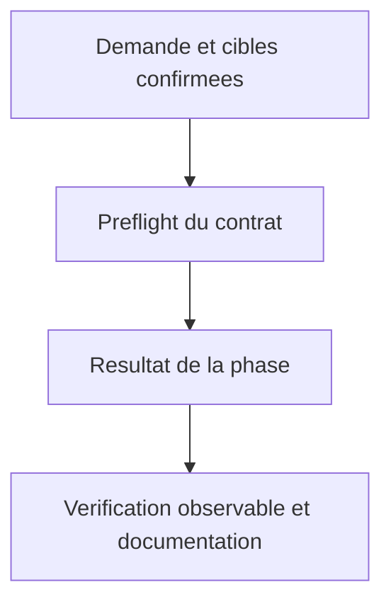
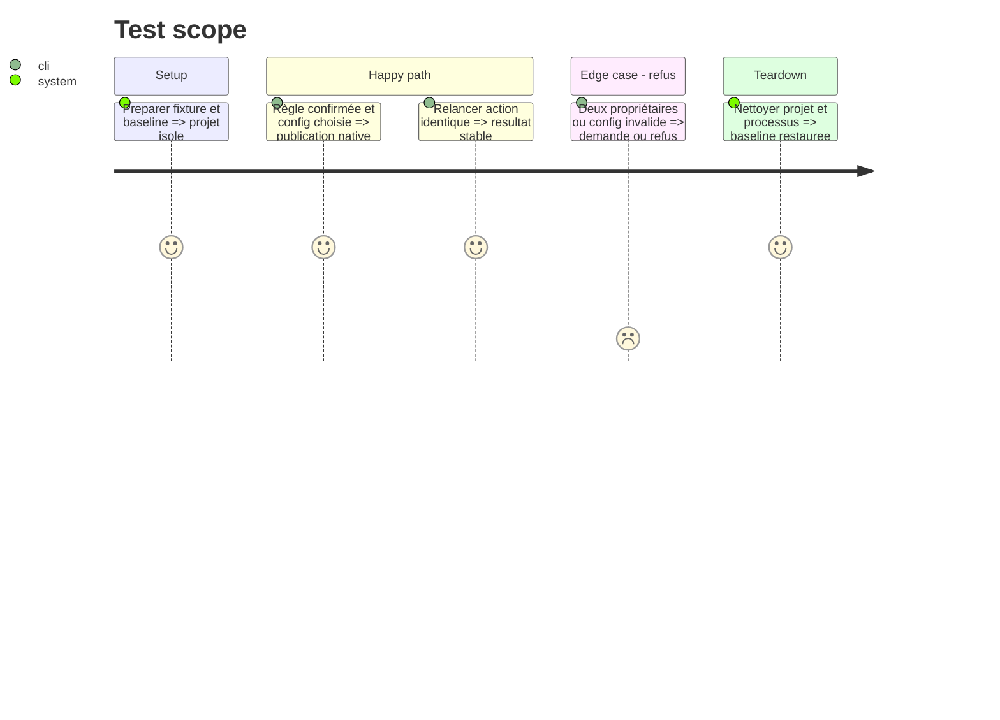

# Instruction: Publier une règle Kilo sans perdre sa configuration

## Reprise du 12 octobre 2026

`upstream/next` contient le merge de #979 (`c827990f`). Le writer partagé de #979 a été étendu pour Kilo ; les tâches 1–4 ci-dessous sont implémentées et leurs critères techniques sont vérifiés par tests et par une observation runtime Kilo 7.8.8/Linux. La phase 6 reste hors périmètre. Le statut de phase reste `in-progress` jusqu’à la validation dans Claude demandée par `CONTRIBUTING.md`, ou une exception explicite du mainteneur ; aucune preuve d’une telle validation ou exception n’est disponible.

## Décision historique du 10 octobre 2026

Cette tranche limitait initialement le travail tant que #979 était Draft. Elle est obsolète depuis la fusion de #979 dans `next` et la décision ultérieure d’étendre son writer. Elle ne décrit plus le périmètre courant.

## Architecture projection

> Arbre des fichiers finaux. ✅ créer · ✏️ modifier · aucune suppression.
> Les chemins conditionnels sont résolus à l’étape de préflight, jamais créés en doublon.

```txt
.
✏️ plugins/aidd-context/skills/05-rule-generate/SKILL.md
✏️ plugins/aidd-context/skills/05-rule-generate/actions/01-capture-rule.md
✏️ plugins/aidd-context/skills/05-rule-generate/actions/02-write-rule.md
✏️ plugins/aidd-context/skills/05-rule-generate/actions/03-validate.md
✏️ plugins/aidd-context/skills/05-rule-generate/references/tool-paths.md
✏️ plugins/aidd-context/skills/05-rule-generate/scripts/write-rule.cjs (base fournie par #979)
✅ plugins/aidd-context/skills/05-rule-generate/scripts/kilo-config.cjs
✏️ scripts/__tests__/rule-generation.test.js (fourni par #979, revalider après intégration)
✅ scripts/__tests__/kilo-rule-publication.test.js
✅ scripts/__tests__/fixtures/context-generation/kilo-config/
✏️ plugins/aidd-context/README.md
```

## User Journey



## Test Scope



## Tâches et résultats

### `1)` Aligner le propriétaire des règles

> Aligner le propriétaire des règles.

1. **Done.** Réutiliser le writer partagé de #979, conserver ses contrats existants et y intégrer Kilo ; aucun deuxième writer n’est créé.

### `2)` Sélection de configuration observable

> Sélection de configuration observable.

1. **Done.** Avant publication, inspecter les quatre configurations candidates ; utiliser le défaut documenté si aucune n’existe, la candidate unique si une seule existe, et le propriétaire unique de l’entrée exacte ou un choix explicite si plusieurs existent. Les cas ambigus refusent avant mutation. Les tests et la sonde Kilo 7.8.8 couvrent la sélection et la fusion observée ; aucun ordre total au-delà des configurations sondées n’est revendiqué.

### `3)` Publication sans perte

> Publication sans perte.

1. **Done.** Publier la règle sous `.kilo/rules/<category>/<slug>.md` et ajouter son chemin exact à `instructions`. Préserver les octets JSON/JSONC hors insertion et refuser les états ambigus/dangereux avant écriture. Les tests vérifient le préflight, l’idempotence et la restauration pour les erreurs couvertes. Les courses entre contrôle et appel système, l’arrêt brutal et la panne machine ne sont pas garantis.

### `4)` Tests et documentation de publication

> Tests et documentation de publication.

1. **Done.** Les tests du writer partagé et les tests Kilo couvrent génération/publication, idempotence, préservation, refus sans mutation et rollback des erreurs simulées. Une observation Kilo 7.8.8/Linux avec contrôle positif et négatif vérifie le chargement de cette règle. Les limites et la provenance sont consignées dans [le rapport de phase](phase-2-report.md) et [les preuves runtime expurgées](evidence/phase-2/runtime-report.md).

## Test acceptance criteria

| Task | Acceptance criteria |
| --- | --- |
| 3 | Règle canonique Kilo et chemin instructions exact existent ; Kilo charge le corps ; dossier seul ne suffit pas. |
| 2 | Aucun choix implicite en ambiguïté ; propriétaire unique réutilisé, annulation ne crée aucun fichier. |
| 3 | JSON/JSONC gardent doublons, ordre, commentaires, trailing commas et format hors insertion ; second passage byte-identique. |
| 3 | Configuration invalide ou cible dangereuse, y compris dernier fichier d’un fan-out, ne laisse aucun changement ; erreurs de publication testées ne laissent ni règle orpheline ni référence cassée. |
| 4 | Les publications Claude/Cursor/Copilot et partagées Codex/OpenCode du writer retenu gardent leurs contrats et les blocs de mémoire. |

## Validations de clôture

- Tests ciblés : **90/90 historiquement rapportés** ; la sortie détaillée a été retirée et ce résultat n’est pas directement rejouable depuis l’archive conservée.
- Suite scripts : **795/795 historiquement rapportés** ; la sortie détaillée a été retirée et ce résultat n’est pas directement rejouable depuis l’archive conservée.
- Kilo 7.8.8/Linux : observation positive et négative ; voir [rapport runtime](evidence/phase-2/runtime-report.md). Cela démontre le chargement de cette fixture dans cet environnement, pas une couverture générale de modèles ou plateformes.
- Claude authentifié : non exécuté. Windows : non exécuté. `CONTRIBUTING.md` demande `make reload`, redémarrage des sessions et test dans Claude et un autre outil. Le contrôle Claude reste donc ouvert ; une clôture sans ce test nécessite une exception explicite du mainteneur, non obtenue à ce jour.
- Limites : pas de garantie face aux courses entre contrôle et appel système, à une mutation externe durant la restauration, à l’arrêt brutal ou à une panne machine.
