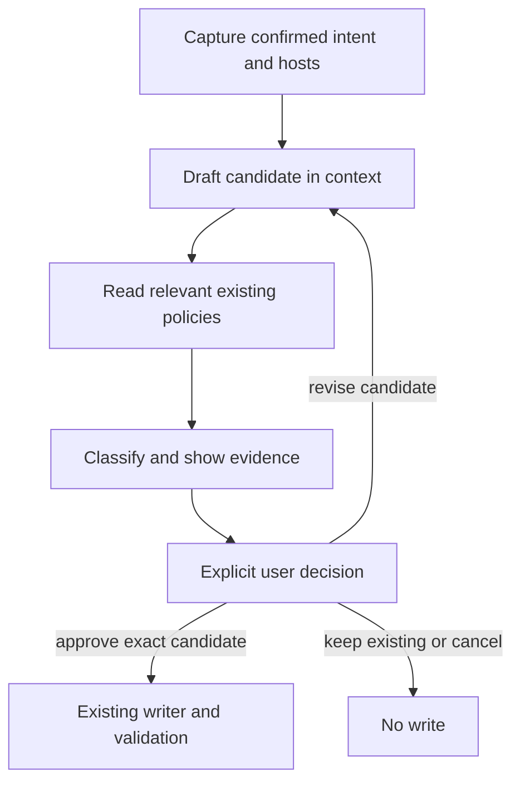
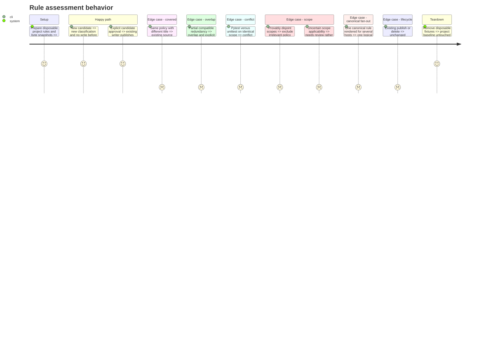

# Instruction: Assess and resolve a candidate before publication

## Architecture projection

```txt
plugins/aidd-context/skills/05-rule-generate/
  SKILL.md                              modify: route four actions
  actions/01-capture-rule.md             modify: retain publish/delete bypass
  actions/02-assess-existing-rules.md    create: read-only assessment and decision
  actions/03-write-rule.md               rename/modify: consume approved candidate
  actions/04-validate.md                 rename/modify: validate the resolved result
  references/tool-paths.md               modify: canonical discovery authority
  references/rule-authoring.md           modify only if existing R5 needs explicit cross-rule scope
docs/CATALOG.md                         modify: action count
plugins/aidd-context/CATALOG.md          regenerate: current action inventory
aidd_docs/tasks/2026_10/2026_10_12_rule-conflict-assessment/
  verification.md                       create: behavior receipts and limits
  review.md                             create: independent review
```

## User Journey



## Test Scope



## Tasks to do

### `1)` Define the pre-write seam

> Keep one source of truth for supported discovery and one assessed candidate for writing.

1. Add the assessment action and update routing, names, handoffs and catalogs.
2. Prepare the complete candidate in context before comparing it, not on disk.
3. Discover project rules through the existing tool-path reference, including canonical sources and relevant user guidance; do not add host paths in the action.
4. Compare policy, scope, conditions and priority. Exclude only proven disjoint scopes and verified renderings of the same canonical policy.
5. Report new, covered, overlap, conflict or needs review with supporting files; require an explicit decision even for new.
6. Reassess any changed candidate, preserve unchanged publish/delete routing, and retain every writer safety/refusal contract.

### `2)` Prove behavior and integration

> Exercise the actual skill in disposable projects and preserve evidence of refusal before approval.

1. Run focused architecture, links and existing writer regression tests.
2. Exercise the journey with subscription-backed native sessions only, with no paid API fallback, and compare before/after project bytes.
3. Run the existing pre-commit and applicable pre-push gates, including generated catalogs.
4. Obtain independent review and final outcome challenge; repair actionable findings.

## Test acceptance criteria

| Task | Acceptance criteria |
| --- | --- |
| 1 | No create/update write occurs without an explicit assessment and decision about the complete candidate. |
| 1 | Covered, overlap, conflict and needs-review results cite involved sources; scope and canonical rendering exclusions are justified. |
| 1 | A changed resolution is assessed again; keeping an existing policy and cancelling leave project bytes unchanged. |
| 1 | Publish/delete and the installed five-host writer retain their existing behavior. |
| 2 | Native-session receipts show classification and no-write behavior for the specified cases, with uncertain results recorded honestly. |
| 2 | Required gates pass and independent judgment has no unresolved blocking finding. |
