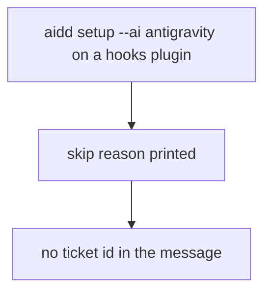
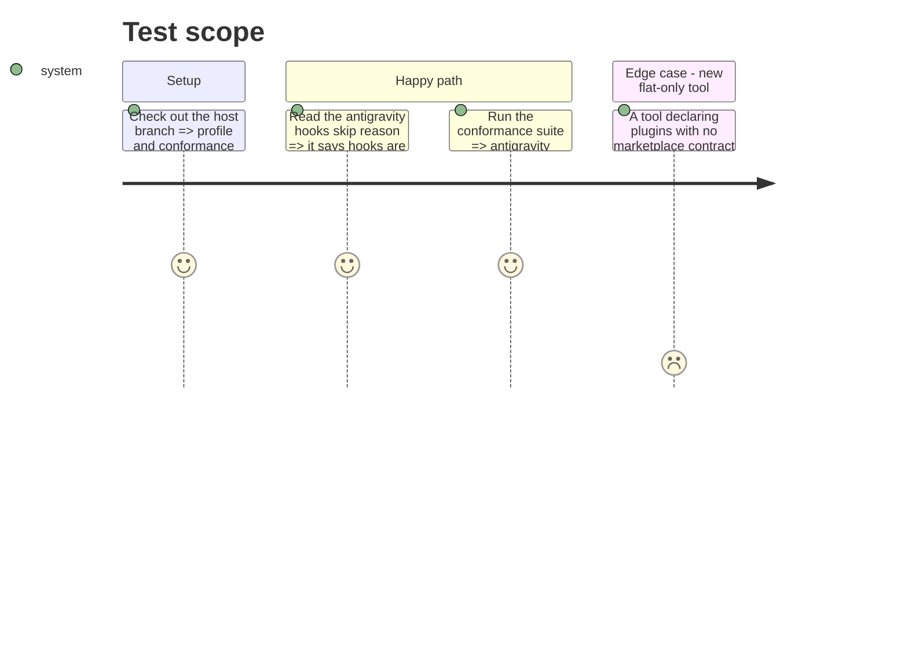

# Instruction: Host profile: user-facing skip message, conformance guard

Owning commit: `feat(cli): add Antigravity CLI as a flat host for skills` on `feat/511-antigravity-host`.

## Architecture projection

> Tree of the final files. ✅ create · ✏️ modify · ❌ delete

```txt
cli/
├── src/contexts/tools/domain/profiles/antigravity/profile.ts                 ✏️ skip reason without a ticket reference
└── tests/contexts/tools/domain/
    ├── profiles/antigravity/profile.unit.test.ts                             ✏️ assert the new reason
    └── registry-conformance.unit.test.ts                                     ✏️ named opt-out replaces the silent early return
```

## User Journey



## Test Scope



## Tasks to do

### `1)` Skip reason

> The message a user reads carries no ticket reference.

1. Set `hooksUnsupportedReason` to `Antigravity CLI hooks are not wired yet.`
2. Assert that exact string in the profile test instead of `toContain("phase 3")`.

### `2)` Explicit conformance opt-out

> A future flat-only tool cannot skip the marketplace-probe check by accident.

1. Replace the early `return` with a named set of tools exempt from the marketplace probe, holding `antigravity` with a one-line reason.
2. Mutation check: drop `antigravity` from the set, the probe test goes red; restore.

## Test acceptance criteria

| Task | Acceptance criteria |
| ---- | ------------------- |
| 1 | The antigravity hooks skip reason contains no `#` ticket id and the profile test pins it |
| 2 | Removing antigravity from the opt-out set fails the conformance test for antigravity only |
