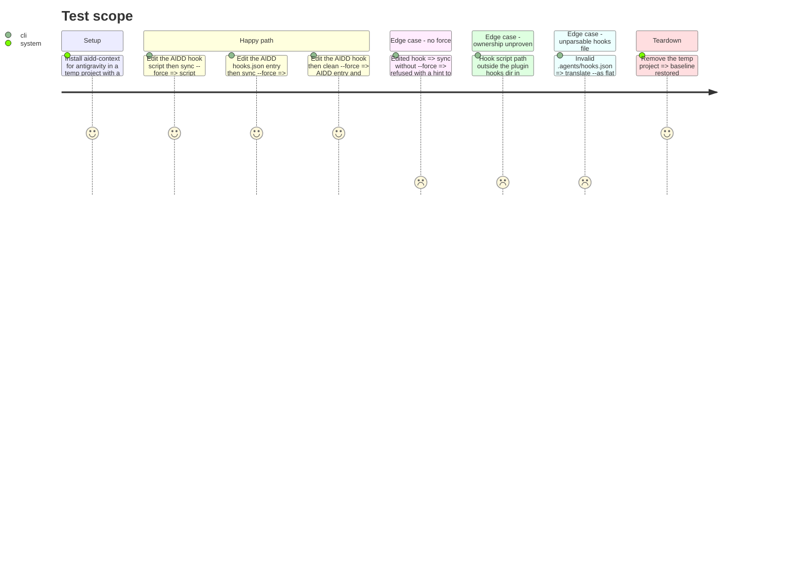

# Instruction: Project hooks: `--force` reaches the edit guard

Owning commit: `feat(cli): merge plugin hooks into antigravity's .agents/hooks.json` on `feat/511-antigravity-memory-hook`.

## Architecture projection

> Tree of the final files. ✅ create · ✏️ modify · ❌ delete

```txt
cli/
├── src/contexts/framework/application/
│   ├── shared/remove-project-hooks.ts                          ✏️ overwriteEdited option; refusal hints --force
│   ├── framework/translator/project-hooks-materializer.ts      ✏️ honour overwriteEdited, obsolete-script removal too
│   ├── framework/translator/plugin-translator.ts               ✏️ contract carries overwriteEdited
│   ├── framework/translator/mode-b-flat-materialization-translator.ts   ✏️ forward it
│   ├── framework/translator/built-tree-materialization-translator.ts    ✏️ forward it; drop flat hook scripts from plugin files
│   ├── plugin/plugin-helpers.ts                                ✏️ materializeViaTranslator forwards it
│   ├── shared/apply-plugin-files-use-case.ts                   ✏️ option force
│   ├── restore/restore-all-plugins-use-case.ts                 ✏️ option force
│   ├── restore/restore-use-case.ts                             ✏️ pass ctx.force to plugin restore
│   └── clean-use-case.ts                                       ✏️ pass options.force to hook preflight and removal
├── src/contexts/tools/domain/profiles/antigravity/antigravity-hooks.ts   ✏️ comment without a pinned agy version
├── src/contexts/translate/application/strategies/flat-build-strategy.ts   ✏️ unparsable hooks file named, left untouched
└── tests/                                                      ✏️ reviewer reproductions, duplicate-record check, translate error
```

## User Journey

```mermaid
flowchart TD
  A[setup --ai antigravity] --> B[user edits AIDD hook script or its hooks.json entry]
  B --> C{command}
  C -- sync --force --> D[AIDD entry and script rewritten, user key kept, drifted skill restored]
  C -- clean --force --> E[AIDD entry and scripts removed, user key kept, all plugin files removed]
  C -- sync without --force --> F[refused, message suggests --force]
```

## Test Scope



## Tasks to do

### `1)` Reproduce first

> The reviewer's three reproductions fail before any production change.

1. Add use-case level tests for: edited script + `sync --force`, edited entry + `sync --force`, edited hook + `clean --force`; each also asserts the user `lint` key survives.
2. Add the no-force refusal test expecting the `--force` hint, and the unproven-path test expecting a refusal under force.
3. Run them; record the red failure messages.

### `2)` Thread `force` to the guard

> One explicit option flows from the command to the guard; no global state.

1. `assertProjectHooksUnchanged` takes `{ overwriteEdited }`; when true it skips only the entry-digest and script-hash "edited after install" refusals.
2. `removeObsoleteScripts` deletes an edited obsolete script when `overwriteEdited` is set.
3. Forward it: `RestoreUseCase` → `RestoreAllPluginsUseCase` → `ApplyPluginFilesUseCase` → `materializeViaTranslator` → `PluginTranslator.addPlugin` → `ProjectHooksMaterializer`; and `CleanUseCase` → `assertProjectHooksRemovable` / `removeProjectHooks`.
4. Without the option, the refusal text ends with a hint to rerun with `--force`.
5. Mutation check: drop the forwarding at one layer, a reproduction goes red.

### `3)` One owner per hook script

> A project-delivered hook script is recorded in the hooks provenance only.

1. Test: after a flat antigravity install, `plugins[].files` holds no `.agents/hooks/` path and `projectHooks.scripts` holds the script.
2. In the built-tree flat route, drop the flat hook output paths from the plugin files when the tool delivers hooks to the project.
3. Re-run the restore test of the top branch to confirm it still holds.

### `4)` Minors

> Small corrections the reviewer named.

1. `translate --as flat` with an unparsable `.agents/hooks.json` reports the same "is not valid JSON (...); left untouched." message as setup; test first.
2. Remove the pinned `agy` version from the `antigravity-hooks.ts` comment.
3. Rebuild and record the bundle size; bump the budget only if exceeded, with its comment line.

## Test acceptance criteria

| Task | Acceptance criteria |
| ---- | ------------------- |
| 1 | The three reproductions and the no-force test exist and failed before task 2 |
| 2 | `sync --force` and `clean --force` succeed on an edited AIDD hook, the user `lint` key survives, an unproven path still refuses, no-force refuses with a `--force` hint |
| 3 | A fresh antigravity manifest records the hook script once, under `projectHooks.scripts` |
| 4 | The translate error names `.agents/hooks.json`; no agy version in the comment; bundle under budget |
