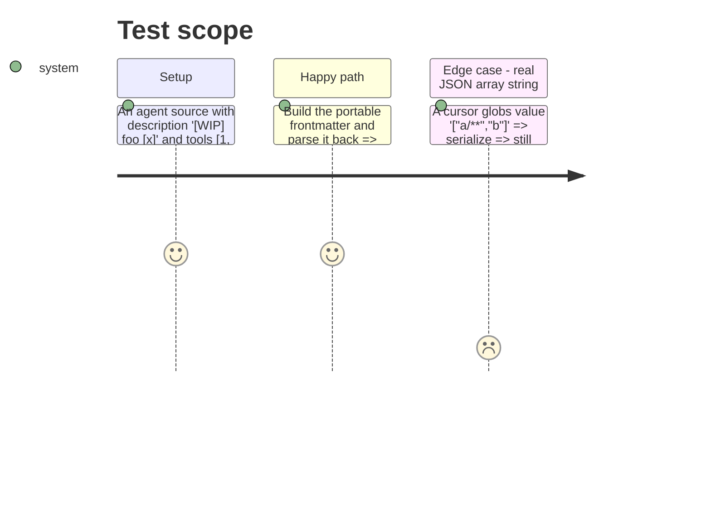

# Instruction: Agents: bundle figures, bracketed frontmatter values

Owning commit: `feat(cli): emit antigravity agents as portable .agents/agents/<name>/agent.md` on `feat/511-antigravity-agents`.

## Architecture projection

> Tree of the final files. ✅ create · ✏️ modify · ❌ delete

```txt
cli/
├── scripts/check-bundle-size.mjs                                   ✏️ per-PR split of the measured growth
├── package.json                                                    ✏️ budget only if phase 2 moved the size
├── src/kernel/markdown.ts                                          ✏️ raw emission only for a real JSON array
└── tests/
    ├── contexts/tools/domain/formats/portable-agent.unit.test.ts   ✏️ bracketed description, non-string tools
    └── kernel/markdown.unit.test.ts                                ✏️ the same value round-trips as a string
```

## User Journey

```mermaid
flowchart TD
  A[agent description '[WIP] foo [x]'] --> B[antigravity build]
  B --> C[frontmatter parses, description is the same string]
```

## Test Scope



## Tasks to do

### `1)` Bundle figures

> The comment and the commit tell the same per-PR story as the measurements.

1. Rebuild each branch tip after phase 2 and record its size.
2. Rewrite the budget comment lines: host profile, hooks merge, agents, each with its own measured delta.
3. Reword the owning commit message's bundle sentence to the measured figures.

### `2)` Bracketed values

> A string that only looks like a list is quoted.

1. Test first: `[WIP] foo [x]` and non-string `tools` items through `portableAgentFrontmatter` + `serializeFrontmatter`, parsed back with the project's YAML reader.
2. If red, emit a value raw only when it parses as a JSON array; quote otherwise.
3. Keep the cursor globs test green.

## Test acceptance criteria

| Task | Acceptance criteria |
| ---- | ------------------- |
| 1 | The budget comment, the commit message and the measured sizes agree for each of the three branches |
| 2 | A bracketed description parses back as the same string; a JSON-array string still serializes as an inline array |
