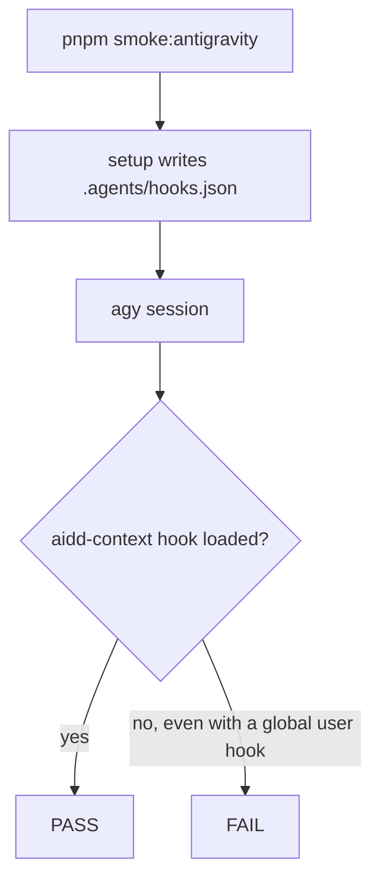
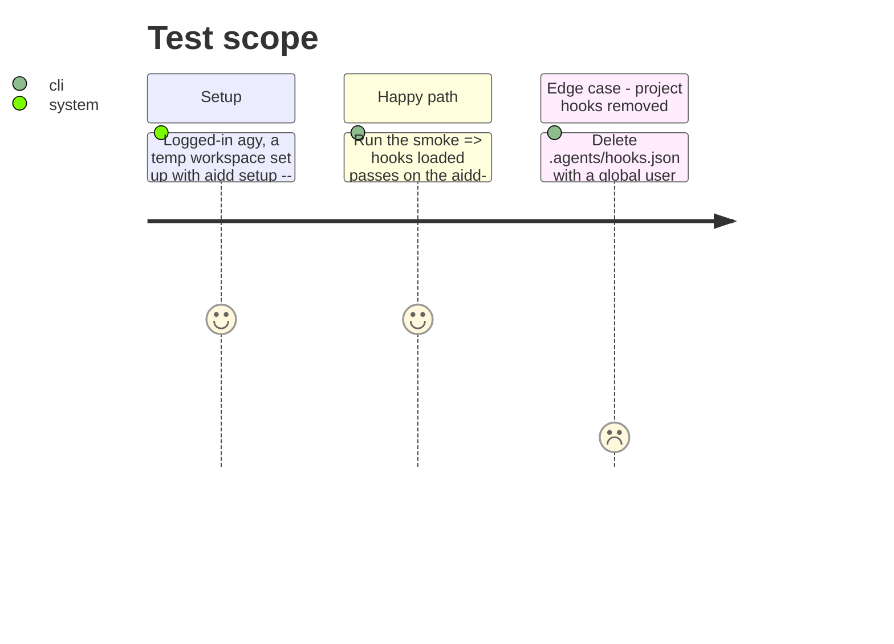

# Instruction: Docs and runtime smoke

Owning commits on `feat/511-antigravity-docs`: the smoke (`test(cli): add a local runtime smoke for antigravity`), the `aidd-context` surfaces (`feat(aidd-context): refresh AGENTS.md for antigravity ...`), the docs (`docs: list antigravity cli as a supported flat host`).

## Architecture projection

> Tree of the final files. ✅ create · ✏️ modify · ❌ delete

```txt
.
├── README.md                                                        ✏️ Docs link points at the Antigravity overview
├── cli/scripts/smoke-antigravity.sh                                 ✏️ project hook proof, short header, portable script(1)
├── cli/src/contexts/tools/domain/registry.ts                        ✏️ JSDoc keeps only the null case
└── plugins/aidd-context/skills/
    ├── 04-skill-generate/references/tool-detect.md                  ✏️ .agents/skills/ wording agrees with ai-mapping
    ├── 05-rule-generate/references/tool-paths.md                    ✏️ glob with paths, always_on without; measured truncation
    └── 11-explore/references/ai-mapping.md                          ✏️ plugins/ paths marked unmeasured; .agents/skills/ wording
```

## User Journey



## Test Scope



## Tasks to do

### `1)` Smoke proves the project hook

> A global user hook can no longer make the check pass.

1. Read what an `agy` log prints for loaded hooks; match `aidd-context` if it is named.
2. Otherwise compare the loaded count with and without `.agents/hooks.json` and require it to be higher with it.
3. Negative control: delete `.agents/hooks.json`, the check fails.
4. Check whether a `-p` run fires the SessionStart hook; if it does, drop the interactive session part.
5. Shorten the header; no pinned version; pick BSD or util-linux `script` syntax at runtime when the interactive part stays.

### `2)` Docs precision

> Each claim states what was measured and what was not.

1. `tool-paths.md` (rules): a rule with paths is `trigger: glob` with `globs`, one without is `always_on`; the per-file limit is measured, `agy` truncates near 23 to 25 KB and `write-rule.cjs` refuses above 24,000 bytes.
2. `ai-mapping.md`: `~/.gemini/config/plugins/<plugin>/` and `.agents/plugins/` marked unmeasured; `.agents/skills/` wording aligned with `tool-detect.md`.
3. README Docs link to the Antigravity overview; `registry.ts` JSDoc reduced to the `null` case.

### `3)` Pull request description

> The description lists every code change it ships.

1. Add the `write-rule.cjs` antigravity target (path, frontmatter, size refusal) to the description draft.

## Test acceptance criteria

| Task | Acceptance criteria |
| ---- | ------------------- |
| 1 | The smoke passes with project hooks and fails without them, whatever the user-global hooks |
| 2 | `ai-mapping.md` and `tool-detect.md` agree on `.agents/skills/`; rules docs name glob vs always_on and the measured truncation |
| 3 | The description draft names the `write-rule.cjs` change |
