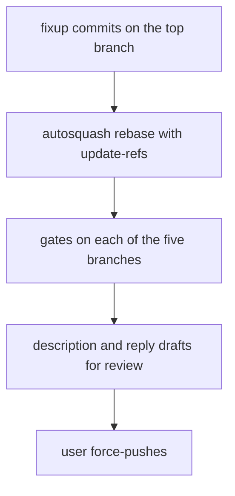
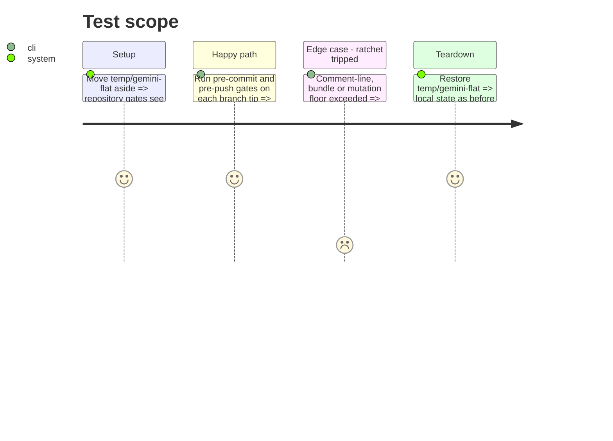

# Instruction: Replay the stack, gate each branch, draft the replies

## Architecture projection

> Tree of the final files. ✅ create · ✏️ modify · ❌ delete

```txt
.
└── cli/tests/e2e/antigravity-foreign-files.e2e.test.ts   ✏️ only if its expectation changed with phase 2
```

## User Journey



## Test Scope



## Tasks to do

### `1)` Replay

> Each fix lands in the commit that owns it, every branch ref follows.

1. Autosquash the fixups from the top branch with `--update-refs`.
2. Confirm each branch's commit list matches the original one, same subjects.

### `2)` Gates

> Every branch is green on its own.

1. Per branch tip: `pnpm exec lefthook run pre-commit --all-files`, `pnpm exec lefthook run pre-push`, scripts tests wrapped.
2. Mutation scope `tools-antigravity` stays at or above its floor.
3. Adapt the restore test only if phase 2 changed what it observes.

### `3)` Drafts

> The user reviews every word that goes public.

1. Description updates for the bundle and description findings.
2. One reply per review, each finding answered: fixed (where) or answered (why).

## Test acceptance criteria

| Task | Acceptance criteria |
| ---- | ------------------- |
| 1 | The five branches keep their commit subjects and order, each fix inside its owning commit |
| 2 | Every gate passes on every branch tip |
| 3 | Every review finding has a fixed-or-answered line in a draft the user approved |
