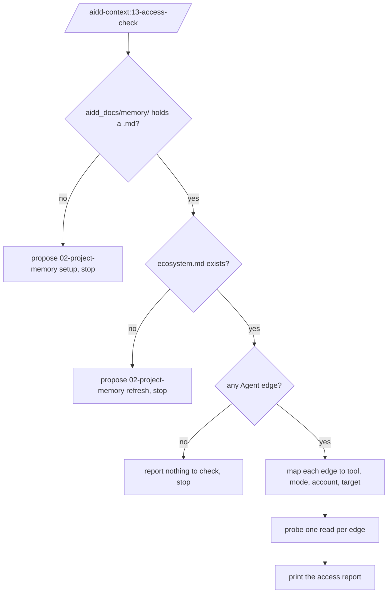
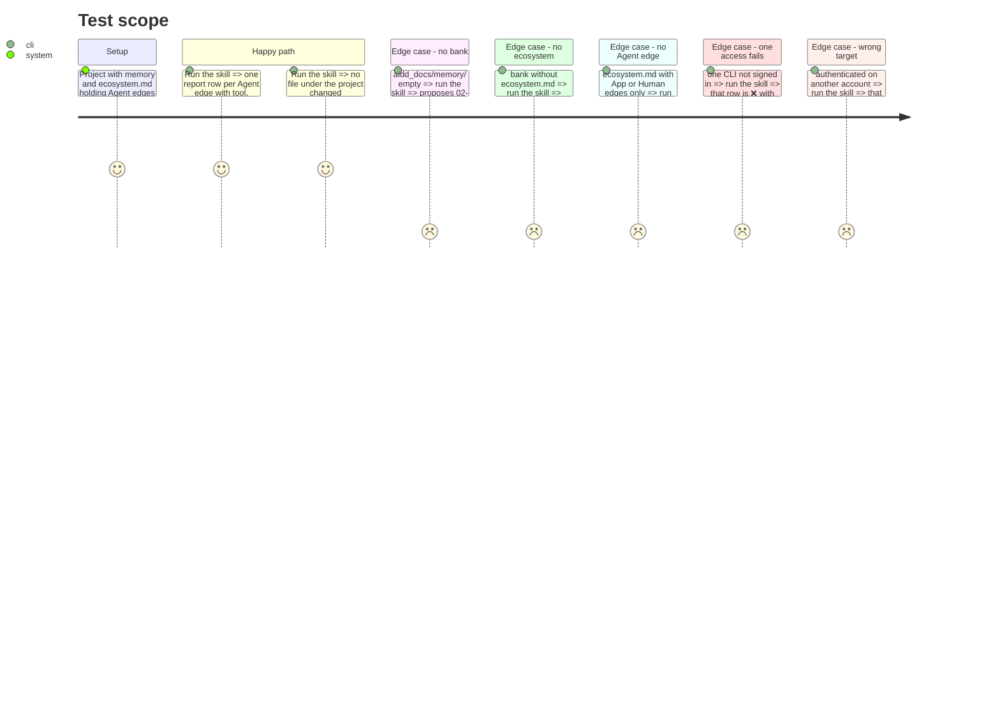

# Instruction: Create the `13-access-check` skill

## Architecture projection

> Tree of the final files. ✅ create · ✏️ modify · ❌ delete

```txt
.
├── docs/
│   └── CATALOG.md                                   ✏️ row for 13-access-check
└── plugins/aidd-context/
    ├── README.md                                    ✏️ row for access-check
    └── skills/13-access-check/
        ├── SKILL.md                                 ✅ router, one action
        ├── actions/
        │   └── 01-check.md                          ✅ from 02-project-memory/actions/05-verify-connection.md
        └── assets/
            └── access-report.md                     ✅ from 02-project-memory/assets/connection-report.md, one row per edge
```

## User Journey



## Test Scope



## Tasks to do

### `1)` Router

> A skill whose name and description say what it checks and what it never does.

1. `SKILL.md` frontmatter: `name: 13-access-check`, description "Check that the assistant can reach the services recorded in project memory, read-only. Use when the user wants to verify or diagnose service access. Not for installing or configuring services.", `argument-hint: tool`.
2. Flowchart of the journey above, one action `check`.
3. Transversal rules: read-only (no writes, installs, logins, configuration or memory changes); never print a secret; a configured tool never proves access, only a read matching the intended account and target does; continue past a failure.

### `2)` Check action

> Map the memory to accesses, probe each once, report.

1. `## Input`: `aidd_docs/memory/ecosystem.md`, plus `vcs.md` and `backlog.md` for accounts and targets. No recipe.
2. `## Process`: **Require** (the three stop cases and their proposal), **Map** (one row per `Agent -- mode --> Tool` edge; an argument narrows to one tool), **Probe** (`cli` => a read-only command, `mcp` => a read tool, `http` => one authenticated GET with the token from the environment), **Report** (fill `access-report.md`).
3. Status per row: ✅ read matches account and target; ❌ read failed, with one corrective action; 🔌 tool or server absent; ⚠️ authenticated but account or target different (naming expected and observed) or not recorded in memory (next step: record it in memory). `Human` and `App` edges get no row.
4. `## Test` table covering every case of the test scope.

### `3)` Report asset

> A report whose rows follow the project, not a fixed category list.

1. Columns: Tool, Mode, Account / target, Status, Evidence / next step.
2. Keep the status legend from `connection-report.md`, drop ⏭️ (an edge in memory is never "not needed").
3. Inline comment contract, removed from the printed report.

### `4)` Listings

> The skill is discoverable where skills are listed by hand.

1. Add `13-access-check` to the aidd-context table of `docs/CATALOG.md` with action `01-check`.
2. Add the `access-check` row to `plugins/aidd-context/README.md`.

### `5)` Onboard

> A first setup ends with the assistant's access proven.

1. `00-onboard` `zones.md`: a `service access` foundation after `memory wiring`, command `aidd-context:13-access-check`, met unless memory or wiring was set up this session and the check has not run or been skipped since.
2. Foundation counts follow: `flow.md`, `screen-map.md`, `03-present.md` test.

## Test acceptance criteria

| Task | Acceptance criteria                                                                                     |
| ---- | ------------------------------------------------------------------------------------------------------- |
| 1    | the skill frontmatter passes the pre-commit skill frontmatter and argument-hint checks                   |
| 1    | no file of the skill links outside `13-access-check/`                                                    |
| 2    | each stop case names the exact command to run next and changes no file                                   |
| 2    | a run against this repository lists the `gh` edges to GitHub and the Roadmap board, each with evidence   |
| 3    | the report has one row per Agent edge and no category row                                                |
| 4    | `docs/CATALOG.md` and the plugin README both list the skill; regenerated `CATALOG.md` and README counts show 14 aidd-context skills |
| 5    | an existing repo renders memory as step 1 of 3, and a session that found memory wired lists no access step |
