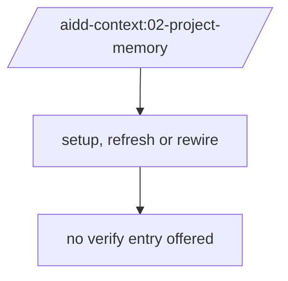
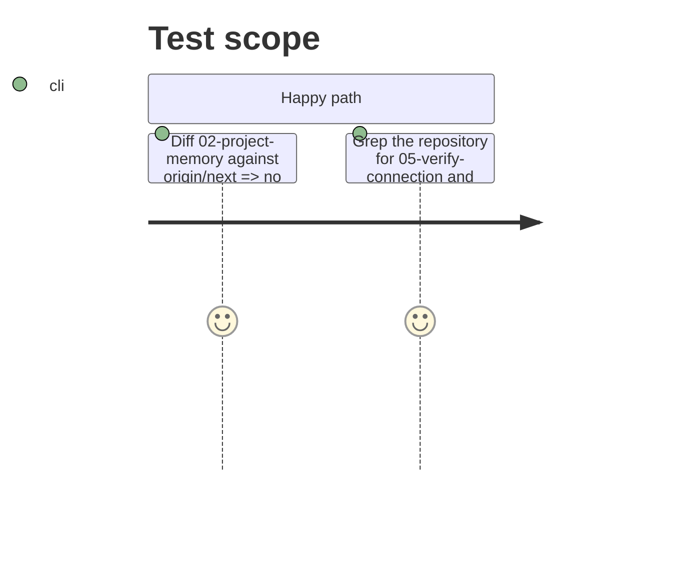

# Instruction: Restore `02-project-memory` to memory only

## Architecture projection

> Tree of the final files. ✅ create · ✏️ modify · ❌ delete

```txt
.
└── plugins/aidd-context/skills/02-project-memory/
    ├── SKILL.md                              ✏️ back to origin/next
    ├── actions/
    │   └── 05-verify-connection.md           ❌ moved to 13-access-check
    └── assets/
        └── connection-report.md              ❌ moved to 13-access-check
```

## User Journey



## Test Scope



## Tasks to do

### `1)` Revert the skill

> The memory skill does one thing again.

1. Restore `02-project-memory/SKILL.md` from `origin/next`.
2. Delete `actions/05-verify-connection.md` and `assets/connection-report.md`.
3. Replace every remaining reference to them (recipe, task docs) with `/aidd-context:13-access-check`; the recipe ones land in phase 3.

## Test acceptance criteria

| Task | Acceptance criteria                                                                    |
| ---- | -------------------------------------------------------------------------------------- |
| 1    | `02-project-memory/` is identical to `origin/next`                                     |
| 1    | the argument hint is `setup \| refresh \| rewire` and the description names no verification |
| 1    | no file in the repository names `05-verify-connection` or `connection-report.md`       |
