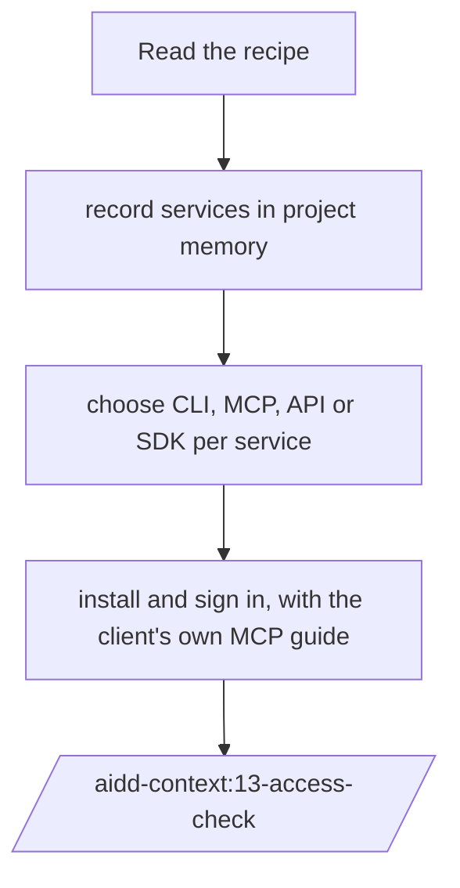
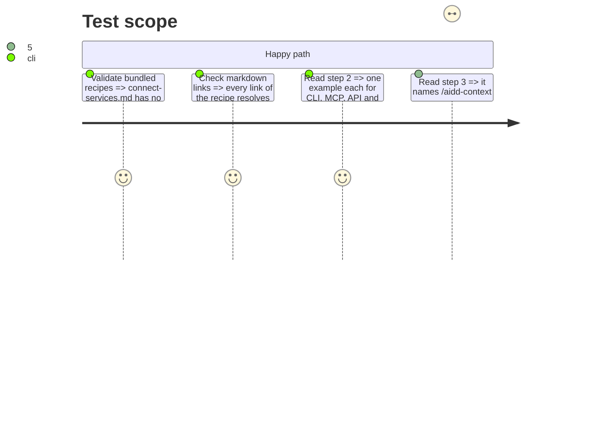

# Instruction: Apply the review to `connect-services.md`

## Architecture projection

> Tree of the final files. ✅ create · ✏️ modify · ❌ delete

```txt
.
└── plugins/aidd-context/skills/12-cook/assets/recipes/
    └── connect-services.md                   ✏️ intro, step 2 examples, step 3 target
```

## User Journey



## Test Scope



## Tasks to do

### `1)` Intro

> The reader records services in memory before connecting them (review #7).

1. Add one line: project memory records which services the team uses, in `ecosystem.md`, built by `/aidd-context:02-project-memory`.

### `2)` Step 2 examples

> Four options announced, four shown, none contradicting CLI-first (review #3, #5, #6).

1. Replace the GitHub API example with an internal team API: one `curl --fail` GET, token read from an environment variable, never pasted.
2. Add an SDK example called from application code (the `App` actor), one official client, a few lines.
3. One sentence: when a service has neither CLI nor MCP, run `/aidd-context:04-skill-generate` starting from its API.

### `3)` Client coverage

> Each client finds its own MCP setup without five copies of the same config (review #4).

1. Keep the Claude Code `/mcp` example.
2. Add a table linking the official MCP setup page of Claude Code, Codex, Cursor, GitHub Copilot and OpenCode; fetch each URL before writing it.

### `4)` Step 3

> Verification is one skill call.

1. Replace the two links to `02-project-memory` files and the raw prompt with `/aidd-context:13-access-check`, by slash command, the way `start-a-project.md` names skills.

## Test acceptance criteria

| Task | Acceptance criteria                                                                         |
| ---- | ------------------------------------------------------------------------------------------- |
| 1    | the intro names `ecosystem.md` and `/aidd-context:02-project-memory`                        |
| 2    | no API or SDK example targets a service whose CLI the recipe already lists                  |
| 2    | no example prints or embeds a token value                                                    |
| 3    | the client table has five rows, each URL answering 200 on the day it was written            |
| 4    | step 3 contains `/aidd-context:13-access-check` and no link into `02-project-memory/`       |
