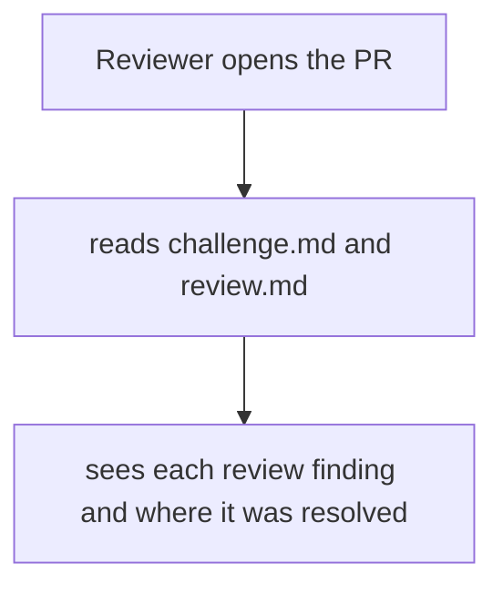
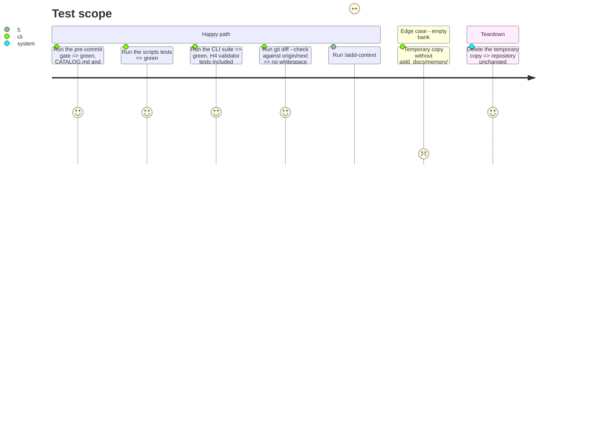

# Instruction: Record the change and prove it end to end

## Architecture projection

> Tree of the final files. ✅ create · ✏️ modify · ❌ delete

```txt
.
└── aidd_docs/tasks/2026_10/2026_10_14_connect-services/
    ├── challenge.md                          ✏️ verdict on the new scope
    └── review.md                             ✏️ phase 2 is the new skill, not a 02-project-memory action
```

## User Journey



## Test Scope



## Tasks to do

### `1)` Task records

> The PR explains itself.

1. `challenge.md`: scope, verdict and evidence for the extracted skill.
2. `review.md`: replace the 02-project-memory phase with the new skill; map each review finding (#1 to #11) to its resolution.

### `2)` Gates

> Every assertion green.

1. `pnpm exec lefthook run pre-commit`.
2. `node --test 'scripts/__tests__/*.test.js'`.
3. `cd cli && pnpm test`.
4. `git diff --check origin/next`.

### `3)` Live run

> The skill does what its `## Test` claims.

1. Run the skill on this repository and keep the printed report.
2. Run it on a temporary copy without memory and keep the stop message.

## Test acceptance criteria

| Task | Acceptance criteria                                                                 |
| ---- | ----------------------------------------------------------------------------------- |
| 1    | each of the eleven review findings appears in `review.md` with its resolution       |
| 2    | every gate exits 0                                                                  |
| 3    | the live report has one row per Agent edge of `aidd_docs/memory/ecosystem.md`       |
| 3    | the empty-bank run proposes `/aidd-context:02-project-memory` and writes nothing    |
