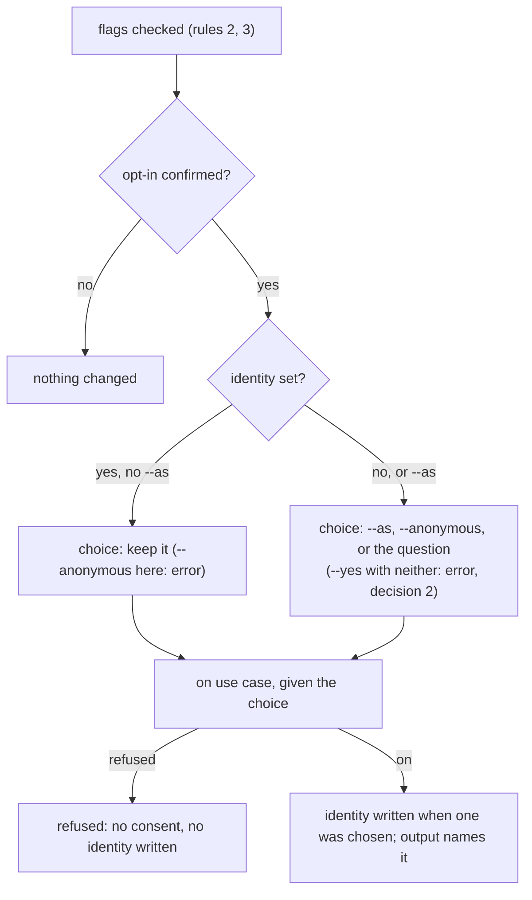

# Who is measured is chosen at opt-in

## Need

`aidd telemetry report --axis person` names a person only when they ran `aidd telemetry identity <id>`, a command almost nobody finds (#1029). Otherwise the row reads `not set`, and nothing says under which name a machine is measured. The person axis matters once a team's figures are gathered (#662), so each person must have chosen how they appear before that.

## Decisions (agreed with the user)

| # | Decision | Why |
| --- | --- | --- |
| 1 | With no identity, the text report labels the person row `anonymous`. The envelope is unchanged: kind `absent`, `key: null`. | Version 1 keeps its meaning, a real identity named `anonymous` cannot be confused with none, and `--absent person` (#1030) still selects it. |
| 2 | A non-interactive `on --yes` with no identity set and neither `--as` nor `--anonymous` is an error, exit 1, before anything is written. | Same rule as `--yes` today: nothing implicit. |
| 3 | Choosing to stay anonymous is not stored. The next `on`, in any clone, asks again while no identity is set. | `on` runs once per clone; the identity store keeps its one-field format. |

## Surface

| Command | Behaviour |
| --- | --- |
| `aidd telemetry on` (interactive), no identity set | After the opt-in is confirmed, one question: name me as the proposal, as another identifier (then typed), or stay anonymous. With no proposal, the first choice is not offered. |
| `aidd telemetry on`, identity set | No question. The output says under which name the clone is measured. |
| `aidd telemetry on --as <id>` | Sets `<id>` as the identity, replacing one already set; the output names the previous one when it changes. |
| `aidd telemetry on --anonymous` | Sets nothing. With an identity already set, it is an error, exit 1, pointing to `aidd telemetry identity --off`. |
| `aidd telemetry status` | Says under which name this machine is measured, or `anonymous` and how to be named. |
| `aidd telemetry report` | Text: the person row with no identity reads `anonymous`. JSON unchanged. |

## Rules

| # | Rule |
| --- | --- |
| 1 | The proposal is the git `user.name` of the directory the command runs in, else its `user.email`, as git resolves them (local, then global). Read through a port. It is shown, never stored without the person choosing it. |
| 2 | A proposal or a typed identifier goes through `personIdOf` (trimmed, one line, 1 to 128 characters). A proposal it rejects is not offered. A rejected `--as` is an error before anything is written. |
| 3 | `--as` and `--anonymous` together: error, exit 1. Either with `--yes` or interactive is accepted. |
| 4 | The identity is written only when `on` succeeds (status `on`). A refused `on` writes no identity. |
| 5 | `AIDD_TELEMETRY=0` does not refuse `on`, as before this change. Under it, the git name is neither read nor proposed: the question offers only another identifier or anonymous. |
| 6 | `identity`, `identity <id>` and `identity --off` behave as before; their wording says `anonymous` for nobody, as the report does (decision 1). |

The question comes after the opt-in is confirmed and before the use case writes anything, so a refusal leaves both consent and identity untouched: the choice is passed to the use case, which writes the identity only on success.

## Unchanged

The identity store format, `identity.json` and where it lives; the envelope; consent; what is measured. The identity never leaves the machine.

## Docs

Usage contract (person axis, opt-in), `cli/aidd_docs/memory/telemetry.md`, `plugins/aidd-telemetry/README.md`, and the `00-init` skill's `start` action: it asks the person to type an identifier or stay anonymous, reads nothing from git so no name reaches the session before the person chooses, says that `aidd telemetry on` in a terminal offers the git name, and runs `aidd telemetry on --yes --as '<id>'` or `--anonymous`.

## Acceptance

| # | Criterion | Proof |
| --- | --- | --- |
| 1 | Every row of the Surface and Rules tables has a test, written first and seen failing | tests, red run in `evidence.md` |
| 2 | A refused `on` writes neither consent nor identity, whatever the flags | use-case test |
| 3 | No identity is ever written without `--as`, a typed id, or the proposal chosen | test per path, plus a mutation on the write guard |
| 4 | The envelope is byte-identical to before for every axis | existing envelope tests unchanged |
| 5 | Telemetry mutation at 96 or above, every mutant on a changed line killed or explained | stryker |
| 6 | `pnpm smoke`, `scripts/check-claude-tokens-end-to-end.cjs` both modes pass | `evidence.md` |
| 7 | Docs and the `00-init` skill say what `on` asks and how to answer it non-interactively | grep, plus a fresh checker |
