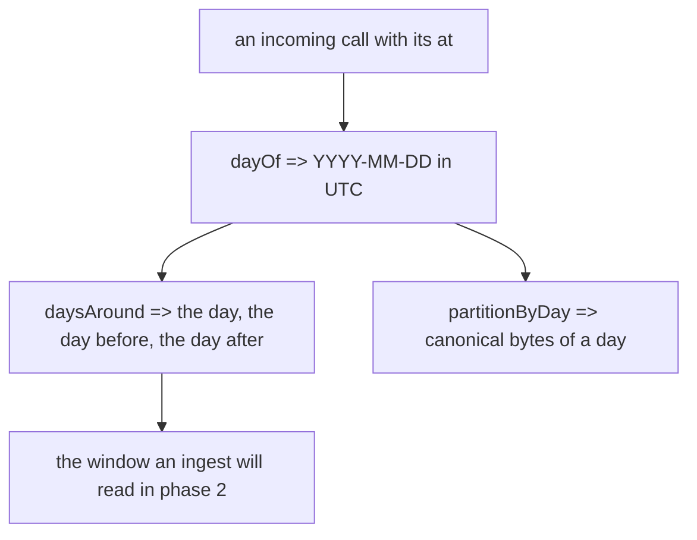
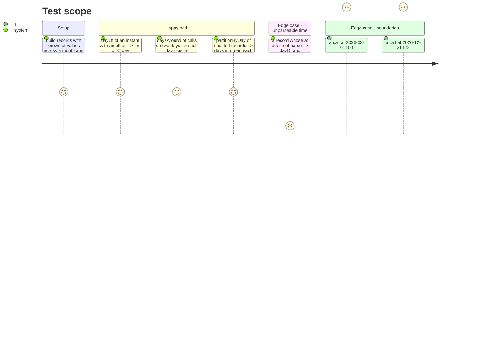

<!-- Fill or omit these sections; never add, rename, or reorder one. -->

# Instruction: A record belongs to a day, an ingest to a window

## Architecture projection

> Tree of the final files. ✅ create · ✏️ modify · ❌ delete

```txt
cli/
├── src/contexts/telemetry/domain/
│   └── stored-usage.ts                      ✏️ add dayOf, partitionByDay, daysAround (monthOf, partitionByMonth stay until phase 2)
└── tests/contexts/telemetry/domain/
    └── stored-usage.unit.test.ts            ✏️ day, partition-by-day and window cases, written first
```

## User Journey



## Test Scope



## Tasks to do

### `1)` Measure "before"

> Record the baseline criterion 1 is judged against, on unchanged code.

1. From the repository root, run the bench as it stands (command in `phase-5.md`, task 1) and keep its per-step timings (`load() total`, `upsert one`, `save(month)`) for the phase 5 comparison. The contract's table (~11.5 s) is the reference if the run differs by machine.

### `2)` Tests first

> Each new test fails because the function does not exist or returns the month.

1. In `stored-usage.unit.test.ts`, a `describe("a record belongs to the day of its own time, in UTC")`: reads the day from the instant; uses UTC at the day boundary whatever the offset (`2026-10-07T23:30:00-02:00` => `2026-10-08`); pads month and day; `null` for a time that is not one. Must fail with "dayOf is not exported".
2. A `describe("an ingest reads its calls' days and the day on each side")` for `daysAround(records)`: one call => three days; two calls on adjacent days => four days, no duplicate; month boundary (`2026-03-01` => `2026-02-28`) and year boundary (`2026-12-31` => `2027-01-01`); an unparseable `at` contributes nothing; empty input => empty set. Must fail with "daysAround is not exported".
3. A `describe("a partition is the day's records in a fixed order")` mirroring the month block (lines ~120-176): groups by day and orders by time then key; lists days in order whatever the input order; two records of one instant ordered by key; a record with no usable time in no partition; the linear-copy case kept. Must fail with "partitionByDay is not exported".
4. Run `pnpm vitest run tests/contexts/telemetry/domain/stored-usage.unit.test.ts` and see exactly those failures.

### `3)` Implement

> Pure transforms, beside the month ones they will replace.

1. `dayOf(at)`: `YYYY-MM-DD` of `Date.parse(at)` in UTC, `null` when it does not parse. Doc comment says why UTC (partition independent of the machine's zone).
2. `partitionByDay(records)`: same algorithm as `partitionByMonth` (parse once, sort by instant then `tool\0key` with `compareText`, push by key, keys sorted), keyed by `dayOf`.
3. `daysAround(records)`: for each record with a day, add the day and its UTC neighbours (`Date.parse(day + "T00:00:00.000Z") ± 86_400_000`, sliced back to a day). Doc comment cites the contract's evidence: a call's snapshots are minutes apart, so a neighbour day holds any earlier one.
4. Re-run the file: green. `pnpm typecheck` green (old functions still used, nothing removed yet).

## Test acceptance criteria

<!-- Each criterion is an observable behavior, not a command. -->

| Task | Acceptance criteria              |
| ---- | -------------------------------- |
| 1    | A "before" timing for one call into a 265k-call month is recorded, for contract #1 |
| 2    | Each new test was seen failing for the missing export, before any implementation (contract #6) |
| 3    | A call's day is its UTC day; a window holds each call's day and both neighbours across month and year boundaries; a day's records come out in time then key order whatever the input order (contract Format) |
