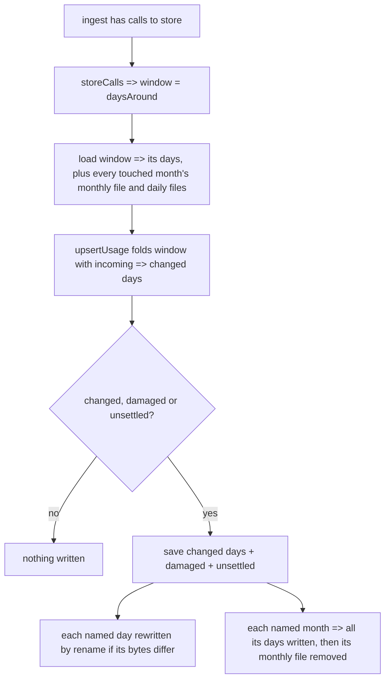
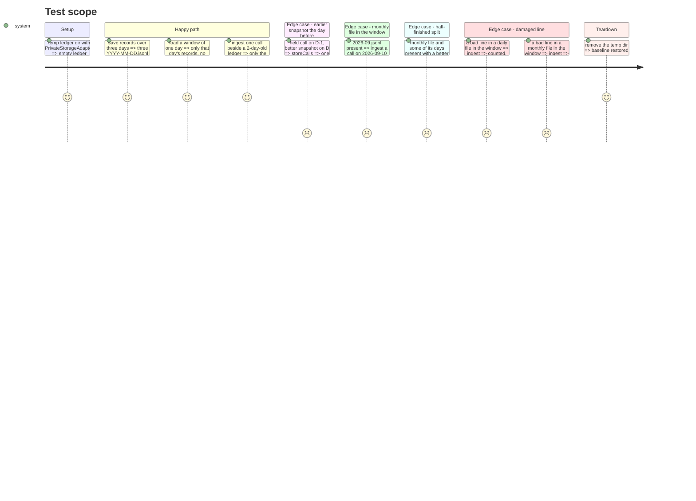

<!-- Fill or omit these sections; never add, rename, or reorder one. -->

# Instruction: The ledger on disk, by day, read by window

## Architecture projection

> Tree of the final files. ✅ create · ✏️ modify · ❌ delete

```txt
cli/
├── src/contexts/telemetry/
│   ├── domain/
│   │   ├── stored-usage.ts                          ✏️ upsertUsage returns days; monthOf and partitionByMonth removed
│   │   └── ports/usage-ledger.ts                    ✏️ load(days?), save(records, partitions?), LoadedLedger.damaged + unsettled
│   ├── infrastructure/usage-ledger-adapter.ts       ✏️ daily files, windowed read, monthly split and retirement
│   └── application/
│       ├── ledger-upkeep.ts                         ✅ storeCalls(ledger, incoming)
│       └── ingest-usage-use-case.ts                 ✏️ calls storeCalls; undated check uses dayOf
└── tests/
    ├── helpers/ports/in-memory-telemetry.ts         ✏️ InMemoryLedger follows the new port
    └── contexts/telemetry/
        ├── domain/stored-usage.unit.test.ts         ✏️ month cases removed, upsert names days
        ├── infrastructure/usage-ledger-adapter.integration.test.ts  ✏️ day format, window, migration, damage
        └── application/ingest-usage-use-case.unit.test.ts           ✏️ window and saved partitions
```

## User Journey



## Test Scope



## Tasks to do

### `1)` Tests first, adapter

> Rewrite `usage-ledger-adapter.integration.test.ts` around days and windows; every new case fails on the monthly adapter.

1. Turn every month case into its day twin (`files each record under the day of its own time, in UTC`, `rewrites only the days it is told changed, and reads no other partition`, `removes a told day that no longer holds anything`, `leaves one live record when a better snapshot moves a call to another day`, `reads only partition files, and leaves the offsets, roots, consents and lock beside them alone`, `names only the partitions that hold a line that is not a record`). Fails: files are named `YYYY-MM.jsonl`.
2. Window read: `load(new Set(["2026-10-07"]))` returns the records of that day only, and does not open another day (prove it as the existing "reads no other partition" case does: a neighbour file holding a bad line is neither counted nor rewritten). Fails: `load` takes no argument and reads everything.
3. Monthly read: a hand-written `2026-09.jsonl` (canonical month bytes built in the test, not with a removed helper) is read by `load()` and by `load(new Set(["2026-09-10"]))`; both list `2026-09` in `unsettled`. Fails: `unsettled` does not exist.
4. Month touched by the day before: `load(new Set(["2026-10-01", "2026-09-30"]))` with only `2026-09.jsonl` present reads it.
5. Split: `save(records, new Set(["2026-09"]))` writes each September day that has records, removes `2026-09.jsonl`, and the bytes equal those of `save(records)` into an empty dir. Removal happens after the days: with a `PrivateStorage` whose `replace` throws on the n-th call, the monthly file is still there.
6. Half-finished split: `2026-09.jsonl` plus `2026-09-10.jsonl` holding a better snapshot of a call the month also holds; `load(new Set(["2026-09-20"]))` returns the better snapshot and lists both partitions in `unsettled` (same call in two partitions); saving `unsettled` keeps it and removes the monthly file.
7. Duplicate across days: the same key in `2026-10-06.jsonl` and `2026-10-07.jsonl` => full `load()` lists both in `unsettled`, the folded record once.
8. Damage in both formats: a bad line in a daily and in a monthly file is skipped, counted in `skippedLines`, named in `damaged`, and gone once that partition is saved (for the monthly one, once its month is split).
9. Run the file: every new case red for the reason it names.

### `2)` Tests first, domain and use case

> The fold reports days; ingest reads its window and saves only what it must.

1. `stored-usage.unit.test.ts`: delete the month `describe` blocks (lines ~32-50 and ~120-176, now covered by phase 1's day twins); `names the days it changed: where a record is now, and where a replaced one was` replaces the month case (line ~53). Fails: `months` is returned, not `days`.
2. `ingest-usage-use-case.unit.test.ts` (lines ~320-353): `tells the ledger to load only its calls' days and the day on each side` (asserts the set `InMemoryLedger` was loaded with); `tells the ledger to rewrite only the day a new call falls in`; `also rewrites a damaged partition its window read, whatever the call that came`; `repairs damage in its window even when every call it read was already held`; `finishes a monthly partition its window read even when every call was already held`; `loads nothing when no call is to be stored` (kept behaviour). Fails: `load` called without a window, `savedMonths` holds months.
3. `InMemoryLedger` follows the port: `load(days?)` records `loadedDays` and returns the records whose `dayOf` is in the days (all without), `damaged` and `unsettled` are settable sets, `save` records `savedPartitions`.

### `3)` Implement

> Port first, then domain, adapter, use case; the doc comments state the rules, not the history.

1. `ports/usage-ledger.ts`: `LoadedLedger { records; skippedLines; damaged; unsettled }` and `load(days?)`, `save(records, partitions?)`, each doc'd exactly as `plan.md` Decisions rows 3-5 state, keeping "the caller vouches that the rest is as it was".
2. `stored-usage.ts`: `upsertUsage` returns `days` (via `dayOf`) instead of `months`; remove `monthOf` and `partitionByMonth` (knip would flag them).
3. `usage-ledger-adapter.ts`: `DAILY` and `MONTHLY` regexes; one `readdir` per call; `load(days?)` per Decision row 3, collecting `damaged` and `unsettled` (a `Map<tool\0key, partition>` filled while parsing; a second partition for the same key adds both); `save` per Decision row 5, writing with `storage.replace` only when the bytes differ, removing an emptied day, and removing each named monthly file after all its days; class doc rewritten for days and the window (drop "rewrite stays cheap": the window is why).
4. `application/ledger-upkeep.ts`: `storeCalls(ledger, incoming)` => `{ added, updated, skippedLines }`: `load(daysAround(incoming))`, `upsertUsage`, and `save(merged.records, days ∪ damaged ∪ unsettled)` when `added + updated > 0` or `damaged` or `unsettled` is not empty. Runs under the caller's lock.
5. `ingest-usage-use-case.ts`: lines ~116-130 become one `storeCalls` call; `outcomeOf` checks `dayOf(record.at) === null` and its comment says "no day to be kept in".
6. Re-run the three test files: green. `pnpm typecheck`, `pnpm lint` green.

## Test acceptance criteria

<!-- Each criterion is an observable behavior, not a command. -->

| Task | Acceptance criteria              |
| ---- | -------------------------------- |
| 1    | Every adapter case was seen red on the monthly adapter before the change (contract #6) |
| 1, 3 | A saved ledger is one `YYYY-MM-DD.jsonl` per UTC day, canonical order, one call per line; an unchanged day keeps its inode (contract Format) |
| 2, 3 | Ingest reads only its calls' days, the day on each side and any monthly file those days fall in, and writes only changed, damaged or unsettled partitions: its work does not depend on how many other days the ledger holds (contract Ingest, #1) |
| 1, 3 | A monthly file touched by a window is split into its days, then removed; after a crash between the two, the next ingest keeps the better snapshot of each call and finishes the split (contract Migration, #3) |
| 1, 3 | A line that is not a record is skipped, counted and dropped when its daily or monthly partition is rewritten (contract Damage) |
| 2    | `added` and `updated` count the calls new or replaced within the window, as before (contract Unchanged) |
