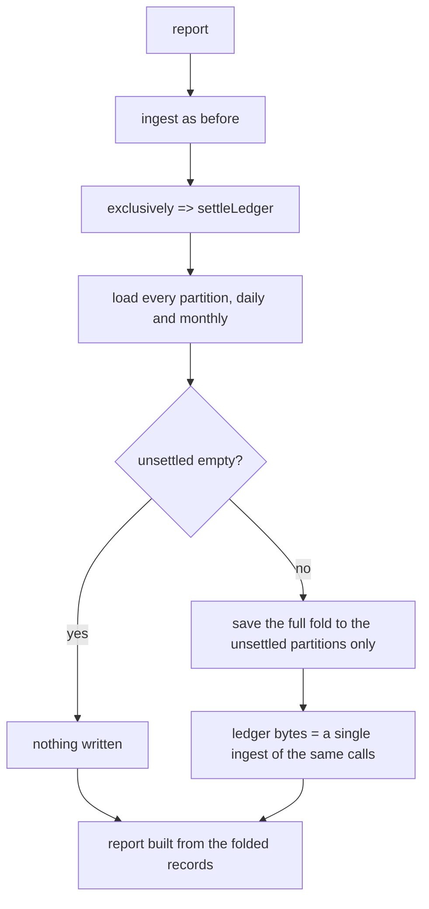
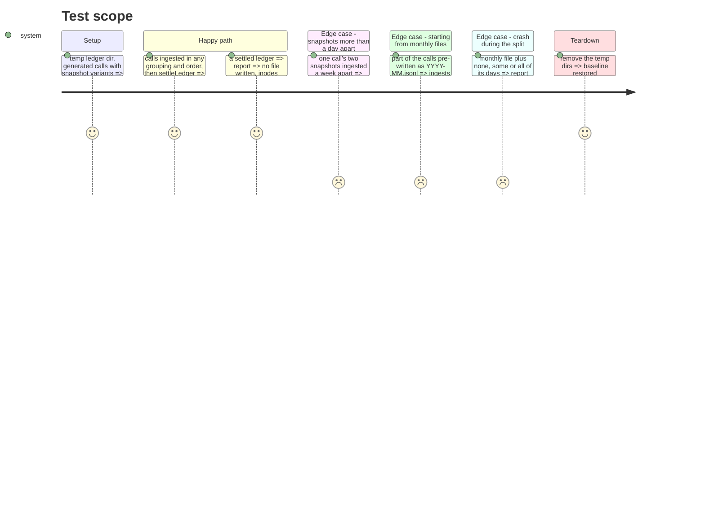

<!-- Fill or omit these sections; never add, rename, or reorder one. -->

# Instruction: Report settles the ledger, proven by property

## Architecture projection

> Tree of the final files. ✅ create · ✏️ modify · ❌ delete

```txt
cli/
├── src/contexts/telemetry/application/
│   ├── ledger-upkeep.ts                                   ✏️ add settleLedger(ledger)
│   └── report/report-usage-use-case.ts                    ✏️ exclusively(() => settleLedger(ledger))
└── tests/contexts/telemetry/application/
    ├── ledger-upkeep.property.integration.test.ts         ✅ fast-check, byte identity (contract #2)
    ├── ledger-upkeep.integration.test.ts                  ✅ migration and crash states, totals unchanged (contract #3)
    └── report/report-usage-use-case.unit.test.ts          ✏️ settles under the lock, writes nothing when settled
```

## User Journey



## Test Scope



## Tasks to do

### `1)` Tests first

> Each test fails because `settleLedger` does not exist or the report never writes.

1. `report-usage-use-case.unit.test.ts`: `settles a call held in two partitions under the ledger lock` (with `InMemoryLedger.unsettled` set: events are `lock, load, save, unlock` and `savedPartitions` equals the unsettled set); `writes nothing when the ledger is settled`; `repairs a damaged partition outside any ingest window` (plan Decisions last row: savedPartitions holds the damaged one, and the next load reports 0 skipped lines). Fails: the report only loads.
2. `ledger-upkeep.property.integration.test.ts` (fast-check, `UsageLedgerAdapter` + `PrivateStorageAdapter` on a temp dir per run): generate a small key pool (so keys collide) and per key 1-3 snapshots with different counters; `at` within minutes of each other, plus a rarer variant days apart (the case the contract never observed); dates in years 2025-2027 spanning month and year ends (4-digit years only: `toISOString` writes `+275760-...` past 9999, which no partition regex reads, an existing limit out of scope). Partition the calls into 1-5 batches in any order, optionally pre-write a random subset as canonical monthly files (built in the test from `JSON.stringify` grouped by `at.slice(0, 7)` after `foldUsage`). Run `storeCalls` per batch, then `settleLedger`. Assert the sorted file names and every file's bytes equal those of `storeCalls(allCalls)` into an empty dir followed by `settleLedger`. No damaged lines generated. Fails: `settleLedger` is not exported.
3. `ledger-upkeep.integration.test.ts`: a ledger of calls over September and October as monthly files; for each disk state of a split (monthly only; monthly plus some of its days; monthly plus all of its days; days only), the report totals, from `buildReport` over `load().records` on the `total` axis with no declarations, equal the totals before any migration; then `settleLedger` (and, separately, one `storeCalls` whose window touches the month) leaves the days-only bytes. Fails on `settleLedger`.
4. Run the three files and see each failure.

### `2)` Implement

> One function, one call site.

1. `ledger-upkeep.ts`: `settleLedger(ledger)` => the `LoadedLedger`: `load()`, then `save(held.records, held.unsettled)` when `unsettled` is not empty. Doc comment: after it, the ledger is byte-identical to a single ingest of the same calls; it rewrites only the partitions involved; runs under the caller's lock.
2. `report-usage-use-case.ts` line ~59: `this.ledger.exclusively(() => settleLedger(this.ledger))`. Class doc gains one sentence: the report also leaves the ledger settled.
3. Re-run: green. If the property finds a counterexample, fix the code, never narrow the generator past the contract.

## Test acceptance criteria

<!-- Each criterion is an observable behavior, not a command. -->

| Task | Acceptance criteria              |
| ---- | -------------------------------- |
| 1    | The three files were seen red before `settleLedger` existed (contract #6) |
| 1, 2 | One set of calls gives byte-identical partitions whatever the order and grouping of its ingests, from monthly files or not, once a report has run (contract #2) |
| 1, 2 | No report total changes across the migration or a crash at any point of it, and the next ingest or report finishes the split (contract #3, Migration) |
| 1, 2 | A report rewrites only partitions holding a call another one holds, or monthly ones, under the ledger lock, and writes nothing on a settled ledger (contract Report) |
