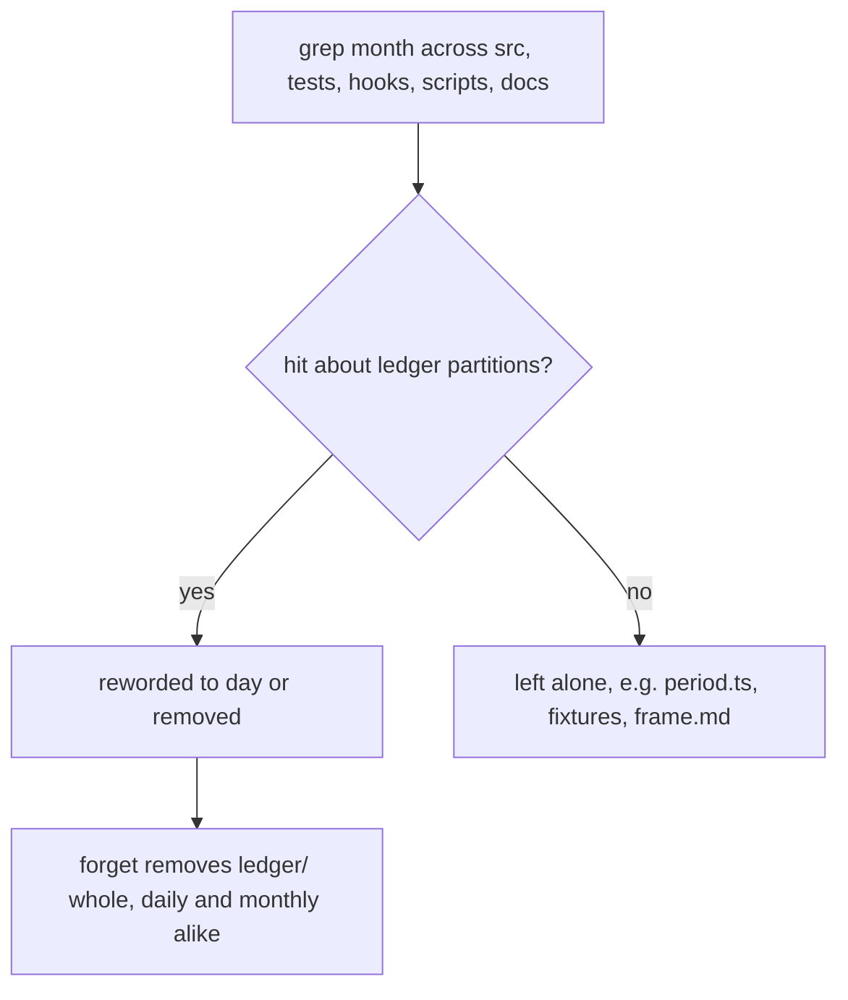
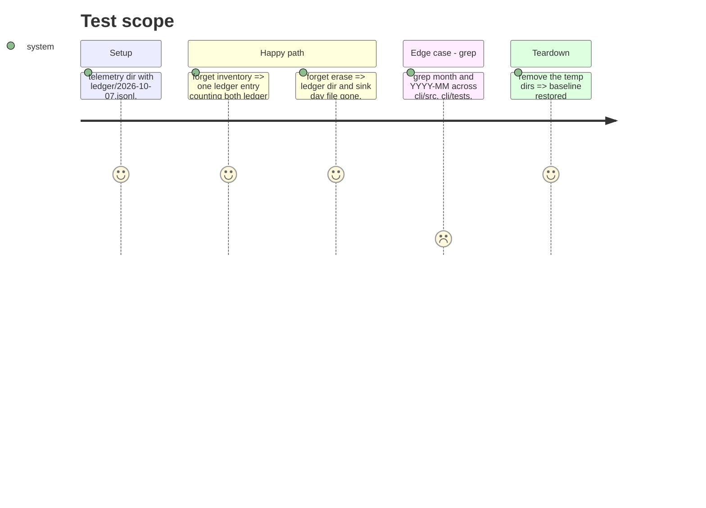

<!-- Fill or omit these sections; never add, rename, or reorder one. -->

# Instruction: Every reader and every page says "day"

## Architecture projection

> Tree of the final files. ✅ create · ✏️ modify · ❌ delete

```txt
.
├── aidd_docs/product/usage-contract.md                                  ✏️ Stores row for ledger/<YYYY-MM-DD>.jsonl and the monthly migration
├── cli/
│   ├── aidd_docs/memory/telemetry.md                                    ✏️ "Where to look" row for the ledger's layout and the ingest window
│   ├── src/contexts/telemetry/domain/legacy/legacy-locations.ts         ✏️ DAY_FILE doc no longer claims the ledger never uses the name
│   └── tests/contexts/telemetry/
│       ├── domain/legacy/legacy-locations.unit.test.ts                  ✏️ "is a date, not a ledger month" renamed
│       └── infrastructure/forget/measurement-erasure-adapter.integration.test.ts  ✏️ ledger daily and monthly files go as the ledger
└── plugins/aidd-telemetry/skills/01-usage/actions/frame.md              (no change: grep finds no partition wording)
```

## User Journey



## Test Scope



## Tasks to do

### `1)` Forget, both formats

> `forget` needs no code: `MeasurementErasureAdapter` removes `ledger/` recursively, and `DAY_FILE` only scans the legacy sink directories, never `ledger/`.

1. In `measurement-erasure-adapter.integration.test.ts`, add `removes the ledger's daily and monthly partitions as the ledger, never as an earlier day file`: inventory has one `ledger` entry with `files` counting both, no `previous-day-file` for them; `erase` leaves no `ledger/`. This test pins existing behaviour, so it cannot be seen red on today's code; prove it bites by the mutation of pointing the `DAY_FILE` scan at `ledger/` too, and watch this test (not another) fail. Note the residual risk in the PR: a person setting `AIDD_TELEMETRY_DIR` to the `ledger/` directory itself would see ledger days listed as earlier day files.

### `2)` Wording, from the grep

> Contract #5: every reader updated, and the contract and code map say "day".

1. Grep evidence (re-run before editing): `grep -rnIiE "YYYY-MM[^-]|<month>|by month|monthOf|partitionByMonth|damagedMonths|savedMonths" . --exclude-dir={node_modules,.git,fixtures,dist}` and `grep -rnE 'ledger|\\d\{4\}' plugins/aidd-telemetry/hooks scripts`. At planning time the only non-history hits were the files of phases 1-3 plus `aidd_docs/product/usage-contract.md:114`; hooks and scripts read no partition (`catch-up.cjs` only calls the CLI); `frame.md` and `cli/src/presentation` mention no month partition, so no help golden changes.
2. `usage-contract.md` Stores table, line ~114: `ledger/<YYYY-MM-DD>.jsonl` | `ingest`, `report` | `report`, `forget` | `StoredUsage` by UTC day of `at`, in time then key order, one call per line. Ingest reads its calls' days and the day on each side, and rewrites only a changed day, whole, by rename; `report` rewrites the partitions that share a call. A monthly `<YYYY-MM>.jsonl` from an earlier version is still read, split into its days by the first ingest whose window touches it or by a report, then removed.
3. `cli/aidd_docs/memory/telemetry.md` "Where to look": add `How the ledger lies on disk, and what an ingest reads` => `infrastructure/usage-ledger-adapter.ts`, `domain/stored-usage.ts`, `application/ledger-upkeep.ts`.
4. `legacy-locations.ts` `DAY_FILE` doc: "A day file's name in the directories the previous version wrote to. The ledger names its days the same way, inside `ledger/`, which is never one of them." Rename its test to `is a date, not a month`.
5. Re-run the grep: every remaining hit is history (`aidd_docs/tasks/`), the migration reader (`MONTHLY` in the adapter and its tests), or a fixture.

## Test acceptance criteria

<!-- Each criterion is an observable behavior, not a command. -->

| Task | Acceptance criteria              |
| ---- | -------------------------------- |
| 1    | `forget` removes daily and monthly ledger partitions alike, as the ledger, with `offsets.json` in the same format as today (contract forget) |
| 1    | The forget guard fails under its named mutation (contract #6) |
| 2    | No reader, page or code map names a ledger partition by month, except the monthly reader kept for migration (contract #5) |
