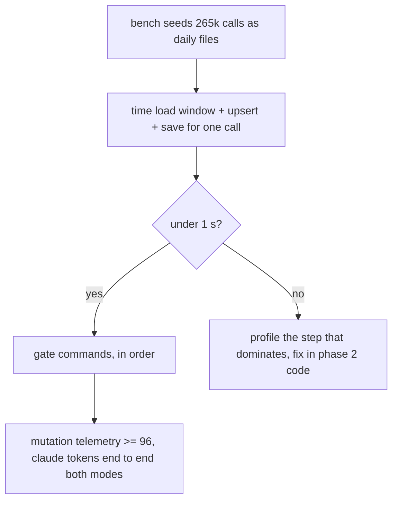
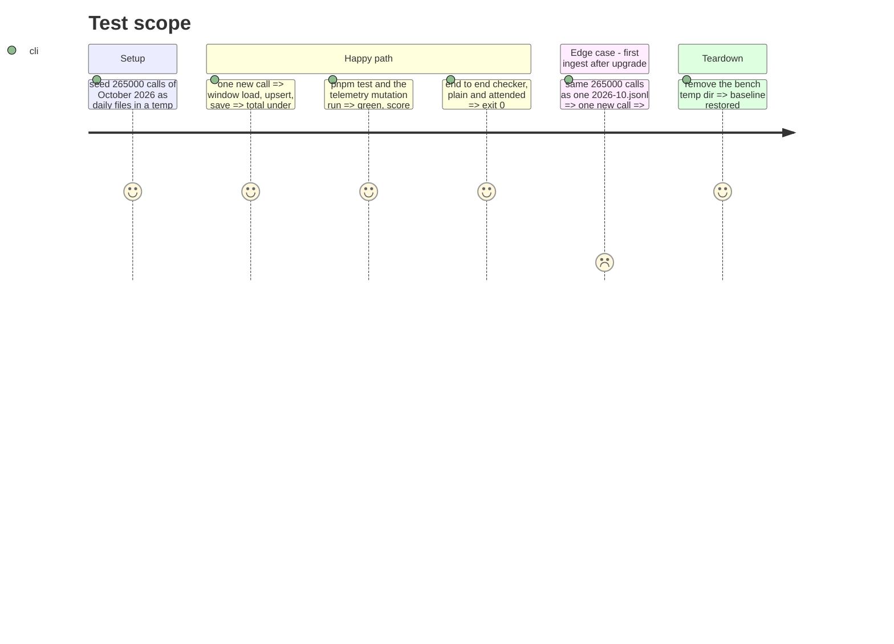

<!-- Fill or omit these sections; never add, rename, or reorder one. -->

# Instruction: Bench and the full gate

## Architecture projection

> Tree of the final files. ✅ create · ✏️ modify · ❌ delete

```txt
.
└── (no repository file; the bench lives in the session scratchpad and is not committed)
```

## User Journey



## Test Scope



## Tasks to do

### `1)` Bench (contract #1)

> Same machine, same stub storage, same record shape as the "before" run of phase 1.

1. Adapt `bench.ts` in `<scratch>/bench/`: seed with `ledger.save(allRecords)` (daily files), then time `storeCalls(ledger, [fresh])` and, separately, its three steps (`load(daysAround([fresh]))`, `upsertUsage`, `save`). A second section seeds the old `2026-10.jsonl` and times the same one call, labelled "one-time split".
2. Build and run, from the repository root:
   `B='<scratch>/bench'; cli/node_modules/.pnpm/esbuild@0.27.3/node_modules/esbuild/bin/esbuild $B/bench.ts --bundle --platform=node --format=esm --outfile=$B/bench.mjs && node $B/bench.mjs 265000`
3. Report before (phase 1) and after side by side. A 3-day window at this density is ~29k records, roughly 0.8 s by linear scaling of the contract's table: if it lands over 1 s, find the dominating step (likely the compare-read in `save` or the full `foldUsage` sort) and fix it in the phase 2 code, not in the bench.

### `2)` Gate, in order

> `cli/aidd_docs/memory/coding-assertions.md`, then the repository's own hooks.

1. From `cli/`: `pnpm lint`, `pnpm test:arch` (folder size: `application/` at 10 direct files), `pnpm typecheck`.
2. From the repository root: `node scripts/check-cli-type-honesty.mjs`.
3. From `cli/`: `pnpm knip` (no leftover `monthOf`, `partitionByMonth`), `pnpm test`.
4. From `cli/`: `pnpm test:mutation:telemetry`; the score must be 96 or more (`break: 96` in `cli/mutation-scopes.json`). Survivors in `usage-ledger-adapter.ts`, `stored-usage.ts` or `ledger-upkeep.ts` get a test, written red first.
5. From `cli/`: `pnpm build` (the checker defaults to `cli/dist/cli.js`; a stale build tests old code). Then from the root: `node scripts/check-claude-tokens-end-to-end.cjs` and `node scripts/check-claude-tokens-end-to-end.cjs --attended`, both exit 0.
6. From the root: `pnpm exec lefthook run pre-commit`.
7. A fresh checker (`aidd-dev:checker`) reads the diff against `contract.md` rows 1-6.

## Test acceptance criteria

<!-- Each criterion is an observable behavior, not a command. -->

| Task | Acceptance criteria              |
| ---- | -------------------------------- |
| 1    | One call into a 265k-call month ingests in under 1 s, before and after shown from the same bench (contract #1) |
| 2    | The fold rule is unchanged: the existing suite passes and the end-to-end checker reports exactly what the fake API billed in both modes, every axis adding up to `totals` (contract #4) |
| 2    | Telemetry mutation score is 96 or more (contract #6) |
| 2    | A fresh checker finds no partition reader or page left on months (contract #5) |
