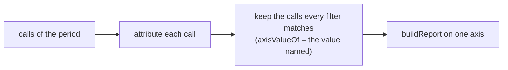

# The report answers about one task, ticket, person or more

## Need

`aidd telemetry report` splits every call of a period along one axis (#1030). It cannot answer "what did task `auth-refactor` cost, per day" or "what did this repository cost, per model": every question about one value of an axis is answered by reading one row of a split, and no question crosses two axes.

## Principle

**Every row a report prints can be selected, and the report it selects adds up to that row.**

A row is one `AxisValue` (`domain/report/usage-report.ts`): a `value`, `absent` (the axis has no value for the call), or `unattributed` with a `reason`. The filters use the same three kinds, and a call matches a filter when `axisValueOf` gives it exactly the value the filter names. A filter and a row therefore cannot disagree on what a call is: they are worked out by the same function.

Two axes have no flag. A `day` row is selected by the period, `--from D --to D`. The `total` row is the whole report. Every other axis has one.

## Surface

| Flag | Selects, on axis | Value |
| --- | --- | --- |
| `--task <name>` | `task` = value | a task name |
| `--ticket <ref>` | `ticket` = value | a ticket, as declared |
| `--person <id>` | `person` = value | the identity |
| `--model <id>` | `model` = value | a model id |
| `--agent <agent>` | `agent` = value | `main`, `subagent`, `advisor` |
| `--session <id>` | `session` = value | a session id, or a prefix of one |
| `--repository <id>` | `repository` = value | a repository id, a prefix of one, or `.` |
| `--absent <axis>` | that axis = `absent` | `person`, `model`, `ticket` |
| `--unattributed [reason]` | `task` and `ticket` = `unattributed` | `no-binding`, `declared-none`, or `any` (the default) |

`--absent` offers only the axes a call can have no value for: `model` is `null` when the tool does not say, `person` when no identity is set, `ticket` when a task was declared without one. `session`, `agent` and `repository` are never `null` in the ledger (`stored-usage.ts`, `usage-record.ts`), and `task` has no `absent`: work with no task is `unattributed`.

## Rules

| # | Rule | Why |
| --- | --- | --- |
| 1 | Flags combine with AND. Each flag takes one value; given twice, it is an error. | Commander keeps the last value silently. |
| 2 | **One selector per axis.** `--unattributed` selects on `task` and on `ticket`, so it cannot be combined with `--task`, `--ticket` or `--absent ticket`; a value and `--absent` of the same axis (`--model m --absent model`) cannot be combined either. Such a combination is an error, exit 1. | Two selectors on one axis select nothing, by construction. |
| 3 | A value is trimmed as a declaration is (`textOrNull`, `task-declaration.ts`). A value empty once trimmed is an error. | What is typed is compared with what was stored, and what was stored was trimmed. |
| 4 | A value is compared exactly, case included. | Task names and tickets are kept as typed. |
| 5 | `--session` and `--repository` take a full value or a prefix, looked up among the values of that axis in the calls of the period. A value equal to the one typed wins. Otherwise a prefix names the one value that starts with it. Two or more: error, exit 1, listing them in full, sorted. None: the report is empty, and `filters` prints the value as typed. | The text report shows 8 characters of each; that is what a person copies. |
| 6 | `--repository .` names the repository of the directory the command runs in, by the rule ingest uses (`RepositoryLocator.locate`, then `repositoryIdOf`). Not a repository, gone, unreadable, or with neither a hosted `origin` nor a commit: error, exit 1. It is resolved after the refusal and before ingest (rule 9). | A repository is named by its hosted address else its first commit; a worktree and another clone of the same `origin` name the same repository. |
| 7 | A value outside a closed set is an error (`--agent`, `--absent`, `--unattributed`, by Commander's `choices`). A value of an open set that no call has gives an empty report, exit 0. | A value that cannot exist is a mistake; one that does not exist this period is an answer. |
| 8 | Filters apply after attribution and after the period. The ledger window of #1032 is unchanged. | Attribution is per call, so a filter changes no call's task or ticket. |
| 9 | Order: the flags are checked (rules 1, 2, 3, 7), then `AIDD_TELEMETRY=0` refuses, then `.` is resolved, then transcripts are ingested and the ledger read, then prefixes are resolved. Under `AIDD_TELEMETRY=0` the envelope stays `{"version": 1, "refused": "AIDD_TELEMETRY=0"}`, with no `filters`, and git is not run. | Refusal means nothing is read, a repository included. |

## Output

**Envelope**, still `version: 1`. One field is added, `filters`, always present, its keys in this order: `task`, `ticket`, `person`, `model`, `agent`, `session`, `repository`, `absent`, `unattributed`. Each is `null` when the flag is not given, else the value **as resolved**: the full id for a prefix or `.` (the prefix as typed when it matches nothing), the axis for `absent`, the reason or `any` for `unattributed`. Every value it prints can be typed back.

| Field | With filters |
| --- | --- |
| `rows`, `totals`, `unknown_records` | the calls of the period that match |
| `coverage.records` | unchanged: the calls of the period, matching or not |

**Text.** When a filter is given, one line before the table names each, as its row would label it. When no call matches, the text says so, and the exit code is 0.

## Unchanged

The period, the ledger window and settle of #1032, attribution, every axis, the row order, and every envelope field already printed. A report with no filter prints what it prints today, plus `filters` with every key `null`.

## Limits, written in the usage contract

- A task name belongs to no repository: `--task refactor` adds up every repository's `refactor`, as `--axis task` does. Add `--repository .` for one.
- The text report folds whitespace in a name onto one line. A filter compares with the stored value, which `--json` prints as `key`.
- `--repository .` names the repository as it stands now. Calls stored under an earlier `origin`, or before a remote was added, carry another id and are not selected; `--axis repository` lists them.
- `--person` is the identity of the machine reporting, as `--axis person` is: locally it selects every call or none (#1029).

## Acceptance

| # | Criterion | Proof |
| --- | --- | --- |
| 1 | For any ledger, period, axis and row of that report, the report filtered to that row (a `day` row by its period, the `total` row by no filter) has `totals` equal to that row, and every axis of it adds up to its `totals` | fast-check property on the use case |
| 2 | Filters commute and combine with AND: the calls kept are those every filter alone keeps | fast-check property |
| 3 | A bounded and filtered report equals the unbounded report with the same filters, restricted to the period. Prefixes are resolved against the period's calls on both sides | extends the #1032 property |
| 4 | Every error of rules 1, 2, 3, 5, 6 and 7 exits 1 with a message naming the flag; those of rules 1, 2, 3, 6 and 7 before any transcript or ledger is read | command and use-case tests |
| 5 | `.` resolves, in a linked worktree and in the main tree, to the id ingest stored for that repository | integration test on a real git repository |
| 6 | No filter: the envelope equals today's, plus `filters` with every key `null` | test |
| 7 | Tests are written first, and their red run is recorded | `evidence.md` |
| 8 | Telemetry mutation stays at 96 or above, and every mutant on a changed line is killed or explained | stryker |
| 9 | Usage contract, `cli/aidd_docs/memory/telemetry.md` and the `01-usage` skill (`frame`, `envelope.md`) say what a filter selects | grep, plus a fresh checker |
| 10 | `pnpm smoke` and `scripts/check-claude-tokens-end-to-end.cjs`, both modes, pass; the end-to-end also runs one filtered report | output in `evidence.md` |
