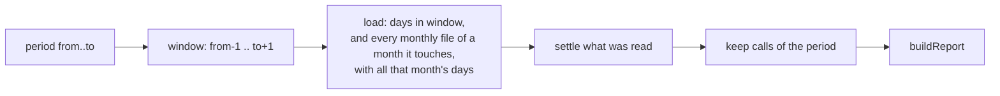

# A report reads its period

## Need

`aidd telemetry report` reads, folds and settles the whole ledger, then keeps the calls of its period (`report-usage-use-case.ts`). A report on the last 7 days pays for every day ever measured, and that cost grows with the history.

Follow-up of #1001, whose contract left report cost out of scope.

## Measured breakdown, unbounded report

Synthetic ledger of 265,000 calls over 28 days, already by day, `next` at `fcb6022b`, two runs:

| Stage | Time |
| --- | --- |
| read the partitions | 39-43 ms |
| split into lines | 17 ms |
| `JSON.parse` alone | 181-203 ms |
| `parseStoredUsage` (parse and validation) | 303-304 ms |
| `foldUsage` | 143-156 ms |
| `ledger.load()` in all | 603-631 ms |
| `settleLedger` (load, nothing to save) | 615-681 ms |
| `buildReport`, axis `task` / `session` / `day` | 175-197 / 190-219 / 279-298 ms |

The 2.8 s quoted by #1001 was the monthly layout. On the daily layout an unbounded report costs about 0.9 s at this size. No stage dominates: parsing, validation, fold and aggregation each take 0.1-0.3 s. No local change gives 2x without dropping validation, so this change keeps the unbounded read as it is and records the breakdown.

## Decision

A report whose period has a bound reads only the partitions that can hold a call of the period: from the day before `from` to the day after `to`, an open side staying open. A report with no bound reads everything, as today.

The port's `load` takes a test on the day instead of a set of days, so a window costs the partitions on disk, never the length of the period: `--from 0001-01-01` builds no set of three million days.

## Why the window gives the same figures

Let `K` be one call, with its copies on disk, and `w` the copy the fold keeps from all of them. A full read keeps `K` when `day(w)` is in the period. A bounded read folds only the copies it loaded.

| Case | Full read | Bounded read |
| --- | --- | --- |
| No copy of `K` falls in the period | `day(w)` outside: `K` left out | whichever copy wins, its day is outside: `K` left out |
| A copy of `K` falls in the period, and all copies are less than a day apart | `K` kept or left out by `day(w)` | every copy is within one day of that copy, so in the window: same copies, same fold, same `w` |

Copies less than a day apart are within one calendar day of each other. The fold is a function of the set of copies, not of their order (#1031, property on ingest order). So under that bound a bounded report prints the same envelope as the full one filtered.

**Evidence for the bound**, from #1001 (`2026_10_15_ledger-by-day/contract.md`): of 262,631 real keys, the largest spread between a key's first and last line is 0.3 h, and none spans a day.

**Outside the bound**, never observed: a call whose copies are more than a day apart can sit in two partitions only if an ingest window missed one. A bounded report then folds only the copies in its window: it can count a call the full report leaves out of the period, or count another snapshot of it. An unbounded report still folds every copy and settles the whole ledger, and a bounded one never changes what a later full read keeps: it replaces only the copies it loaded with their winner.

## Attribution is per call

`buildReport` attributes each call alone: `attribute(record, facts)` reads the call's session, time, branch and repository, and the declarations, carries and branch snapshots, none of which comes from the ledger (`domain/report/attribution.ts:146`). No call's task or ticket depends on another call, so leaving calls out of the window changes no attribution.

## Contract

- **Window.** A bounded period reads days from `from - 1` to `to + 1`. `--days` and `--from` with `--to` bound both sides. `--from` alone or `--to` alone bounds one side. No option reads everything.
- **Monthly files.** A monthly `<YYYY-MM>.jsonl` is read when one of its days is in the window, with every day of that month, as ingest already does. A report then splits it.
- **Settle.** A report settles what it read. A bounded report rewrites only the partitions it read that are damaged, monthly, or share a call. An unbounded report settles the whole ledger: after it, the ledger is byte-identical to a single ingest of the same calls, as before.
- **`skipped_ledger_lines`** counts the damaged lines of the partitions read. A bounded report does not see damage outside its window.
- **Unchanged.** The fold rule, the attribution, every axis and the envelope `version`. Every axis still adds up to `totals`.
- **Out of scope.** The unbounded report's 0.9 s. A summary kept by day is a second state; the breakdown above does not justify it.

## Acceptance

| # | Criterion | Proof |
| --- | --- | --- |
| 1 | `--days 7` on the 265k-call ledger answers in well under 1 s, before and after measured | bench on the use case |
| 2 | For any ledger with no damaged line whose copies of a call are less than a day apart, any period and any axis, the bounded envelope equals the full one filtered, byte for byte | fast-check property |
| 3 | A bounded report reads no partition outside its window, and reads a monthly file the window touches | tests on the adapter and the in-memory ledger |
| 4 | A bounded report never loses or doubles a call, from a monthly ledger or not, crash or not | tests |
| 5 | An unbounded report still settles the whole ledger | existing tests |
| 6 | Tests are written first, and their red run is recorded | red output in `evidence.md` |
| 7 | Telemetry mutation stays at 96 or above, and every mutant on the changed lines is killed or explained | stryker |
| 8 | Contract, code map and envelope documentation say what a bounded report reads | grep, plus a fresh checker |
