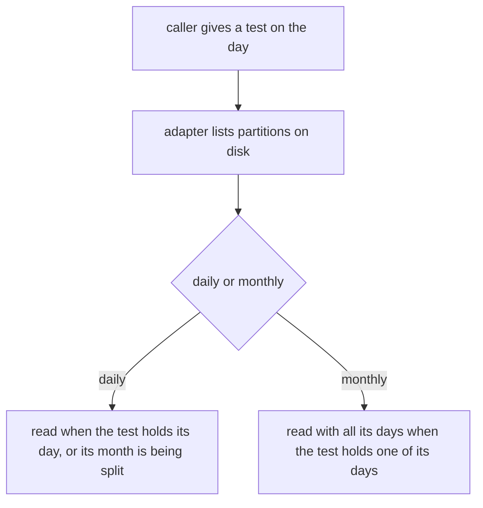
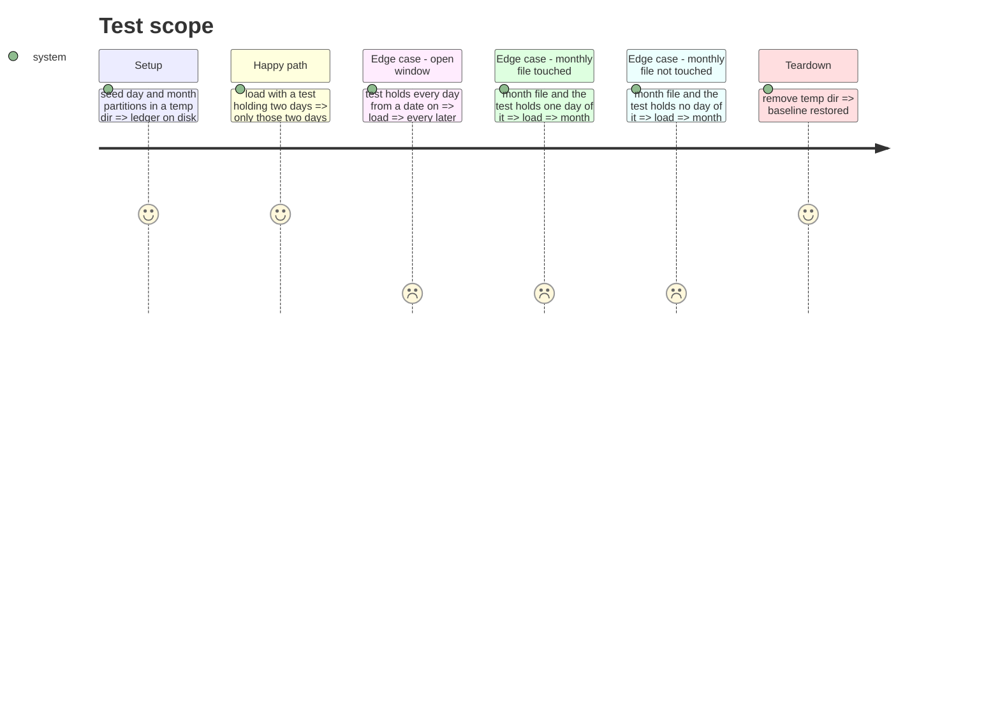

# Instruction: The ledger loads by a test on the day

## Architecture projection

> Tree of the final files. ✅ create · ✏️ modify · ❌ delete

```txt
cli/
├── src/contexts/telemetry/
│   ├── domain/ports/usage-ledger.ts                         ✏️ load(holds?: (day: string) => boolean)
│   ├── application/ledger-upkeep.ts                         ✏️ storeCalls passes the window as a test
│   └── infrastructure/usage-ledger-adapter.ts               ✏️ inWindow keeps a day the test holds, and a month one of whose days it holds
└── tests/
    ├── helpers/ports/in-memory-telemetry.ts                 ✏️ same signature
    └── contexts/telemetry/infrastructure/usage-ledger-adapter.integration.test.ts  ✏️ window cases
```

## User Journey



## Test Scope



## Tasks to do

### `1)` Red first

> Tests that fail on today's signature, run and record their red output in `evidence.md`.

1. Adapter tests: closed window, window open on one side, monthly file touched by one day, monthly file untouched.
2. Run them, copy the failing lines to `evidence.md`.

### `2)` Port and adapter

> `load(holds?)` reads what the test holds; ingest behaves exactly as before.

1. Port doc and signature.
2. `inWindow(names, holds)`: a day when `holds(day)` or its month is splitting; a month when `holds` is true for one of its calendar days.
3. `storeCalls`: `const days = daysAround(incoming); ledger.load((day) => days.has(day))`.
4. In-memory ledger: filter by `holds(dayOf(record.at))`.

## Test acceptance criteria

| Task | Acceptance criteria              |
| ---- | -------------------------------- |
| 1 | the new tests fail before the change, for the reason they name |
| 2 | they pass after it; every existing ingest and ledger test passes unchanged in what it asserts |
