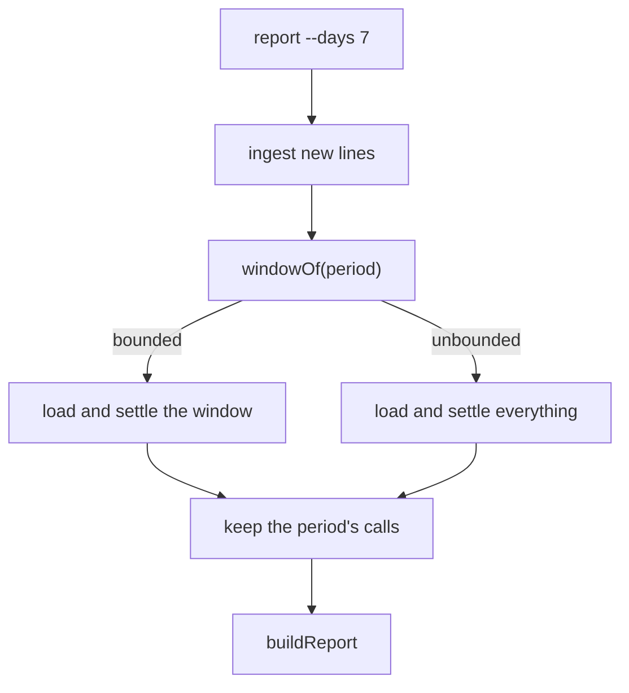
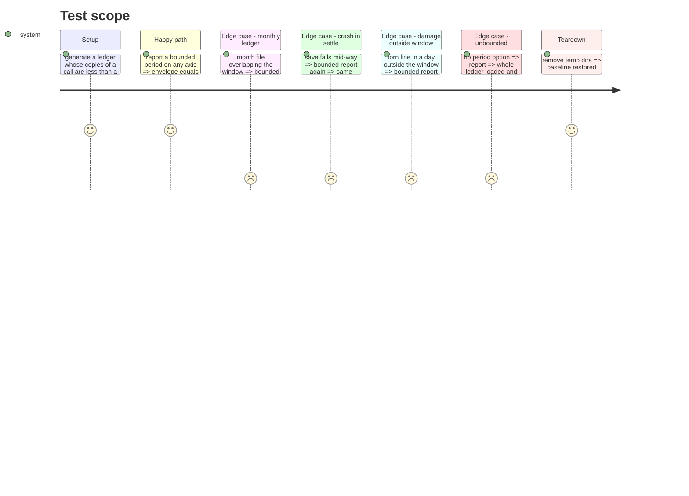

# Instruction: A bounded report loads and settles its window

## Architecture projection

> Tree of the final files. ✅ create · ✏️ modify · ❌ delete

```txt
cli/
├── src/contexts/telemetry/
│   ├── domain/report/period.ts                              ✏️ windowOf(period): the day test from from-1 to to+1, or undefined when unbounded
│   ├── application/ledger-upkeep.ts                         ✏️ settleLedger(ledger, holds?) settles what it read
│   └── application/report/report-usage-use-case.ts          ✏️ settles the period's window
│   └── application/report/report-envelope.ts                ✏️ skipped_ledger_lines: of the partitions read
└── tests/contexts/telemetry/
    ├── domain/report/period.unit.test.ts                    ✏️ windowOf cases
    ├── application/ledger-upkeep.integration.test.ts        ✏️ bounded settle, monthly, crash
    ├── application/report/report-usage-use-case.unit.test.ts ✏️ bounded load asked, unbounded unchanged
    └── application/report/report-window.property.integration.test.ts ✅ bounded envelope == full filtered
```

## User Journey



## Test Scope



## Tasks to do

### `1)` Red first

> Tests and the property, run against today's code, red output recorded in `evidence.md`.

1. `windowOf` unit cases: both bounds, one bound, none, month and year edges.
2. Use case: a bounded report asks the ledger for its window; unbounded asks for everything.
3. Property: bounded envelope equals the full report filtered, for every axis, from daily or monthly partitions.
4. Settle cases: monthly overlap, crash, damage outside.

### `2)` Implement

> Smallest change making them green.

1. `windowOf` in `period.ts`, next to `inPeriod`.
2. `settleLedger(ledger, holds?)` passes `holds` to `load`.
3. Use case passes `windowOf(request.period)`.
4. Envelope doc: `skipped_ledger_lines` counts the partitions read.

## Test acceptance criteria

| Task | Acceptance criteria              |
| ---- | -------------------------------- |
| 1 | each new test fails before the change, for the reason it names |
| 2 | all pass; the property holds over its runs; no existing assertion is weakened |
