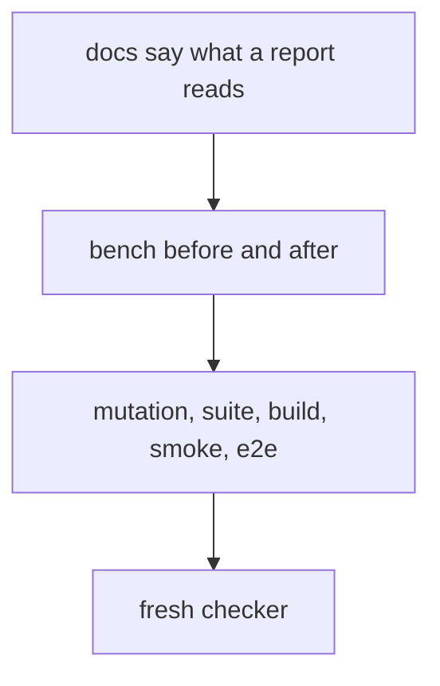
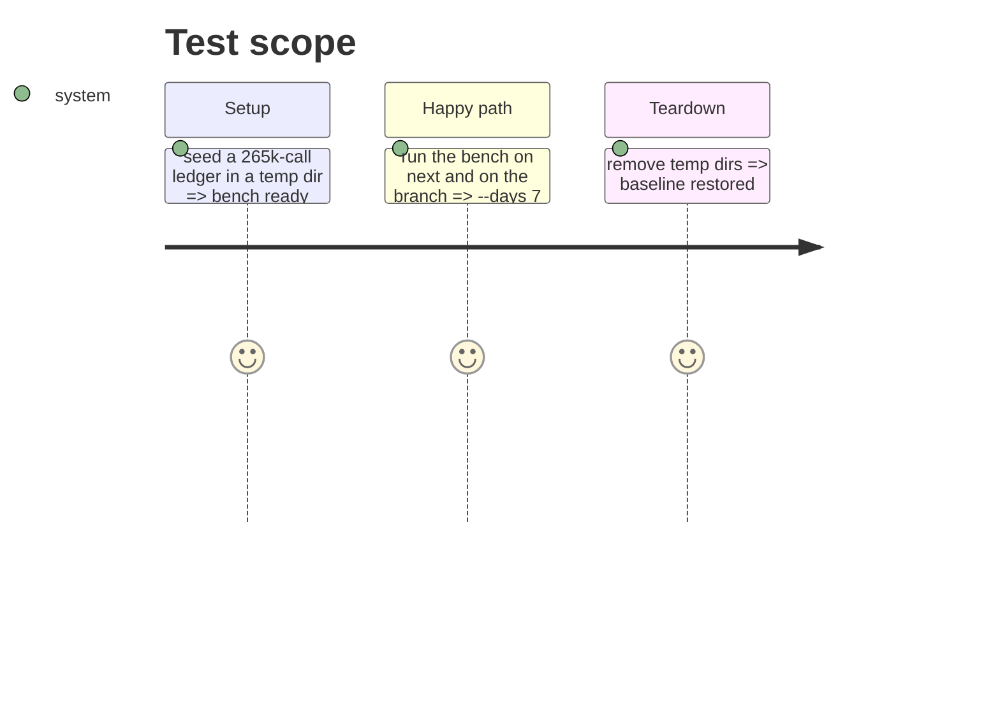

# Instruction: Docs, measures and gates

## Architecture projection

> Tree of the final files. ✅ create · ✏️ modify · ❌ delete

```txt
.
├── aidd_docs/product/usage-contract.md                      ✏️ what a bounded report reads and settles
├── cli/aidd_docs/memory/telemetry.md                        ✏️ same, one line
└── aidd_docs/tasks/2026_10/2026_10_15_report-reads-its-period/
    ├── evidence.md                                          ✅ red runs, bench before and after, mutation, gates
    └── review.md                                            ✅ checker review
```

## User Journey



## Test Scope



## Tasks to do

### `1)` Docs

> The contract and code map say what a bounded report reads.

1. Usage contract: ledger row and the report section.
2. `cli/aidd_docs/memory/telemetry.md`.

### `2)` Gates

> Every gate run, its output recorded.

1. Bench on `fcb6022b` and on the branch.
2. Full `cli` suite, typecheck, lint, knip, build budget, `pnpm smoke`.
3. Stryker on the telemetry scope; list surviving mutants on changed lines.
4. `scripts/check-claude-tokens-end-to-end.cjs`, headless and attended.

## Test acceptance criteria

| Task | Acceptance criteria              |
| ---- | -------------------------------- |
| 1 | a grep for what a report reads finds no sentence saying it reads every partition when bounded |
| 2 | `evidence.md` holds each gate's decisive line; mutation 96 or above |
