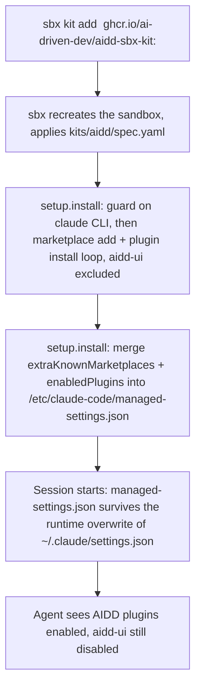
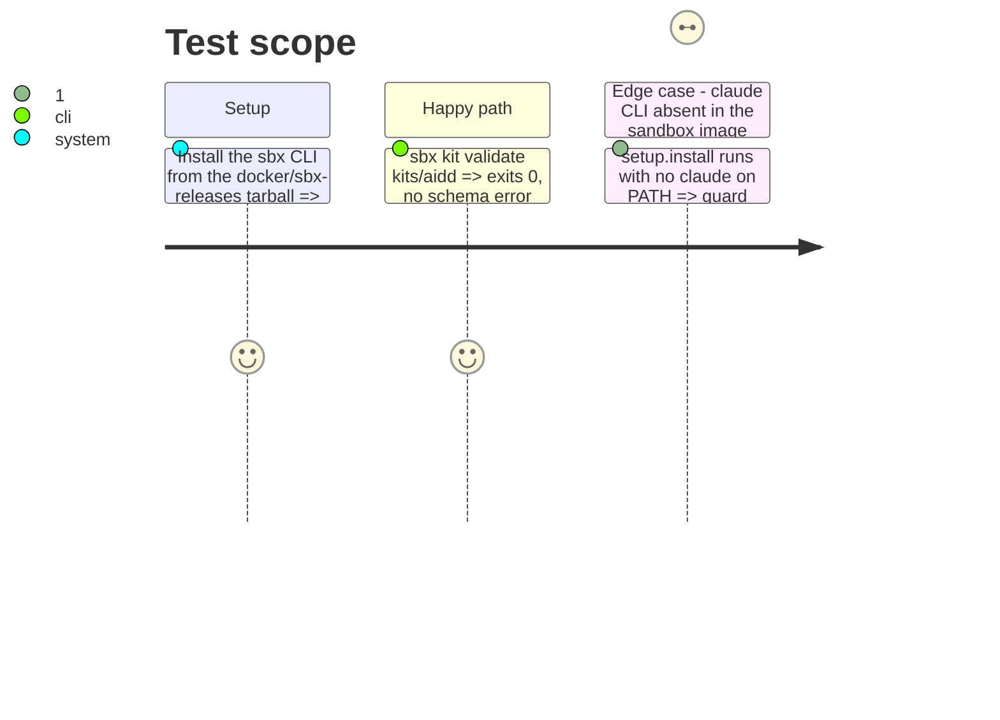

<!-- Fill or omit these sections; never add, rename, or reorder one. -->

# Instruction: Kit descriptor

## Architecture projection

> Tree of the final files. ✅ create · ✏️ modify · ❌ delete

```txt
.
└── kits/
    └── aidd/
        ├── spec.yaml   ✅ create
        └── README.md   ✅ create
```

## User Journey



## Test Scope

<!-- Required for every phase. Keep Setup, Happy path, any qualifying Edge cases, and any required Teardown in this one journey. -->



## Wireframe

<!-- UI phase only. No UI => omit the section, don't invent one. -->

## Tasks to do

### `1)` Write the kit descriptor

> `kits/aidd/spec.yaml`, the mixin Docker Sandbox kit v2 descriptor.

1. `schemaVersion: "2"`, `kind: mixin`, `name: aidd`, `version: "1.0.0"`, `displayName`, `description`, `sourceURL: https://github.com/ai-driven-dev/framework`.
2. `permissions.network.allow: [github.com]` — the marketplace add clones over HTTPS.
3. `setup.install`, step one, run as the sandbox's non-root user: guard on `command -v claude`, exit 1 with a stated reason if absent; `claude plugin marketplace add ai-driven-dev/framework`; loop `claude plugin install "<plugin>@aidd-framework"` over `aidd-context`, `aidd-refine`, `aidd-dev`, `aidd-vcs`, `aidd-pm`, `aidd-orchestrator` — `aidd-ui` is not in this list.
4. `setup.install`, step two: merge `extraKnownMarketplaces` and `enabledPlugins` from the user's `~/.claude/settings.json` into `/etc/claude-code/managed-settings.json` (create both as `{}`/`/dev/null` when absent, never run the merge as root against the user file, preserve every other key already in the managed file).
5. `agentInstructions.content`: the AIDD SDLC primer (same text already proven in the installed kit instance under `kits-agent-context/aidd.md`).

### `2)` Write the kit's README

> `kits/aidd/README.md` — purpose, install command, limits.

1. State what the kit installs and that it targets Claude Code only.
2. Show `sbx kit add <sandbox> ghcr.io/ai-driven-dev/aidd-sbx-kit:<version>` and `sbx run <agent> --kit ./kits/aidd` for local use.
3. State the limit: a mixin kit, not a full sandbox template — it does not provide or replace the agent's own image.

### `3)` Validate the kit locally

> Prove the descriptor is well-formed before it ever reaches CI.

1. Install `sbx` the same way CI will: pull the pinned `docker/sbx-releases` linux-amd64 tarball, extract `docker-sbx/sbx`, install it on `PATH`.
2. Run `sbx kit validate kits/aidd`; fix the descriptor until it exits 0.

## Test acceptance criteria

<!-- Each criterion is an observable behavior, not a command. -->

| Task | Acceptance criteria              |
| ---- | -------------------------------- |
| 1    | `kits/aidd/spec.yaml` parses as a valid Docker Sandbox kit v2 mixin; its install loop names six plugins and never names `aidd-ui` |
| 2    | `kits/aidd/README.md` names the install command and states the Claude-only, mixin-only scope |
| 3    | `sbx kit validate kits/aidd` exits 0 |
