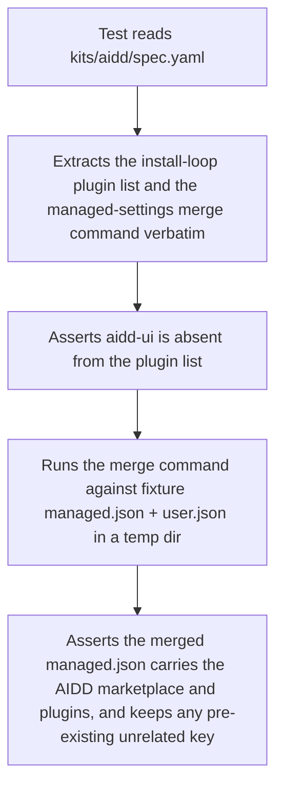
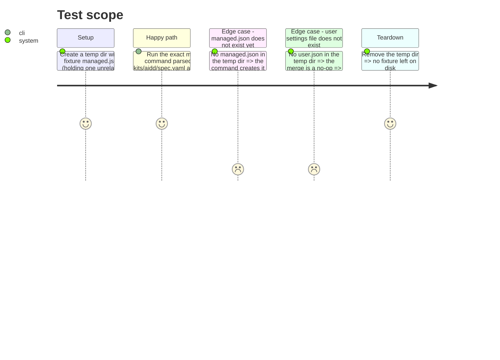

<!-- Fill or omit these sections; never add, rename, or reorder one. -->

# Instruction: Managed-settings regression test

## Architecture projection

> Tree of the final files. ✅ create · ✏️ modify · ❌ delete

```txt
.
└── scripts/
    └── __tests__/
        └── kit-aidd-managed-settings.test.js   ✅ create
```

## User Journey



## Test Scope

<!-- Required for every phase. Keep Setup, Happy path, any qualifying Edge cases, and any required Teardown in this one journey. -->



## Wireframe

<!-- UI phase only. No UI => omit the section, don't invent one. -->

## Tasks to do

### `1)` Extract the live spec's install logic

> Pin the test against the real file, never a re-typed copy.

1. Parse `kits/aidd/spec.yaml` with `js-yaml` (already a dev dependency) inside the test.
2. Read `setup.install[0].command` and `setup.install[1].command` as plain strings — nothing else in the test re-implements them.

### `2)` Write and run the regression test

> `scripts/__tests__/kit-aidd-managed-settings.test.js`.

1. Assert `aidd-ui` is not among the plugins named in the install loop; assert the other six are.
2. In a fresh `mkdtemp` directory, write the fixture `managed.json` and `user.json` described in Test Scope.
3. Run the extracted merge command in that directory (substituting its hardcoded paths for the fixture paths), then read back `managed.json`.
4. Assert the merged shape and the two edge cases from Test Scope; clean up the temp directory.
5. Run via `node scripts/check-tests-leave-git-alone.js -- node --test 'scripts/__tests__/kit-aidd-managed-settings.test.js'`.

## Test acceptance criteria

<!-- Each criterion is an observable behavior, not a command. -->

| Task | Acceptance criteria              |
| ---- | -------------------------------- |
| 1    | the test's assertions read from `kits/aidd/spec.yaml` itself, not from a duplicated string |
| 2    | the test fails if `aidd-ui` is ever added to the install loop, and passes against the current `spec.yaml` |
