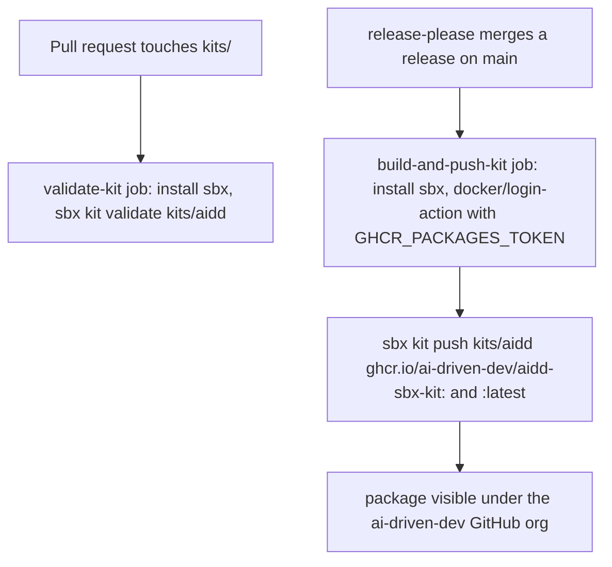
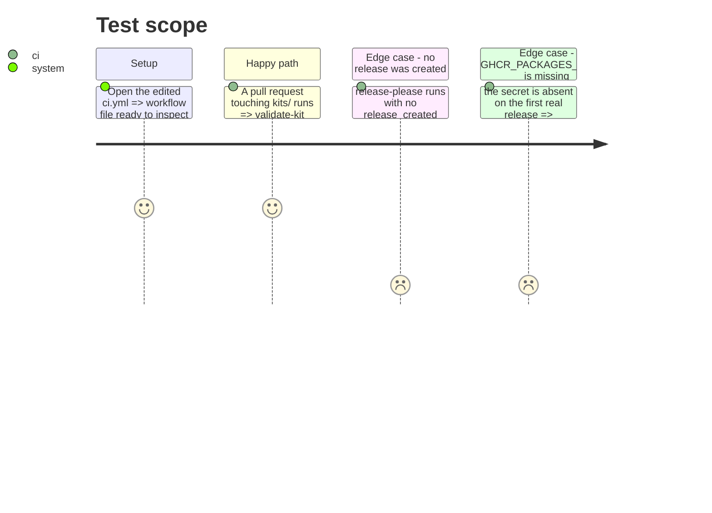

<!-- Fill or omit these sections; never add, rename, or reorder one. -->

# Instruction: CI wiring and docs

## Architecture projection

> Tree of the final files. ✅ create · ✏️ modify · ❌ delete

```txt
.
├── .github/
│   └── workflows/
│       └── ci.yml                 ✏️ modify
├── aidd_docs/
│   └── memory/
│       └── codebase-map.md        ✏️ modify
├── docs/
│   └── ARCHITECTURE.md            ✏️ modify
└── commitlint.config.cjs          ✏️ modify
```

## User Journey



## Test Scope

<!-- Required for every phase. Keep Setup, Happy path, any qualifying Edge cases, and any required Teardown in this one journey. -->



## Wireframe

<!-- UI phase only. No UI => omit the section, don't invent one. -->

## Tasks to do

### `1)` Add the PR-time validate job

> `validate-kit` in `.github/workflows/ci.yml`, runs on every pull request and push, independent of `release-please`.

1. Install `sbx` from the pinned `docker/sbx-releases` linux-amd64 tarball (same pin as phase 1's local check).
2. Run `sbx kit validate kits/aidd`.

### `2)` Add the release-time publish job

> `build-and-push-kit`, `needs: [release-please]`, `if: needs.release-please.outputs.release_created == 'true'`, mirroring `build-and-attach`'s gating.

1. `permissions: packages: write` on the job (matches the existing `publish-cli` job's grant for its GitHub Packages mirror).
2. Install `sbx` the same way as task 1.
3. `docker/login-action` against `ghcr.io` using a new repository secret `GHCR_PACKAGES_TOKEN` — a personal access token with `write:packages`, not `GITHUB_TOKEN`: pushing a brand-new non-container OCI artifact under `GITHUB_TOKEN` 403s on package creation. **This secret must exist before this job can succeed; creating it is an org-admin action outside this change's scope — state that plainly in the pull request rather than assuming it is already set.**
4. `sbx kit push kits/aidd ghcr.io/ai-driven-dev/aidd-sbx-kit:${{ needs.release-please.outputs.version }}` and again tagged `:latest`.

### `3)` Update the memory and architecture docs

> Keep the maps honest now that `kits/` exists.

1. Add a `kits/` row to `aidd_docs/memory/codebase-map.md`'s Areas table: holds the Docker Sandbox kit descriptors that install the framework into a sandbox.
2. Add one line to `docs/ARCHITECTURE.md` placing `kits/` relative to `plugins/`: a kit packages the CLI-free native install path for one external tool (Docker Sandboxes), not a Claude Code plugin.
3. Add `kit` to `commitlint.config.cjs`'s `scope-enum` list, kept kebab-case and alongside the other path-named scopes.

## Test acceptance criteria

<!-- Each criterion is an observable behavior, not a command. -->

| Task | Acceptance criteria              |
| ---- | -------------------------------- |
| 1    | a pull request touching `kits/` runs `validate-kit` and it exits 0 against the current descriptor |
| 2    | `build-and-push-kit` runs only when `release-please` reports a release, and is absent from the run otherwise |
| 3    | `codebase-map.md` and `ARCHITECTURE.md` each name `kits/` and its relation to `plugins/` |
