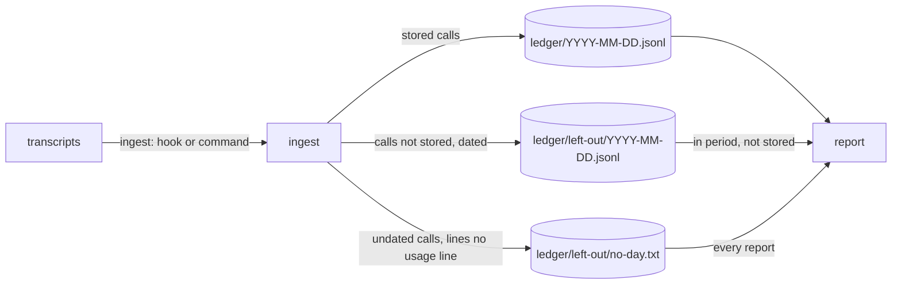

# Nothing is lost silently

## Need

Product rule ([usage contract](../../../product/usage-contract.md)): an unknown is never counted as zero, and nothing measured is dropped without being said. An independent audit (R1) found two holes.

| # | Hole | Where |
| --- | --- | --- |
| M1 | What an ingest leaves out (calls not stored, lines no usage line) is counted for that run only. The plugin's catch-up hook runs `aidd telemetry ingest --quiet`, which prints nothing, and moves the offsets on. A report run later ingests nothing new and prints `0`. | `application/ingest-usage-use-case.ts`, `application/report/report-usage-use-case.ts` |
| M2 | A ledger line the reader does not recognise (a newer CLI's record, a hand edit) is deleted the next time its partition is rewritten. An older CLI erases a newer one's records. | `infrastructure/usage-ledger-adapter.ts` `save` |

## Decision

### M1: what an ingest leaves out is kept, by key

| Left out | Kept as | Where |
| --- | --- | --- |
| A call not stored, with a day | the call's `tool`, `key` and `agent`, the start of the UTC day of its earliest copy with a day, `session_id` `left-out`, the reason in `repository_id`, every other field `null` | `ledger/left-out/<YYYY-MM-DD>.jsonl`, the ledger's own format and code |
| A call not stored, `undated` | `undated <hash of tool and key>` | `ledger/left-out/no-day.txt`, one line each, sorted, each line once |
| A transcript line that is no usage line | `unrecognised <hash of the line>` | same |

- **Idempotent.** An entry is named by what it is: a call by its key, a line by its text. A re-read, an offsets reset or the same ingest run twice adds nothing. Dated entries go through the ledger's own fold and settle, so their bytes after a full report are those of one ingest, as the ledger's are.
- **Why the earliest copy.** With no counter kept, the fold of left-out copies keeps the earliest. A call whose copies straddle a midnight, read in one ingest, must land on the day two ingests would give it: so it is dated by its earliest copy, not by the copy that won.
- **Stored beats left out.** A call left out once and stored on a later read (an `unreadable-consent` repaired, offsets reset) is counted as stored. The report applies the rule, so the bytes never depend on the order of the ingests.
- **Consent.** Storing follows consent. A left-out entry holds no counter, model, session, directory, branch or repository, and no transcript text: a hash. It is the least that counts a call once, and `forget` removes it with `ledger/`.
- **Reported.** `coverage.not_stored` counts the calls of the report's period that were left out and are not stored, whoever ran the ingest. `undated` and `coverage.unrecognised_shapes` have no day: every report counts all of them, since hiding them would print `0`.
- **What a shape is now.** The reader also notes a call it keeps with a counter missing. That call is stored with the counter `null`, already counted in `unknown_records`, so `unrecognised_shapes` now counts only the lines that are no usage line.
- **Unchanged.** The hook: the ingest it runs now keeps what it leaves out. `ingest` still prints its own run. `files_read` stays the run's. The envelope stays `version: 1`: no field is renamed, retyped or removed; the meaning of `not_stored` and `unrecognised_shapes` moves from "this run" to "of the period, durable".

### M2: a ledger line that is not a record is kept, in its partition

- A partition rewritten keeps every non-empty line that is not a record, as it is, after its records, in text order, each line once.
- A day holding only such lines is kept, never removed. The lines of a monthly file go to the first day of its month, written before the monthly file is removed.
- `skipped_ledger_lines` counts them on every read of their partition, so damage stays said until a person removes it.
- **Why in the partition, not a quarantine.** A newer CLI reads its own lines where it wrote them. Lines moved to a file it does not know of are as lost to it as deleted ones.
- **Why each line once.** A crash between writing the first day of a month and removing the monthly file leaves a line in both. Without it, every crashed split would copy it again.

## Properties

| # | Property |
| --- | --- |
| P1 | After a report with no period, the ledger is byte-identical to one ingest of the same calls followed by that report, whatever the order, grouping, starting format, monthly files and lines that are not records. Each partition holds its calls, then its kept lines. (#1032, extended) |
| P2 | Across any sequence of ingests and settles, bounded or not, crash or not, no line that is not a record disappears. |
| P3 | Any ingests, in any order, any number of times over the same transcripts, then a report: the same `left-out/` bytes and the same envelope as one ingest then that report. |

## Acceptance

| # | Criterion | Proof |
| --- | --- | --- |
| 1 | A call the catch-up hook leaves out is counted by a report run later | e2e: hook then `report --json` |
| 2 | Re-ingesting the same transcript counts nothing twice | unit + P3 |
| 3 | A left-out call later stored is counted stored, not left out | unit |
| 4 | An unrecognised ledger line survives every rewrite and is counted in `skipped_ledger_lines` | adapter tests + P2 |
| 5 | P1, P2, P3 hold | fast-check |
| 6 | A bounded report still prints the full report filtered | `report-window.property` unchanged and green |
| 7 | Tests first, red run recorded; each guard has a mutation that turns its test red | `evidence.md` |
| 8 | Telemetry mutation 96 or above, every mutant on changed lines killed or explained | stryker |
| 9 | Bundle within 695 KB, never raised | `check-bundle-size.mjs` |

## Limits

- Two identical lines that are no usage line count once, wherever they are: a line is named by its text.
- Two identical lines that are not ledger records, in one partition, are kept once.
- A left-out reason this version does not know (a newer version's) is kept and not counted.
- Entries left out before this version were never written: they cannot be recovered.
- cli-v5.5.0 still deletes a line it does not recognise when it rewrites a day. `left-out/` is a directory it never reads.
