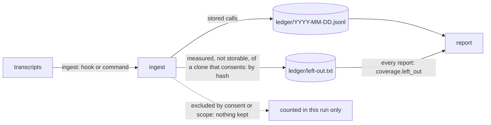

# Nothing is lost silently

## Need

Product rule ([usage contract](../../../product/usage-contract.md)): an unknown is never counted as zero, and nothing measured is dropped without being said. An independent audit (R1) found two holes.

| # | Hole | Where |
| --- | --- | --- |
| M1 | What an ingest leaves out (calls not stored, lines no usage line) is counted for that run only. The plugin's catch-up hook runs `aidd telemetry ingest --quiet`, which prints nothing, and moves the offsets on. A report run later ingests nothing new and prints `0`. | `application/ingest-usage-use-case.ts`, `application/report/report-usage-use-case.ts` |
| M2 | A ledger line the reader does not recognise (a newer CLI's record, a hand edit) is deleted the next time its partition is rewritten. An older CLI erases a newer one's records. | `infrastructure/usage-ledger-adapter.ts` `save` |

## Decision

### M1: what was measured and could not be stored is kept, by hash

Round 1 of review (`review.md`) found the first design kept the key of every call left out, a clone that never opted in included. Product rule: a clone that never opted in, or work after `off`, leaves nothing on disk (usage contract, [Consent](../../../product/usage-contract.md#consent)). So:

| Read | Kept | Counted |
| --- | --- | --- |
| A call excluded by consent or scope: `no-consent`, `consent-closed`, `unreadable-consent`, `outside-repo`, `never-seen-alive`, `no-cwd` | nothing: it is not measured | in that run's `not_stored` only |
| An `undated` call of a clone that consents at the time of the read | `undated <hash of tool and key>`, 41 B | that run's `not_stored`, and `coverage.left_out.undated` of every report |
| A line that is no usage line naming the directory of a clone that consents at the line's time, or with none the read's | `unrecognised <hash of the line>`, 46 B | that run's `unrecognised_shapes`, and `coverage.left_out.unrecognised` of every report |
| A line that names no directory, or one of a clone that does not consent | nothing | that run's `unrecognised_shapes` only |
| A call missing a counter | stored, the counter `null` | `unknown_records`, and that run's `unrecognised_shapes` |

- **One file, `ledger/left-out.txt`.** Sorted, each line once, a sha-256 cut to 32 hex characters of the reason and what the thing is. No key, no line in clear. A line this version does not know is kept and not counted. Its own small adapter (`infrastructure/left-out/left-out-adapter.ts`): the main ledger exposes it as `leftOut`, nothing more.
- **Idempotent.** Named by what it is: a re-read, an offsets reset or the same ingest twice adds nothing.
- **Envelope.** `version: 1`, one field added: `coverage.left_out: {undated, unrecognised}`, cumulative, the same in every report. `files_read`, `unrecognised_shapes` and `not_stored` keep their meaning: this run's. Ingest and report count `unrecognised_shapes` the same way.
- **A call whose consent is not known yet (review round 2).** `unreadable-consent` is not a no: the clone may consent once git can read it. Ingest keeps the position of every transcript holding such a call from before that read, so the next ingest, a report's included, reads it again; nothing is written. Stored once readable; until then every run says it. Bounded (review round 3): held only when a clone `roots.json` remembers at that directory consented at the call's time (for an undated call or a line, at the read), so the hold ends once the clone is repaired. A directory no read saw readable, a repository that never opted in, or a call made while its clone did not consent moves on: once readable it could never be stored, so a hold would never end. The same rule holds an undated call and a line of such a clone. Not for a damaged consent log: it stays damaged until `forget`, which removes it, so a hold would never end.
- **`never-seen-alive` is a stated loss.** Its consent is unknown, so nothing may be kept; the directory never comes back, so reading it again would never end. Only the run that read it says it. Recording a session's directory at SessionStart was weighed and left out: subagent worktrees fire no SessionStart, and the budget left no room (`consentsAt`, `here`: about 330 B).
- **`roots.json`.** Resolving the directory of an undated call or a line remembers it when alive, in any clone, as for every dated call already: a directory and its clone, never a call. This narrows round 1's "a clone that never opted in leaves no byte" to `left-out.txt`.
- **The hook is unchanged.**

### M2: a ledger line that is not a record is kept, in its partition

- A partition rewritten keeps every non-empty line that is not a record, as it is, after its records, in text order, each line once.
- A day holding only such lines is kept, never removed. The lines of a monthly file go to the first day of its month, written before the monthly file is removed.
- `skipped_ledger_lines` counts them on every read of their partition, so damage stays said until a person removes it.
- **Why in the partition, not a quarantine.** A newer CLI reads its own lines where it wrote them. Lines moved to a file it does not know of are as lost to it as deleted ones.
- **Why each line once.** A crash between writing the first day of a month and removing the monthly file leaves a line in both. Without it, every crashed split would copy it again.

## Properties

| # | Property |
| --- | --- |
| P1 | After a report with no period, the ledger is byte-identical to one ingest of the same calls followed by that report, whatever the order, grouping, starting format, monthly files and lines that are not records. Each partition holds its calls, then its kept lines. (#1032, extended) |
| P2 | Across any sequence of ingests and settles, bounded or not, no line that is not a record disappears. |
| P3 | Any ingests of the same transcripts, in any order and split, any number of times, offsets lost or not: the same ledger and `left-out.txt` bytes and the same envelope as one ingest; `left_out` is what the contract keeps (an oracle written from the table above) and the same bounded or not; a clone that never opted in leaves no `left-out.txt`. |
| P4 | With `left-out.txt` present, a bounded report prints the full report filtered, byte for byte (`report-window.property`). |

## Acceptance

| # | Criterion | Proof |
| --- | --- | --- |
| 1 | What the catch-up hook measured and could not store is counted by a report run later | e2e: hook then `report --json` |
| 2 | A clone that never opted in, or work after `off`, leaves no byte of this | ingest unit test, P3, e2e |
| 3 | Re-ingesting the same transcript counts nothing twice | unit + P3 |
| 4 | An unrecognised ledger line survives every rewrite and is counted in `skipped_ledger_lines` | adapter tests + P2 |
| 5 | P1 to P4 hold | fast-check |
| 6 | Tests first, red run recorded; each guard has a mutation that turns its test red | `evidence.md` |
| 7 | Telemetry mutation 96 or above, every mutant on changed lines killed or explained | stryker |
| 8 | Bundle within budget: raised to 709 KB in `7287c9ce` per the registry policy, 695.3 KB measured, 2.0% headroom | `check-bundle-size.mjs` |

## Limits

- Two identical lines that are no usage line count once, wherever they are: a line is named by its text.
- Two identical lines that are not ledger records, in one partition, are kept once.
- A call is assumed to have its copies all dated or all undated. One read with only a dated copy and another with only an undated one would store it and keep it as undated: `P3`'s generator holds to the assumption, which no transcript seen breaks.
- An undated call is judged by its clone's consent at the time of the read, having no time of its own: one made while `off` and read after `on` again leaves a hash; one made while on and read after `off` is lost. Named in the usage contract's Consent section.
- A clone that consents and stays unreadable has the part of its transcripts read since re-read by every ingest, until repaired, `forget --yes`, or the clone removed; `off` refuses such a clone and does not end it. Inferred, not measured: a re-read longer than the hook's 110 s limit would stop the hook saving any position.
- A session in a subdirectory of an opted-in clone that no read ever saw readable has no remembered clone at that directory: an unreadable call there moves on, said only by that read.
- A subagent's worktree removed before the next ingest loses its calls (`never-seen-alive`): a subagent fires no SessionStart. A `SubagentStart` or `SubagentStop` hook could record its directory alive; whether its `cwd` is the worktree is unverified, and it is out of scope here.
- A line that is no usage line and names no directory cannot be tied to a clone: only the run that read it says it.
- Growth: 41 or 46 bytes per thing kept (`undated ` or `unrecognised `, 32 hex characters, a newline: the format the adapter test pins), only for a clone that consents. `left-out.txt` is read whole by every report and rewritten by an ingest that adds to it.
- Nothing measured before this version was kept.
- cli-v5.5.0 still deletes a ledger line it does not recognise when it rewrites a day; it never reads `left-out.txt`.
