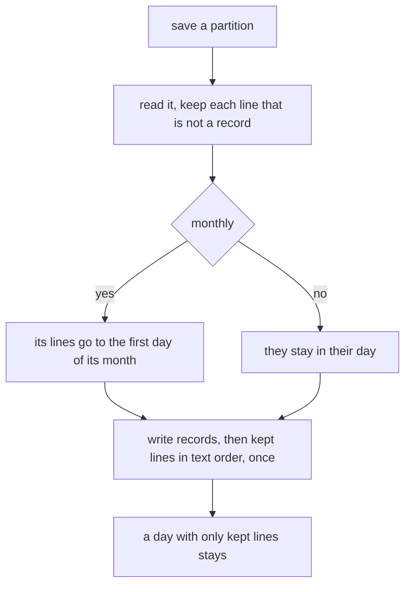

# Instruction: A ledger line no reader knows is kept (M2)

## Architecture projection

```txt
cli/
├── src/contexts/telemetry/infrastructure/usage-ledger-adapter.ts   ✏️ save keeps every line that is not a record
├── src/contexts/telemetry/domain/ports/usage-ledger.ts             ✏️ the rule, on the port
└── tests/contexts/telemetry/
    ├── infrastructure/usage-ledger-adapter.integration.test.ts     ✏️ kept, ordered, once, monthly, crash
    ├── application/ledger-upkeep.integration.test.ts               ✏️ kept through settle and ingest
    └── application/ledger-upkeep.property.integration.test.ts      ✏️ P1 with kept lines, P2
```

## User Journey



## Test Scope

| Case | Proof |
| --- | --- |
| a newer version's record survives every rewrite, byte for byte | adapter test |
| kept lines sorted and once | adapter test, mutations M2-b, M2-c |
| a day left with only kept lines stays | adapter test, mutation M2-a |
| a monthly file's lines, crash or not | adapter tests, mutation M2-e |
| byte identity after a full settle, and no kept line ever lost | property P1/P2 |
