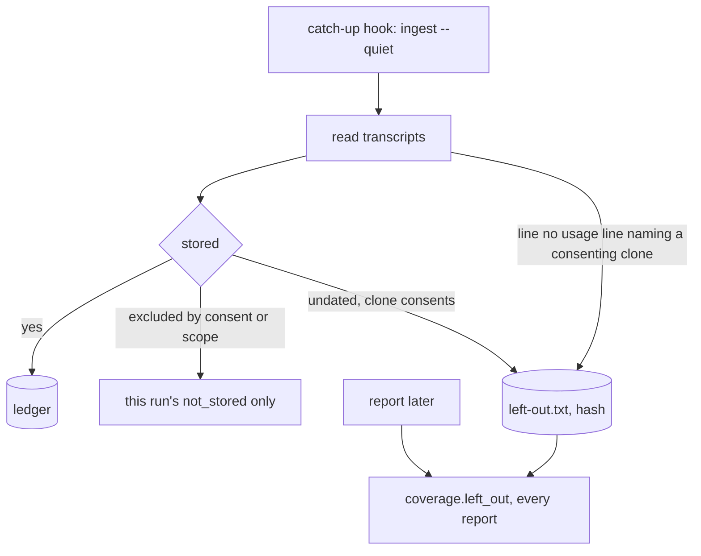

# Instruction: What was measured and could not be stored is kept and reported (M1)

## Architecture projection

```txt
cli/
├── src/contexts/telemetry/
│   ├── domain/ports/usage-ledger.ts                      ✏️ LeftOutStore, LeftOutEntry, LeftOutReason; UsageLedger.leftOut
│   ├── domain/usage-record.ts                            ✏️ LineNames
│   ├── domain/formats/claude-transcript-usage.ts         ✏️ a line no usage line names its directory and time
│   ├── application/read-usage-use-case.ts                ✏️ dropped lines that name a directory
│   ├── application/directory-resolver.ts                 ✏️ the run's now
│   ├── application/ingest-usage-use-case.ts              ✏️ keeps what was measured and cannot be stored, of a clone that consents
│   ├── application/report/report-usage-use-case.ts       ✏️ coverage.leftOut, under the lock
│   ├── application/report/report-envelope.ts             ✏️ coverage.left_out
│   └── infrastructure/left-out/left-out-adapter.ts       ✅ ledger/left-out.txt, by hash
└── tests/   ingest, report, reader, adapter, envelope, display, P3, window property, journey e2e
```

## User Journey



## Test Scope

| Case | Proof |
| --- | --- |
| what the hook measured is in a later report | e2e |
| a clone that never opted in, or after `off`, leaves nothing | ingest tests, P3, e2e, mutation R1-a |
| hashes only, each once | adapter tests, mutations R1-f |
| bounded equals full with left-out present | window property, P3 |
