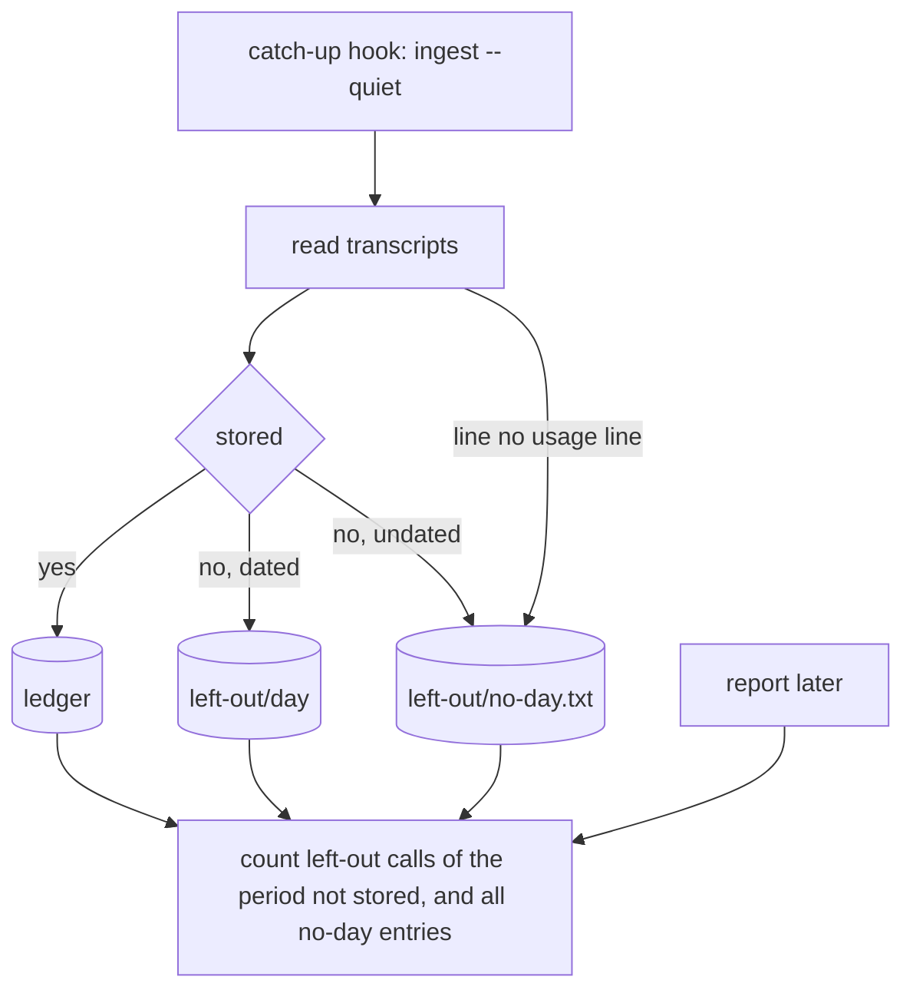

# Instruction: What an ingest leaves out is kept and reported (M1)

## Architecture projection

```txt
cli/
├── src/contexts/telemetry/
│   ├── domain/ports/usage-ledger.ts                      ✏️ DayLedger, LeftOutLedger, NoDayEntry
│   ├── domain/stored-usage.ts                            ✏️ callId, leftOutOf
│   ├── application/read-usage-use-case.ts                ✏️ dropped lines, earliest dated copy per call
│   ├── application/ingest-usage-use-case.ts              ✏️ keeps what it leaves out, before the offsets move
│   ├── application/report/report-usage-use-case.ts       ✏️ counts the period's left-out calls, stored beats left out
│   └── infrastructure/usage-ledger-adapter.ts            ✏️ leftOut: the same files under left-out/, no-day.txt
└── tests/
    ├── contexts/telemetry/application/ingest-usage-use-case.unit.test.ts       ✏️
    ├── contexts/telemetry/application/report/report-usage-use-case.unit.test.ts ✏️
    ├── contexts/telemetry/application/report/left-out.property.integration.test.ts ✅ P3
    ├── contexts/telemetry/infrastructure/usage-ledger-adapter.integration.test.ts ✏️
    └── e2e/telemetry-journey.e2e.test.ts                  ✏️ catch-up hook, then report --json
```

## User Journey



## Test Scope

| Case | Proof |
| --- | --- |
| what the hook left out is in a later report | e2e, red on `origin/next` |
| nothing else of a call kept, no transcript text | ingest and adapter tests, mutations M1-k, M1-m |
| re-read, offsets reset: nothing counted twice | ingest test, P3, mutation M1-l |
| dated by the earliest dated copy | ingest tests, P3, mutations M1-c, M1-d |
| stored beats left out, period, unknown reason | report tests, mutations M1-e, M1-f, M1-g |
| every ingest order and count: same bytes and envelope | property P3 |
