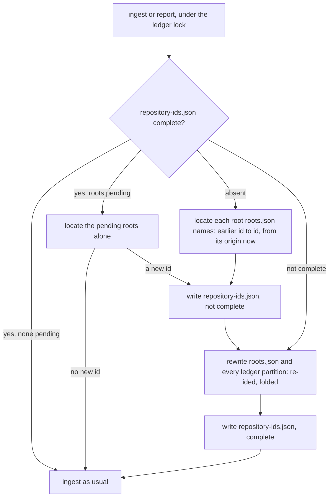

Superseded on the requestless rule by aidd_docs/tasks/2026_10/2026_10_17_simplest-true/contract.md

# One call, one key; one repository, one id

## Need

Found by the R1 telemetry audit. Maintainer decision: migrate the stored data, the measurement is a beta.

| # | Hole | Where |
| --- | --- | --- |
| M7 | One repository gets several ids. The owner and repository keep their case on every host, and an `ssh://` or `git://` host keeps its case too (WHATWG `URL` folds only special schemes): `git@github.com:Example/X.git`, `ssh://git@GitHub.com/example/x` and `https://github.com/example/x` give three ids. | `domain/repository-identity.ts` |
| M10 | A call with no `requestId` is keyed `message.id:sessionId:timestamp`. Its copies carry different timestamps, so they are never folded and the call is counted once per copy. | `domain/formats/claude-transcript-usage.ts` |

## Rules, before and after

| Rule | Before (cli-v5.5.0 to `616dbbea`) | After |
| --- | --- | --- |
| Scheme | dropped | dropped |
| Userinfo | dropped | dropped |
| Port | dropped (a scp-like address has none) | dropped |
| Host | case-folded for `http(s)`, `ws(s)`, `ftp` and scp-like; kept for `ssh://`, `git://`, `git+ssh://` | case-folded on every form ([RFC 3986 §3.2.2](https://www.rfc-editor.org/rfc/rfc3986#section-3.2.2): the host is case-insensitive) |
| `ssh.github.com` | its own host | `github.com`: GitHub's SSH over port 443 answers there for the same repositories ([GitHub docs](https://docs.github.com/en/authentication/troubleshooting-ssh/using-ssh-over-the-https-port)) |
| Owner and repository | case kept | `github.com`: case-folded (GitHub REST: owner and repo, "The name is not case sensitive", [docs](https://docs.github.com/en/rest/repos/repos#get-a-repository)). Any other host, GitHub Enterprise included: case kept, since no primary source says otherwise there; two spellings may then still give two ids, never one id for two repositories |
| `.git` suffix, leading and trailing `/` | dropped | dropped, after case-folding where the host folds it |
| No origin | root commit | root commit |
| Key, with `requestId` | `message.id:requestId` | unchanged |
| Key, without `requestId` | `message.id:sessionId:timestamp` | not stored, counted in `left_out` as `requestless` (see the usage contract) |
| Advisor iteration | key + `#advisor<n>` | unchanged |

## Store inventory

Everything under the telemetry directory, and what this fix does to it.

| Store | Holds an id or a key | Migration |
| --- | --- | --- |
| `ledger/<YYYY-MM-DD>.jsonl` | `repository_id`, `key` | every read re-ids; the first run rewrites them all, folded |
| `ledger/<YYYY-MM>.jsonl` (earlier layout) | `repository_id`, `key` | same; split into days by that rewrite, as any full settle does |
| `ledger/left-out.txt` | `undated <hash>` = hash of tool and key | none: the hash cannot be undone (see Limits). `unrecognised` hashes a line's text: no id, no key |
| `ledger/roots.json` | `repository_id` per directory and clone | every read re-ids; the first run rewrites it |
| `ledger/repository-ids.json` | earlier id to id, both hashes | new: the migration's journal and alias table |
| `ledger/offsets.json` | transcript path to position | none |
| `ledger/consents.jsonl` | token, clone, time | none |
| `ledger/.lock`, `bindings/.lock` | pid, time | none |
| `bindings/branches.jsonl` | `repository_id` per snapshot | every read re-ids; never rewritten, it stays append-only |
| `bindings/sessions.jsonl`, `carries.jsonl`, `processes.jsonl` | session ids | none |
| `identity.json` | person id | none |
| git config `aidd.telemetry`, `branch.<name>.aidd*` | token, task | none |
| plugin hooks (`plugins/aidd-telemetry/hooks/lib/`) | compute no repository id and no key | none |

## Migration

| Requirement | How |
| --- | --- |
| Automatic | first step of every ingest, so of every report and of the plugin's hook |
| Deterministic | the alias table is a function of each root's `origin` now, written before anything else; a rerun reuses it |
| Idempotent | an alias never names an id that is itself aliased: an earlier address differs from today's only by an upper-case letter or `ssh.github.com`, which no address of today holds |
| Crash-safe | under the ledger lock; every write is the existing write-then-rename; the table is written first and marked complete last, so a run stopped at any step leaves it incomplete and the next run redoes the whole rewrite. Exercised: a failure at every write (`replace`). Reasoned, not exercised: a stop during the removals that follow the writes, and a `kill -9` |
| Read-time | every reader of the ledger, `roots.json` and `branches.jsonl` applies the table, so a state the migration has not finished, or lines an older CLI writes afterwards, still count each call once under one id in a report with no period |
| No double count | copies of a call fold, by the existing fold, to the copy one ingest would have kept |

**An older CLI on migrated data** (cli-v5.5.0): the lines have the same shape, so it reads and reports them as they are, and ignores `repository-ids.json`. What it ingests afterwards it stores under its own rules; the newer CLI then re-ids it when its repository is in the table, at every read.

## Acceptance

1. `normaliseRemote` folds every form in the table above to one address, and keeps owner and repo case for any host but `github.com`.
2. A requestless call's copies at different timestamps are one record.
3. For any pre-migration store (mixed-case ids, timestamped keys, copies across days, partitions and the earlier monthly layout), the migrated report and ledger bytes equal those of one fresh ingest under the new rules.
4. Migrating twice equals once; a failure at every write, then a rerun, equals a clean run.
5. The id and key in `roots.json` and the ledger are rewritten on disk by the first run; `branches.jsonl` is aliased at read.
6. Gates: `cd cli && pnpm test`, `node --test 'scripts/__tests__/**/*.test.js'`, `pnpm test:mutation:telemetry` at 96 or more, `pnpm smoke`, the tokens end-to-end checks, bundle within 709 KB.

## Limits

| Limit | Effect |
| --- | --- |
| A root unreadable or absent at the migration | kept pending and looked at again by every ingest; until it can be read, its stored calls keep the earlier id and its new calls get the new one: two ids. A clone deleted for good stays pending, at the cost of one look per ingest |
| `repository-ids.json` damaged | made again from the clones still there; `branches.jsonl`, never rewritten, then loses the alias of a repository with no clone left, and its declarations stop matching the calls of now |
| A root whose `origin` changed since its calls were stored | the table maps the address it has now, so those calls keep their id, as before |
| `undated` hashes in `left-out.txt` from before (unreleased: cli-v5.5.0 has no such file) | cannot be re-keyed; copies of one undated requestless call kept apart stay counted apart, and one read again from the start of its transcript adds a hash beside the old one |
| One call seen with and without a `requestId` | stored by the copy with one, and counted in `left_out` by the copy without |
| A host alias from `~/.ssh/config` (`git@work-github:o/r`) | its own host: nothing on disk says what it stands for |
| Percent-encoding in a URL path | kept as written; a scp-like address is never encoded |
