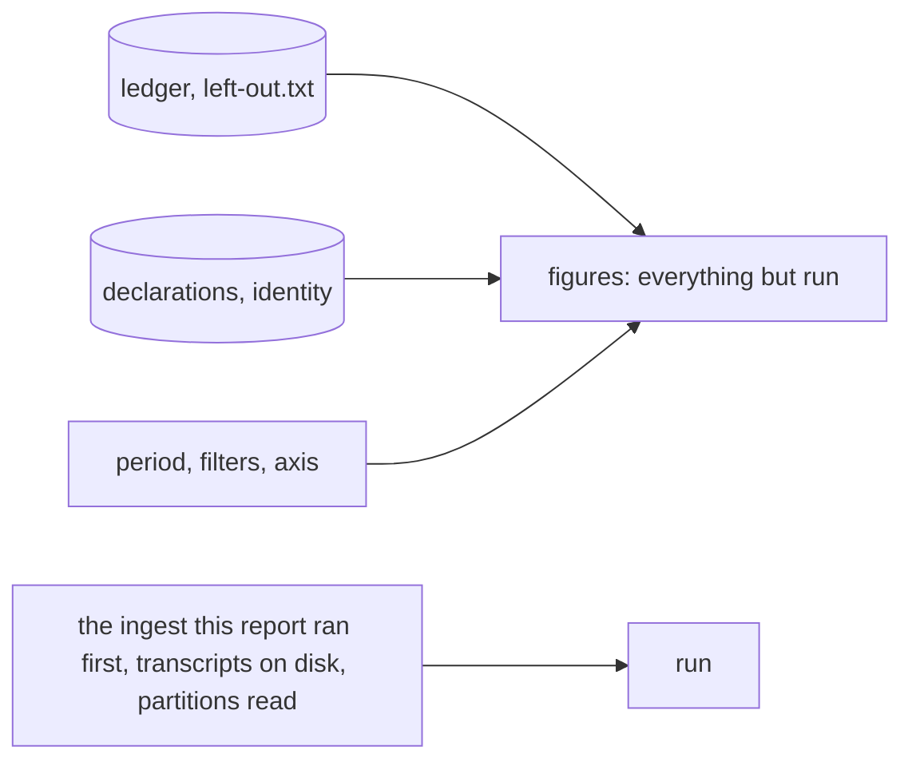

# Report envelope v2: figures apart from the run

## Need

Found by the R1 telemetry audit (M5, M9).

- **M5.** `aidd telemetry report --json` (envelope v1) puts the figures next to facts about the run that printed them. `coverage.files_read`, `unrecognised_shapes` and `not_stored` are "of this run", and `oldest_transcript_at` depends on transcripts on disk. So two reports over the same measured data are not byte-identical: the second reads 0 files where the first read 2.
- **M9.** No test runs under a non-UTC time zone or a non-English locale. CI runs UTC and English, so code that reads the local clock or locale passes everywhere it is checked.

Maintainer decision: move to envelope **v2**, the clean final target. The tool is in beta, so breaking the envelope is accepted, with no v1 shim.

## Decision

- **The figures** are every top-level field except `run`. They are a pure function of the ledger (records and `left-out.txt`), the declarations, the chosen identity, the period, the filters and the axis. Their bytes are `JSON.stringify` of the envelope with `run` removed. The canonical definition, linked from the usage contract and the CLI memory, is the skill's envelope reference (`plugins/aidd-telemetry/skills/01-usage/references/envelope.md#figures-and-run`): a skill links nowhere outside itself, so the definition lives there.
- **`run`**, always last, holds what the read that printed the envelope found. It can differ between two reports over the same data.
- **Inside the CLI**, `ReportResult` makes the same split: `coverage` (`records`, `leftOut`) and `run` (`filesRead`, `unrecognised`, `notStored`, `consentLogDamaged`, `oldestTranscriptAt`, `skippedLedgerLines`). The text report prints exactly what it printed before.
- **Refused** becomes `{"version": 2, "refused": "AIDD_TELEMETRY=0"}`.

## v1 to v2, field by field

| v1 | v2 | Why |
| --- | --- | --- |
| `version: 1` | `version: 2` | breaking shape |
| `refused` | `refused`, with `version: 2` | nothing read, so no figure and no run |
| `period` | `period` | an input |
| `axis` | `axis` | an input |
| `filters` | `filters` | inputs, resolved against the period's calls (a function of the ledger). `--repository .` resolves from the working directory, which is part of the request |
| `rows` | `rows` | ledger, declarations and identity, filtered |
| `totals` | `totals` | same |
| `unknown_records` | dropped: `totals.total.unknown_records` | a copy of a totals field; review round 1 kept one |
| `coverage.records` | `coverage.records` | the calls of the period in the ledger |
| `coverage.left_out` | `coverage.left_out` | a set of hashes, each kept once. Neither order nor a repeated ingest changes it, and none of it has a day, so every report counts all of it |
| `coverage.files_read` | `run.files_read` | what this read opened: 2 then 0 over the same data |
| `coverage.unrecognised_shapes` | `run.unrecognised_shapes` | lines this read met. The lasting count is `coverage.left_out.unrecognised` |
| `coverage.not_stored` | `run.not_stored` | calls this read left out. A later read never sees them again |
| `coverage.consent_log_damaged` | `run.consent_log_damaged` | says whether this read could store anything. It describes the store at run time, not any figure |
| `coverage.oldest_transcript_at` | `run.oldest_transcript_at` | transcripts' mtimes on disk: it moves as Claude Code deletes files |
| `coverage.skipped_ledger_lines` | `run.skipped_ledger_lines` | counts the damaged lines in the partitions this read loaded, before its own settle rewrote them. A rewrite keeps a line once and moves a month's lines to its first day, which a later bounded window may not load. So a re-run can count differently (phase 1 proves it) |

Nothing is dropped: the 01-usage skill reads every run field (unknowns, "when there is nothing", bounding the past).

## Readers

| Reader | Change |
| --- | --- |
| `cli/src/contexts/telemetry/application/report/report-envelope.ts` | shape v2 |
| `cli/src/contexts/telemetry/application/report/report-usage-use-case.ts` | `coverage` and `run` apart |
| `cli/src/presentation/display/telemetry/telemetry-report-display.ts` | reads both, prints the same text |
| `plugins/aidd-telemetry/skills/01-usage` (`answer.md`, `references/envelope.md`) | version 2, `run.*` |
| `aidd_docs/product/usage-contract.md` | the envelope section, and every line naming a moved field |
| `cli/aidd_docs/memory/telemetry.md` | the envelope, figures vs run |
| `scripts/check-claude-tokens-end-to-end.cjs` | checks `version: 2`, reads `totals` and `rows` as before |
| `aidd telemetry explore` | none on `origin/next`, nothing to change |

## Properties

| # | Property |
| --- | --- |
| P1 | For any ledger (daily and monthly partitions, lines that are no record), left-out entries, declarations, identity, period, axis and filters, the figures are byte-identical across: the order and grouping the calls and left-out entries were stored in, the zone they were stored in, extra no-op stores, a second report right after, and `TZ` in `UTC`, `Pacific/Kiritimati`, `America/Adak`, the envelope built in that zone. `run` is exactly what the ingest and the load reported, never part of the figures |
| P2 | Through the built CLI, over one sandbox with real transcripts, the figures of the first report (which reads 2 transcripts) and of every later one are byte-identical across `TZ` ∈ {`UTC`, `Pacific/Kiritimati`, `America/Adak`} × `LC_ALL`/`LANG` ∈ {`C`, `fr_FR.UTF-8`, `ar_SA.UTF-8`}, on the `day` and `task` axes. `run.files_read` is 2, then 0 |

## The time zone and locale guard (M9)

- `cli/scripts/test-foreign-clock.mjs` (`pnpm test:foreign-clock`) runs the telemetry tests (`tests/contexts/telemetry`, `tests/presentation/commands/telemetry`, `tests/presentation/display/telemetry`, `tests/e2e/telemetry`) under `TZ=Pacific/Kiritimati` and `LC_ALL=LANG=ar_SA.UTF-8`. First it checks, in a child Node, that the offset is not 0 and that a number and a date are written otherwise than in `en-US`, and exits 1 if not: a locale ICU has no data for keeps its name and formats as English (review round 1).
- CI: one step in the existing `cli-coverage` job (ubuntu), after the suite. No new job, no matrix.
- Proven by hand (`evidence.md`):
  - the ledger's day read in local time: under UTC it changes nothing, so on `origin/next` the default suite passes it, and with P1 one test fails. The guard fails 36;
  - counts grouped by the default locale: the default suite passes it, and the guard fails 24.

## Acceptance

| # | Criterion | Proof |
| --- | --- | --- |
| 1 | P1, P2 hold, red on `origin/next` for a behavioural reason | fast-check, e2e, `evidence.md` |
| 2 | The envelope test pins v2: `run` last, every figure field, refused v2 | unit test, red first |
| 3 | The guard runs locally and in CI, and goes red on a hand-made dependence on the local zone, and on one on the locale that the default suite misses | `evidence.md` |
| 4 | Every reader updated, and the text report unchanged | e2e text assertions untouched, scripts tests |
| 5 | `cd cli && pnpm test`, `node --test 'scripts/__tests__/**/*.test.js'`, `pnpm test:mutation:telemetry` ≥ 96 with changed-line survivors explained, `pnpm smoke`, both token end-to-end checks | `evidence.md` |
| 6 | Bundle within 709 KB, never weakened. A raise only per `check-bundle-size.mjs`, in its own `chore(cli):` commit | `evidence.md` |

## Out of scope

M10 (fallback key without `requestId`) and M7 (repository id case) change stored keys and get their own migration PR.

## Limits

- **Locale inside one process.** ICU fixes the locale when the process starts, so P1 varies `TZ` in-process and P2 varies the locale in child processes. The guard runs P1 and the rest under one foreign locale.
- **Worker threads.** Node applies a new `TZ` only on a process's main thread. Under Stryker, which runs Vitest on worker threads, P1 runs in the zone the thread started in. The forked suite and the guard still vary it.
- **Windows.** ICU takes its locale from the Windows API, not `LC_ALL`. The guard runs on ubuntu only, and no test asserts the locale.
- **Purity of the figures** assumes the ledger has settled the way it always has. A call with copies more than a day apart is still folded differently by a bounded report and an unbounded one. That rule is unchanged (`windowOf`).
