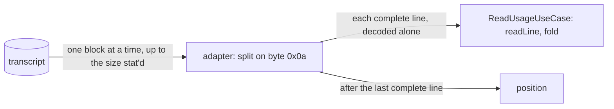

# Transcripts are read as a stream

## Need

Found by the R1 telemetry audit (M3). Ingest reads the unread tail of a transcript whole: one `Buffer` of the tail, one string of it, then one string per line, all alive at once (`infrastructure/claude-transcript-source-adapter.ts` `read`, handed to `application/read-usage-use-case.ts` as `lines: string[]`). The audit reports Claude Code transcripts of 371 MB and 417 MB (not observed here). One ingest of such a tail needs a multiple of its size in memory, and a tail over V8's longest string (512 MB) throws on every ingest, so that transcript is never read again (inferred, not run).

## Decision

- **The port hands lines one at a time.** `TranscriptSource.read(path, since, writtenFrom, each)` calls `each(line)` for every complete line, in order, and resolves to `{position, restarted, skipped}`. An array of lines, or an async iterator collected into one, keeps the memory this fixes. `ReadUsageUseCase` moves its loop body into `each`; what it returns, and everything after it (ingest, the #1046 hold-back, `readAll`), is unchanged.
- **The adapter reads a block at a time** (1 MiB by default, a constructor parameter so tests can use a few bytes), from the handle it already opened and stat'd. A line split across blocks is kept as pieces and joined once at its newline. Each line's bytes are decoded alone: byte `0x0a` never occurs inside a UTF-8 sequence, so this decodes as the whole tail did, invalid bytes and a BOM included.
- **Memory**: one block, up to about three copies of the longest line at its peak (pieces, joined bytes, decoded string), and what the use case keeps (records, unrecognised lines naming a directory). No longer proportional to the tail.
- **Changed under the read (review round 1).** A read now spans many block reads, so a file can change between two of them. After the last block the adapter stats the open handle: shorter than when read began, and the read returns no position. Review round 2 dropped a check of the path's identity: the open handle reads a replaced file whole and consistently, and discarding that read lost its lines, so a path rotated at every read would never be counted. `ReadUsageUseCase` keeps the file's records, unrecognised lines and position out of its reading, so ingest keeps the position it had and the next ingest reads the same bytes again.

## Rules kept, byte for byte

| Rule | As today |
| --- | --- |
| Start | `resumeOffset`: no position, from 0; another identity or a smaller size, from 0 and `restarted`; else from the saved offset |
| End | the size stat'd before reading: bytes appended meanwhile wait for the next read |
| Line | bytes up to `0x0a`; one trailing `\r` removed after decoding; an empty line is a line |
| Saved offset | just after the last `0x0a` consumed; an unterminated last line (still being written) is not consumed and is read again next time |
| Saved size, identity | those stat'd |
| File shorter than stat'd when read (truncated meanwhile) | changed by review round 1: no position, nothing of the read counted, read again next time (before: lines up to where reading stopped, offset after the last of them) |
| Another file at the path once read (replaced meanwhile) | as before: the opened file's lines, its identity saved, so the next read restarts on the new file |
| Saved offset past the size, same identity and size not smaller | nothing read, offset kept |
| Last written before `writtenFrom` | not read, offset at its last complete line (`lastLineEnd`, already a block at a time) |
| Held transcript (#1046) | positions from before the read restored by ingest: untouched |

## Properties

| # | Property |
| --- | --- |
| S1 | For any bytes, any saved offset and any block size from 1 byte, the stream hands the same lines in the same order and saves the same position as the whole-tail reader (kept in the test as an oracle). |
| S2 | For any transcripts, written in any steps between ingests, the ledger, `offsets.json`, `left-out.txt` and the ingest result are byte-identical whether read by the stream at any block size or by the whole-tail reader. |
| S3 | #1032 and #1046 properties unchanged: their suites pass untouched. |

## Acceptance

| # | Criterion | Proof |
| --- | --- | --- |
| 1 | No read of the file asks for more than a block, whatever the tail's size | adapter test spying on `FileHandle.read`, red on `origin/next` |
| 2 | Lines reach the line reader before the tail has been read whole | `ReadUsageUseCase` test, red on `origin/next` |
| 3 | Boundaries: a line split across blocks, a multi-byte character split across blocks, CRLF, no final newline, empty lines, a line longer than a block, a file growing during the read, a truncated or replaced file, a saved offset past the size, an empty file | adapter tests at a block of a few bytes |
| 4 | S1, S2 hold; S3 suites green | fast-check |
| 5 | Peak memory bounded on a generated transcript of a few hundred MB, measured before and after | `evidence.md` |
| 6 | Tests first, red run recorded; each guard has a mutation that turns its test red | `evidence.md` |
| 7 | `cd cli && pnpm test`, `scripts/__tests__`, telemetry mutation 96 or above with every mutant on changed lines killed or explained, `pnpm smoke`, the end-to-end token checks | `evidence.md` |
| 8 | Bundle within budget, no raise unless needed and then per `check-bundle-size.mjs` | `evidence.md` |

## Limits

- A single line is still held whole: memory grows with the longest line, and a line over V8's longest string (512 MB) still cannot be decoded.
- A file rewritten in place to the same size or larger during a read is not seen: a line may be spliced and the offset saved inside the new content. Claude Code only appends.
- An unrecognised line that names a directory is still kept whole until the ingest ends (`dropped`, unchanged): such lines are malformed usage lines, rare.
