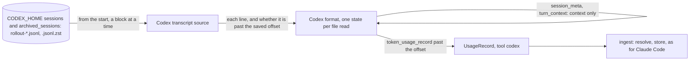

# Codex is measured

## Need

Release 1 measures Claude Code only: the usage record admits `codex`, no reader for it exists. A person who works with Codex in a clone that opted in sees none of that work in `aidd telemetry report`. The measured facts behind every rule below are in `evidence.md`.

## Decision

One more reader in the ingest list. Resolving, consent, storing, attribution and the report are unchanged and written once for every tool.

### Files

- Root: `CODEX_HOME`, else `~/.codex`, read by the composition root. Under `sessions/` and `archived_sessions/`, every `rollout-*.jsonl` and `rollout-*.jsonl.zst`, at any depth. Archiving moves a file there: its calls already stored are the same keys.
- Codex compresses a session file to `.jsonl.zst` about ten days after it was last written, and removes the `.jsonl`. A compressed file is read whole, decompressed as a stream (never held whole), once: it does not change, so its size and identity keep it read. Its calls already stored under the `.jsonl` are the same keys, so the ledger takes them once.
- A runtime whose `node:zlib` has no zstd reads no compressed file, and each one it lists is counted in that run's unrecognised shapes, naming why.

### What a line becomes

Only a `token_usage_record` line is a call. Every other line is context or nothing, and never named as dropped.

| Record field | From |
| --- | --- |
| `tool` | `codex` |
| `key` | `payload.response_id` |
| `session_id` | `payload.session_id`: the root session, also on a sub-agent's call |
| `agent` | `subagent` when `payload.thread_id` differs from `payload.session_id`, else `main` |
| `at` | the line's `timestamp` |
| `input` | `usage.input_tokens − usage.cached_input_tokens − usage.cache_write_input_tokens` |
| `cache_read` | `usage.cached_input_tokens` |
| `cache_write` | `usage.cache_write_input_tokens` |
| `cache_write_1h` | `null`: Codex does not say |
| `output` | `usage.output_tokens`, reasoning included |
| `reasoning` | `usage.reasoning_output_tokens` |
| `model` | `model` of the latest `turn_context` before the line, else `null` |
| `cwd` | `cwd` of the latest `turn_context` before the line, else of the file's first `session_meta` |
| `tool_version` | `cli_version` of the file's first `session_meta` |
| `git_branch` | `git.branch` of the file's first `session_meta` |

- Only `payload.usage` is read. `turn_token_usage`, `thread_token_usage` and `event_msg` `token_count` are running totals: reading them would count a call many times.
- The file's **first** `session_meta` is its own. A sub-agent's file carries its parent's after it.
- A missing or malformed counter is `null` and named, as for Claude Code. An `input` whose parts are not all counts is `null`.
- A `token_usage_record` with no `response_id`, `session_id`, `thread_id`, `timestamp` or `usage` object is unrecognised, named with its context's directory and its time, and never a record. So is a line that is not JSON but holds the text `token_usage_record`.

### Reading from where a read stopped

A call's directory and model are written earlier in the file than the call. A read that started at the saved offset would see calls with no directory, counted `no-cwd` and never stored.

- When a Codex file moved (size or identity), it is read from its start. The lines before the saved offset only build the file's context; the lines after it give calls and unrecognised shapes, exactly as a read from that offset would. So a run counts each line once, whatever the number of ingests.
- `offsets.json` keeps its format. For a `.jsonl`, its meaning too: the end of the last complete line consumed. For a `.jsonl.zst`, read whole once, the offset is its compressed size.
- A file that did not move is not opened again. One last written before the first consent interval is skipped, as for Claude Code.

## Properties

| # | Property | Tested by |
| --- | --- | --- |
| P1 | Any split of a Codex file's growth across ingests stores the same ledger, byte for byte, as one ingest of the whole file, and the runs' unrecognised and not-stored counts add up to the single run's | fast-check over cut points |
| P2 | Every record's `input + output + cache_read + cache_write` equals the line's `usage.total_tokens` | unit, and over the real corpus in `evidence.md` |
| P3 | The same session read from its `.jsonl`, then from its `.jsonl.zst`, stores each call once | integration |
| P4 | The existing ledger and report properties hold with Codex records in their generators | the existing property suites |

## Limits

These are written into the usage contract's residual limits; none is code.

- Task and ticket of a Codex call come from its branch's declaration only. The plugin's hooks run in Claude Code, so nothing asks a Codex session for its task, and a session declaration never binds one.
- `git_branch` is the branch the session started on: a branch changed during the session is not seen.
- Codex is read by `aidd telemetry ingest` and `report`, which the plugin runs at a Claude Code session start. A person who only uses Codex is measured when they run a report.
- Cache writes are part of `input_tokens`, and `input` subtracts them as OpenAI's own formula does; they are billed only on GPT-5.6 and later.
- Per-call records ship from Codex CLI 0.153; an earlier version writes only running totals, which are not read. Observed: 0.149 pre-releases to 0.163.
- Codex is assumed to only append to a `.jsonl`. A rewrite in place behaves as for Claude Code.

## Out of scope

- A tool axis in the report: the model and session axes already tell Codex calls apart. Proposed, not built.
- Codex hooks: asking a Codex session for its task.
- A price: the report counts tokens.
