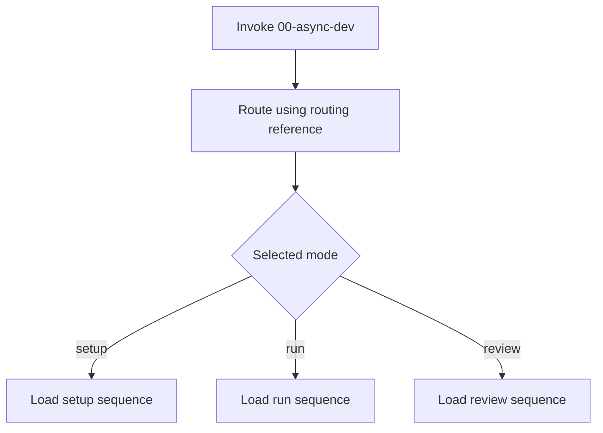
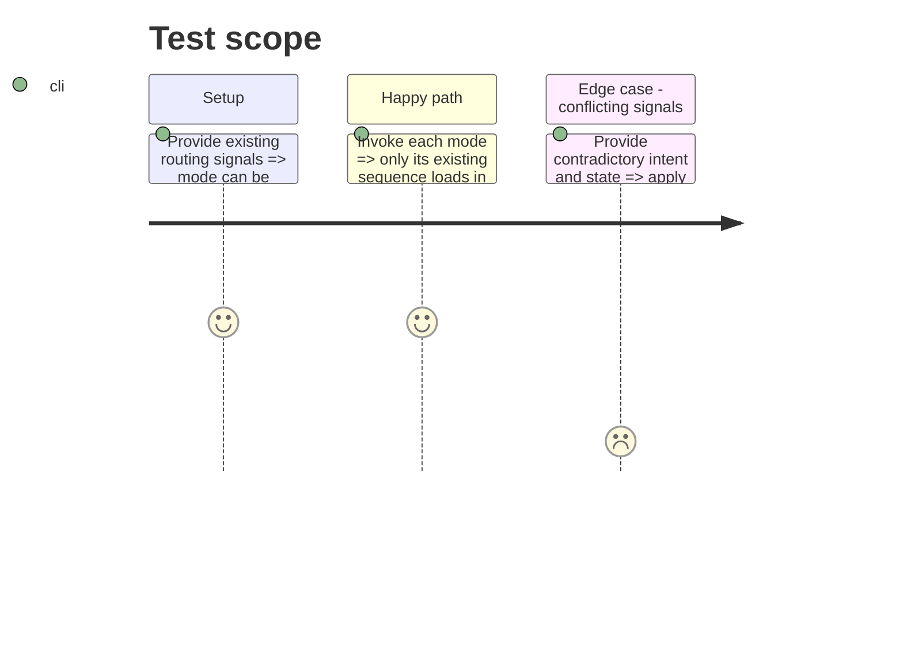

# Instruction: Separate routing and mode sequences

## Architecture projection

> Tree of the final files. ✅ create · ✏️ modify · ❌ delete

```txt
plugins/aidd-orchestrator/skills/00-async-dev/
├── ✏️ SKILL.md                 # flow, action table, transversal rules only
├── ✏️ references/routing.md   # sole signal precedence, aliases, conflict handling
└── actions/
    ├── ✅ route.md             # resolve mode using routing reference
    ├── ✅ setup.md             # load ordered setup actions after selection
    ├── ✅ run.md               # load ordered run actions after selection
    └── ✅ review.md            # load ordered review actions after selection
```

## User Journey



## Test Scope



## Tasks to do

### `1)` Consolidate routing

> Keep selection precedence and aliases in one reference.

1. Reconcile current differences between `SKILL.md` and `references/routing.md`, retaining intended explicit `action=<mode>` and arguments behavior.
2. Put all detailed selection and conflict rules in `references/routing.md`; have `route.md` load and apply it.

### `2)` Establish lazy mode boundaries

> Keep root routing compact and mode actions ordered.

1. Replace root detail with Mermaid flow, four-row action table, and transversal rules.
2. Move each current setup, run, and review sequence to its respective internal action; preserve action order, conditional skips, loops, and dynamic SDLC discovery.

## Test acceptance criteria

| Task | Acceptance criteria |
| --- | --- |
| 1 | Existing trigger aliases and signal conflicts select the same mode. |
| 2 | Root has only flow, action table, and transversal rules; a selected mode loads only its sequence; runtime SDLC discovery remains in the run action. |
